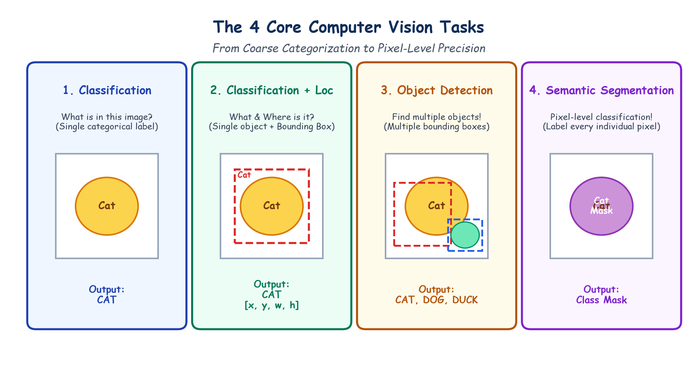

# Submodule 39.03: Core Computer Vision Tasks aur Real-World Applications (Hinglish Guide)

## 1. Computer Vision Ke 4 Mukhya Tasks

Computer Vision mein alag-alag complexities ke tasks hote hain—tasveer ko sirf ek category dena se lekar har ek pixel ko classify karne tak:

```
Coarse (Poori Image) ----------------------------------> Fine (Har Ek Pixel)
[ Image Classification ] -> [ Classification + Loc ] -> [ Object Detection ] -> [ Semantic Segmentation ]
```

---

## 2. Char Mukhya Tasks Ki Paribhasha

### 1. Image Classification (Tasveer Pehchanna)
- **Sawaal**: *"Is image mein kaun sa object hai?"*
- **Output**: Ek single category label (jaise `'Cat'`).
- **Detail**: Isme object kahan hai, uski position predict nahi ki jati; sirf yeh bataya jata hai ki tasveer kis cheez ki hai.

### 2. Classification + Localization (Object + Position)
- **Sawaal**: *"Object kya hai aur tasveer mein kahan par hai?"*
- **Output**: Class label + **1 Bounding Box** coordinates $(x, y, w, h)$:
  - $(x, y)$: Bounding box ka top-left corner.
  - $w, h$: Bounding box ki chaudai aur unchai.

### 3. Object Detection (Multiple Objects Ko Dhoondhna)
- **Sawaal**: *"Tasveer ke andar kitne objects hain, kahan hain, aur kya hain?"*
- **Output**: Multiple bounding boxes aur unke labels (jaise ek hi photo mein Billi, Kutta aur Batakh ko alag-alag boxes mein mark karna).
- **Popular Models**: YOLO, Faster R-CNN.

### 4. Semantic Segmentation (Pixel-Level Masking)
- **Sawaal**: *"Tasveer ka har ek pixel kis class se belong karta hai?"*
- **Output**: Ek 2D mask jahan har single pixel ko label milta hai (jaise Sadak ke pixels alag rang ke, Car ke alag, Pedestrian ke alag).
- **Popular Models**: U-Net, Mask R-CNN.

---

## 3. Hand-Drawn Educational Diagram: Computer Vision Tasks

Neeche diya gaya student-style handwritten diagram charon tasks ke visual differences ko clear boxes aur labels ke sath darshata hai:



---

## 4. Real-World Mein Computer Vision Ke Practical Examples

1. **Smartphone Face Unlock**:
   - Camera chehre ke landmarks ko scan karke phone ko unlock karta hai.
2. **Automated Traffic Challan (ALPR)**:
   - High-speed cameras gaadiyon ki number plate detect karke automatic challan generate karte hain.
3. **Self-Driving Cars (Autonomous Vehicles)**:
   - Tesla aur Waymo live video stream se road, pedestrians, stop signs aur potholes ko detect karte hain.
4. **Smart Retail (Amazon Go)**:
   - Bina cashier ke store jahan cameras detect karte hain ki customer ne shelf se kaun sa product uthaya.
5. **Medical Diagnosis**:
   - X-rays, MRI scans aur CT scans mein pneumonia, fractures ya tumors ko detect karna.
6. **Instagram & Snapchat Filters**:
   - Chehre ke movements ke sath align hone wale AR 3D face filters.
