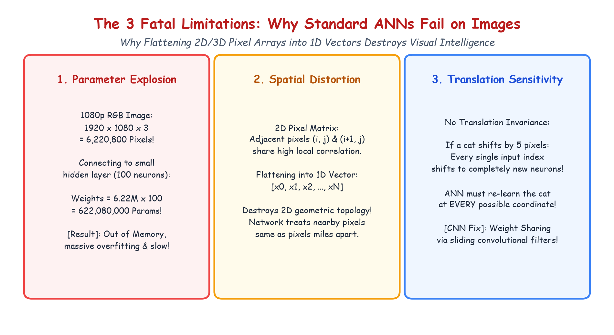

# Submodule 39.04: Why Standard ANNs Fail on Images: The Three Fatal Flaws

## 1. The Core Dilemma: Can We Feed Images to Standard ANNs?

In previous lectures, we used Artificial Neural Networks (FNNs) to solve regression and classification problems with tabular datasets. A natural question arises:
> *"Can we simply flatten a digital image into a 1D vector and feed it into a standard Feedforward ANN?"*

While technically possible for tiny benchmark datasets like $28 \times 28$ MNIST digits, doing so for realistic digital images causes **three catastrophic engineering and theoretical failures**.

---

## 2. Fatal Flaw 1: Parameter Explosion & Computational Collapse

Digital images contain enormous numbers of pixels:
- A modest $324 \times 324$ grayscale image has:
  $$324 \times 324 \times 1 = 104,976 \text{ input features}$$
- A standard 1080p full-HD RGB color image has:
  $$1920 \times 1080 \times 3 = 6,220,800 \text{ input features!}$$

If we connect a single $1920 \times 1080 \times 3$ image to a modest first hidden layer containing just $100$ neurons:
$$\text{Weights} = 6,220,800 \times 100 = \mathbf{622,080,000 \text{ parameters!}}$$

Over **$622\text{ Million weights}$** in just the first layer!
- **Consequences**:
  1. Massive RAM/VRAM exhaustion (Out-of-Memory crashes).
  2. Severe, uncontrollable **overfitting** (parameters vastly exceed training sample counts).
  3. Prohibitive computational latency during training and inference.

---

## 3. Fatal Flaw 2: Destruction of 2D Spatial Structure

Digital images possess rich **spatial locality**:
- Pixels that are physically adjacent (e.g. $(i, j)$ and $(i+1, j)$) share intense statistical correlation. Together, nearby pixels form edges, contours, textures, and continuous surfaces.
- Pixels separated by large distances share weak correlation.

When an image is flattened into a 1D vector $[x_0, x_1, x_2, \dots, x_N]$:
- The pixel at $(0, W-1)$ (end of row 0) is placed immediately adjacent to $(1, 0)$ (beginning of row 1), even though they are on opposite sides of the image!
- The pixel $(0, 0)$ is separated from its vertical neighbor $(1, 0)$ by $W$ elements.
- The 2D geometric neighborhood topology is completely shattered.

---

## 4. Fatal Flaw 3: Lack of Translation Invariance

In visual recognition, an object's identity is invariant to its spatial position in the frame:
- A cat in the top-left corner is still a cat if it appears in the bottom-right corner.

In a fully connected ANN:
- Each input neuron corresponds to a fixed pixel coordinate $(i, j)$.
- If the cat shifts by 5 pixels, its features stimulate completely different neurons and weights.
- The ANN must independently learn what a cat looks like at **every possible pixel location** across the frame, requiring trillions of training examples!

---

## 5. Hand-Drawn Educational Diagram: Why ANNs Fail on Images

The following diagram summarizes the 3 fatal flaws side-by-side:

---

## 6. How CNNs Solve All Three Flaws

Convolutional Neural Networks introduce three revolutionary inductive biases:
1. **Local Receptive Fields**: Neurons connect only to small local patches ($3 \times 3$ or $5 \times 5$), eliminating parameter explosion.
2. **Weight Sharing (Parameter Sharing)**: The same small kernel slides across the entire image, drastically reducing parameters (a $3 \times 3$ kernel has only $9$ weights!).
3. **Translation Invariance**: Because the same kernel scans every location, if a feature (e.g. an edge) appears anywhere in the image, the filter detects it identically.
