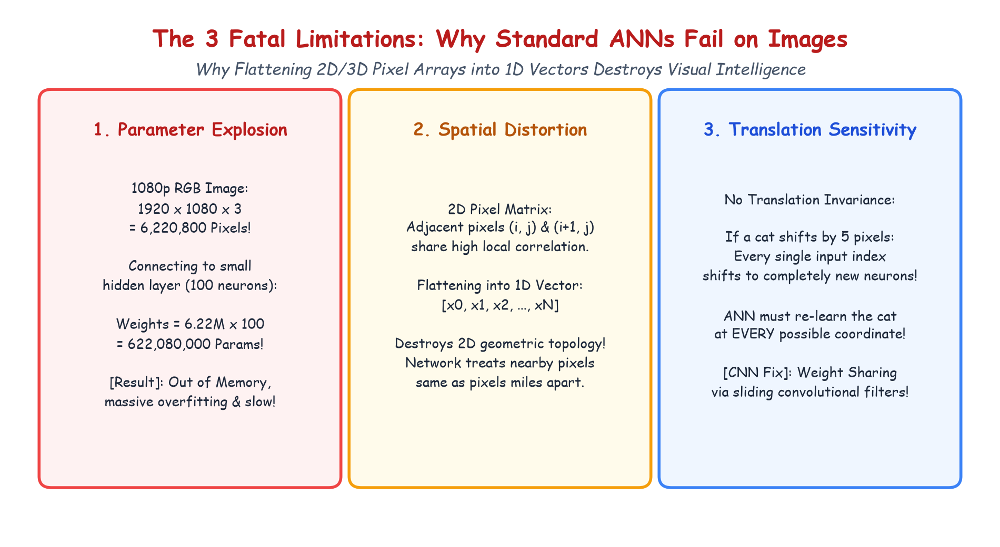

# Submodule 39.04: Images Par Standard ANNs Kyun Fail Hote Hain? (Hinglish Guide)

## 1. Mukhya Sawaal: Kya Hum Images Ko Seedhe FNN Mein Daal Sakte Hain?

Pichle lectures mein humne dekha ki tabular data ko ANN mein pass karke regression aur classification aasani se ho jata hai. Toh sawaal uthta hai:
> *"Kya hum kisi tasveer ko flatten karke (1D vector banakar) seedhe standard ANN/FNN mein pass nahi kar sakte?"*

Chhoti tasveeron (jaise $28 \times 28$ MNIST digits) ke liye yeh kaam kar sakta hai, lekin real-world digital images par aisa karna **teen bade kaaranon ki wajah se poori tarah fail ho jata hai**.

---

## 2. Pehla Kaaran: Parameter Explosion (Computers Crash Ho Jana)

Digital images mein laakhon pixels hote hain:
- Ek chhoti $324 \times 324$ black & white photo mein:
  $$324 \times 324 = 104,976 \text{ pixels (features)}$$
- Ek normal 1080p full-HD color photo mein:
  $$1920 \times 1080 \times 3 = 6,220,800 \text{ pixels!}$$

Agar is 1080p photo ko hum sirf $100$ neurons wali chhoti si hidden layer se connect karein:
$$\text{Weights} = 6,220,800 \times 100 = \mathbf{622,080,000 \text{ parameters!}}$$

Sirf pehli layer mein **62 Crore learnable weights**!
- Iska nateeja:
  1. Memory crash (Out of Memory).
  2. Behad bhayanak **Overfitting** (weights data se hazaron guna jyada ho jayenge).
  3. Model ko train hone mein mahino lag jayenge.

---

## 3. Dusra Kaaran: 2D Spatial Structure Ka Khatam Ho Jana

Tasveer ke andar **padosi pixels (neighboring pixels)** aapas mein jude hote hain:
- Paas-paas ke pixels milkar aankh, naak, kinara (edge) ya texture banate hain.
Lekin jab hum 2D matrix ko khinch kar 1D vector bana dete hain:
- Har row ke aakhri pixel aur agli row ke pehle pixel ka connection toot jata hai.
- Upar aur neeche ke padosi ek dusre se hazaron positions door chale jate hain.
- Poora 2D geometric arrangement nasht ho jata hai.

---

## 4. Teesra Kaaran: Translation Invariance Ka Na Hona

Tasveer mein billi chahe top-left corner mein ho ya bottom-right corner mein, rehti billi hi hai:
- Standard ANN mein har input neuron ek specific coordinate $(i, j)$ se juda hota hai.
- Agar billi 5 pixels right shift ho gayi, toh purane neurons par zero signal aayega aur naye neurons par signal aayega.
- Model ko billi pehchanne ke liye har ek pixel coordinate par alag se training karni padegi, jo asambhav hai.

---

## 5. Hand-Drawn Educational Diagram: Why ANNs Fail on Images

Neeche diya gaya student-style handwritten diagram teeno fatal flaws ko side-by-side visualize karta hai:

---

## 6. CNNs In Teeno Problems Ko Kaise Solve Karte Hain?

CNN teen shandar ideas use karta hai:
1. **Local Receptive Field**: Neurons poori photo se nahi, sirf chote $3 \times 3$ patch se connect hote hain.
2. **Weight Sharing**: Wahi chota $3 \times 3$ filter (sirf 9 weights) poori image par slide karta hai.
3. **Translation Invariance**: Filter jahan bhi feature dekhta hai, usko instantly detect kar leta hai.
