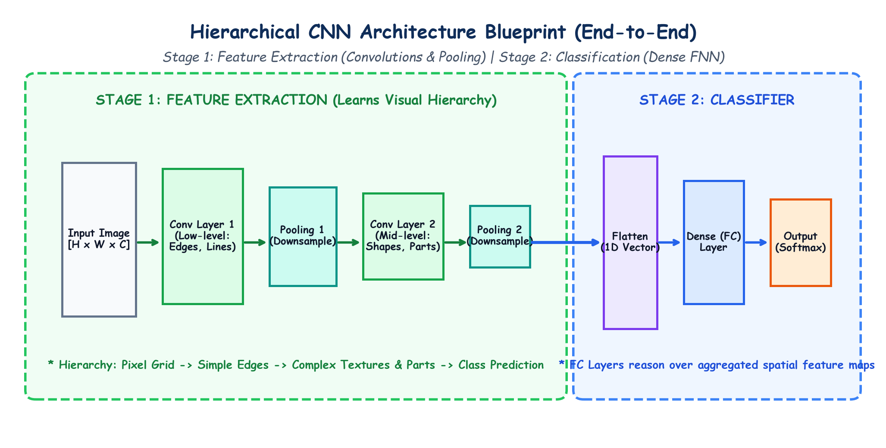

# Submodule 39.05: The CNN Architecture Blueprint & Hierarchical Feature Learning

## 1. The Two-Stage CNN Blueprint

A Convolutional Neural Network decouples visual processing into two distinct functional stages:
1. **Stage 1: Feature Extraction Engine** (Convolutions + ReLUs + Pooling).
2. **Stage 2: Dense Classifier Head** (Flattening + Fully Connected Layers + Softmax).

```
[ INPUT IMAGE ]
       |
       v
+-------------------------------------------------------------+
| STAGE 1: FEATURE EXTRACTION                                 |
|                                                             |
|   [ Conv2d + ReLU ] -> [ MaxPool2d ]                        |
|          |                                                  |
|          v                                                  |
|   [ Conv2d + ReLU ] -> [ MaxPool2d ]                        |
+-------------------------------------------------------------+
       |
       v  (3D Feature Maps: Channels x Height x Width)
+-------------------------------------------------------------+
| STAGE 2: CLASSIFICATION HEAD                                |
|                                                             |
|   [ Flatten to 1D Vector ]                                  |
|          |                                                  |
|          v                                                  |
|   [ Fully Connected (Linear) + Dropout ]                    |
|          |                                                  |
|          v                                                  |
|   [ Output Layer (Softmax Probabilities) ]                  |
+-------------------------------------------------------------+
```

---

## 2. Hierarchical Feature Representation in CNNs

Biological visual cortex (discovered by Hubel & Wiesel) processes vision hierarchically. CNNs replicate this exact hierarchical structure layer-by-layer:

1. **Early Layers (Low-Level Features)**:
   - Small receptive fields capture primitive pixel gradients.
   - Detects: horizontal edges, vertical edges, color transitions, corners.
2. **Middle Layers (Mid-Level Features)**:
   - Aggregates combinations of primitive edges over larger receptive fields.
   - Detects: textures, geometric shapes, circles, stripes, contours, motifs.
3. **Deep Layers (High-Level Semantic Features)**:
   - Combines shapes into complex domain-specific parts.
   - Detects: eyes, wheels, dog snouts, honeycombs, full object silhouettes.

```
Pixels -> Edges & Lines -> Textures & Shapes -> Object Parts -> Whole Category Label
```

---

## 3. The 3 Core Building Blocks of a CNN

| Layer Type | Core Functionality | Does it have Learnable Parameters? |
|---|---|---|
| **1. Convolutional Layer** | Applies sliding filters to extract local feature patterns into feature maps. | **YES** (Kernel weights $\mathbf{W}$ and biases $\mathbf{b}$) |
| **2. Pooling Layer** | Downsamples spatial resolution (cuts $H, W$), retaining dominant activations. | **NO** ($\text{Params} = 0$, deterministic max/avg operation) |
| **3. Fully Connected Layer** | Flattens 3D feature volumes and learns non-linear decision boundaries. | **YES** (Dense weight matrices $\mathbf{W}$ and biases $\mathbf{b}$) |

---

## 4. Hand-Drawn Educational Diagram: CNN Architecture Blueprint

The following student-style handwritten diagram illustrates the complete two-stage CNN pipeline, highlighting the visual feature progression and layer boundaries.



---

## 5. End-to-End Information Flow Walkthrough

1. An input RGB image of shape $(3, H, W)$ enters **Convolutional Layer 1**.
2. Multiple kernels scan the image, outputting $C_1$ feature maps.
3. **ReLU** sets negative activation values to zero.
4. **Pooling Layer 1** downsamples spatial dimensions (e.g. from $H \times W$ to $\frac{H}{2} \times \frac{W}{2}$).
5. **Convolutional Layer 2** combines low-level feature maps into higher-order representations.
6. **Pooling Layer 2** further downsamples spatial resolution.
7. The resulting compact 3D tensor $(C_2, H', W')$ is **flattened** into a 1D vector.
8. The **Fully Connected layer** outputs class logits, which are converted to probabilities via **Softmax**.
