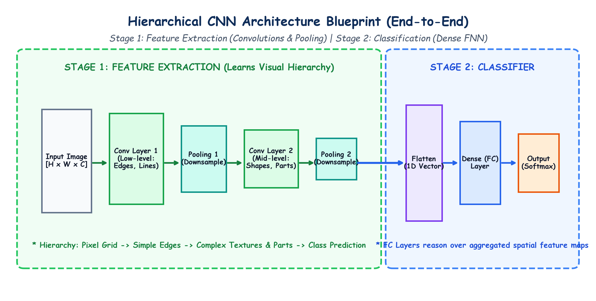

# Submodule 39.05: CNN Architecture Blueprint aur Feature Hierarchy (Hinglish Guide)

## 1. CNN Ka Do-Stage Blueprint

Har Convolutional Neural Network do mukhya hisson (stages) mein divide hota hai:
1. **Stage 1: Feature Extraction Engine** (Convolution + ReLU + Pooling).
2. **Stage 2: Classification Head** (Flattening + Dense FNN + Softmax).

```
[ INPUT IMAGE ]
       |
       v
+-------------------------------------------------------------+
| STAGE 1: FEATURE EXTRACTION                                 |
|                                                             |
|   [ Conv2d + ReLU ] -> [ MaxPool2d ]                        |
|          |                                                  |
|          v                                                  |
|   [ Conv2d + ReLU ] -> [ MaxPool2d ]                        |
+-------------------------------------------------------------+
       |
       v  (3D Feature Maps: Channels x Height x Width)
+-------------------------------------------------------------+
| STAGE 2: CLASSIFICATION HEAD                                |
|                                                             |
|   [ Flatten to 1D Vector ]                                  |
|          |                                                  |
|          v                                                  |
|   [ Fully Connected (Linear) + Dropout ]                    |
|          |                                                  |
|          v                                                  |
|   [ Output Layer (Softmax Probabilities) ]                  |
+-------------------------------------------------------------+
```

---

## 2. Visual Hierarchy (Shuruati Se Lekar Aakhri Layers Tak)

Human brain jaise visual information ko step-by-step process karta hai, bilkul waise hi CNN layers bhi seekhti hain:

1. **Early Layers (Low-Level Features)**:
   - Seedhe raw pixels ko dekhkar choti-choti cheezein dhoondhti hain.
   - Example: Sidhi lines (vertical edges), aadi lines (horizontal edges), rangon ke badlav.
2. **Middle Layers (Mid-Level Features)**:
   - Lines ko aapas mein jodkar complex shapes banati hain.
   - Example: Chokor, gol (circles), corners, patterns, textures.
3. **Deep Layers (High-Level Features)**:
   - Shapes ko combine karke poore object ke parts pehchanti hain.
   - Example: Aankhein, naak, car ke pahiye, chehre.

```
Pixels -> Edges & Lines -> Textures & Shapes -> Object Parts -> Final Class Prediction
```

---

## 3. CNN Ki 3 Core Layers

| Layer Ka Naam | Mukhya Kaam | Kya Isme Weights Hote Hain? |
|---|---|---|
| **1. Convolutional Layer** | Sliding filters se patterns extract karke Feature Maps banana | **HAAN** (Learnable weights aur biases) |
| **2. Pooling Layer** | Feature map ka size chhota karna (Downsampling) | **NAHI** ($\text{Params} = 0$, sirf max/avg lena) |
| **3. Fully Connected Layer**| Features ko flatten karke final category predict karna | **HAAN** (Dense weight matrices) |

---

## 4. Hand-Drawn Educational Diagram: CNN Architecture Blueprint

Neeche diya gaya student-style handwritten diagram CNN ke do-stage blueprint aur feature progression ko visualize karta hai:



---

## 5. End-to-End Data Flow Ka Summary

1. Photo input hoti hai $(3, H, W)$.
2. Conv layer 1 edges detect karti hai.
3. ReLU non-linearity add karta hai.
4. Max pooling size aadha kar deta hai.
5. Conv layer 2 complex shapes dhoondhti hai.
6. Aakhri feature maps ko **Flatten** karke 1D vector banaya jata hai.
7. Dense FNN aur Softmax bata deta hai ki photo billi ki hai ya kutte ki!
