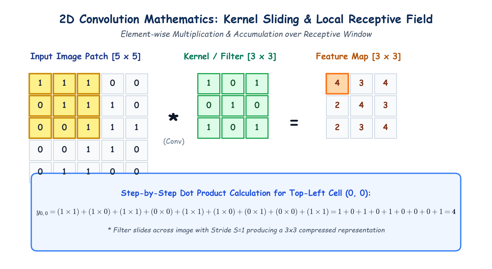

# Submodule 39.06: The Convolutional Layer: Mathematics of Kernels & Sliding Filters

## 1. The Core Operation: 2D Spatial Convolution

The **Convolutional Layer** is the primary computational engine of a CNN. Rather than connecting every input pixel to every neuron via a giant dense weight matrix, the convolutional layer applies small, sliding weight matrices called **kernels** or **filters** across local 2D receptive fields.

For an input image patch $X$ and a kernel $K$ of size $K_h \times K_w$, the 2D cross-correlation output at position $(i, j)$ is computed as:

$$y_{i, j} = \sum_{m=0}^{K_h - 1} \sum_{n=0}^{K_w - 1} X_{i+m, j+n} \cdot K_{m, n} + b$$

Where:
- $X_{i+m, j+n}$ is the pixel intensity in the local receptive window.
- $K_{m, n}$ is the weight parameter of the kernel.
- $b$ is a learnable scalar bias.
- $y_{i, j}$ is the resulting activation value stored in the **Feature Map**.

---

## 2. Step-by-Step Numerical Walkthrough

Consider a $5 \times 5$ binary input image and a $3 \times 3$ kernel:

$$\text{Input Image Patch } X = \begin{bmatrix} 1 & 1 & 1 \\ 0 & 1 & 1 \\ 0 & 0 & 1 \end{bmatrix}, \quad \text{Kernel } K = \begin{bmatrix} 1 & 0 & 1 \\ 0 & 1 & 0 \\ 1 & 0 & 1 \end{bmatrix}, \quad b = 0$$

Computing the output for the top-left cell $(0, 0)$:
$$\begin{aligned}
y_{0,0} &= (1 \times 1) + (1 \times 0) + (1 \times 1) \\
        &+ (0 \times 0) + (1 \times 1) + (1 \times 0) \\
        &+ (0 \times 1) + (0 \times 0) + (1 \times 1) \\
        &= 1 + 0 + 1 + 0 + 1 + 0 + 0 + 0 + 1 = \mathbf{4}
\end{aligned}$$

The filter then shifts by $S$ pixels (the **stride**) to compute the next output cell, scanning row-by-row until the entire image is mapped.

---

## 3. Hand-Drawn Educational Diagram: Convolution Mathematics

The following notebook diagram demonstrates kernel sliding, local receptive window overlap, and the step-by-step element-wise calculation.

---

## 4. Kernels are Learnable Parameters!

A common misconception among beginners is that kernels contain hardcoded image processing coefficients (like traditional Sobel or Prewitt filters).
- In modern Deep Learning, **kernel values are learnable parameters** initialized randomly.
- During training, backpropagation computes $\frac{\partial L}{\partial K_{m,n}}$, and gradient descent automatically optimizes each kernel weight:
  $$K_{m,n} \leftarrow K_{m,n} - \eta \frac{\partial L}{\partial K_{m,n}}$$
- Through training, different kernels organically learn to detect vertical lines, diagonal edges, color contrasts, or circular arcs without any manual human feature engineering.

---

## 5. Multiple Filters = Multiple Feature Maps

A single convolutional layer contains a bank of $M$ independent filters:
- Filter 1 learns vertical edge detection.
- Filter 2 learns horizontal edge detection.
- Filter 3 learns diagonal contrast.
- ...
- Filter $M$ learns corner detection.

Applying $M$ filters to an input generates an output tensor of depth $M$, called a **Volume of Feature Maps** of shape:
$$(M, H_{\text{out}}, W_{\text{out}})$$

---

## 6. Non-Linear Activation: The ReLU Layer

Direct 2D convolution is a purely linear transformation (matrix multiplication and addition). A stack of linear convolutions collapses into a single linear operation.
To enable the network to model complex non-linear visual relationships, the **Rectified Linear Unit (ReLU)** activation function is applied element-wise to every cell of the feature map:

$$f(z) = \max(0, z)$$

ReLU replaces all negative values with zero while keeping positive activations unchanged, introducing non-linearity and inducing sparse activations.
