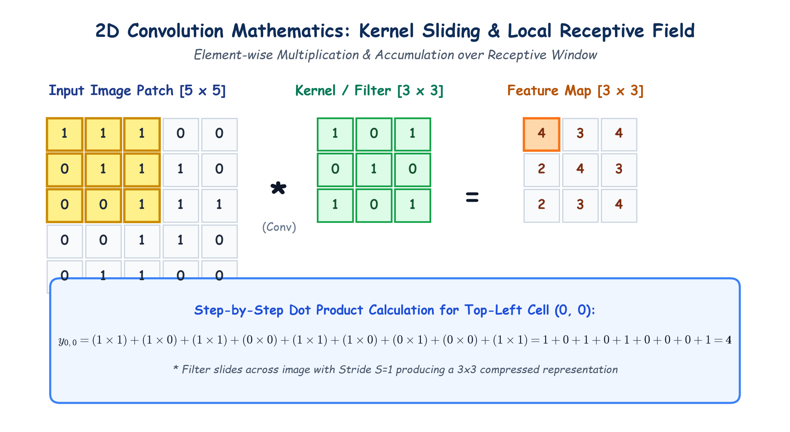

# Submodule 39.06: The Convolutional Layer: Mathematics aur Kernels (Hinglish Guide)

## 1. Convolutional Layer Ka Mukhya Kaam

**Convolutional Layer** CNN ka dil (heart) hoti hai. Purane FNN ki tarah har pixel ko alag-alag weight se connect karne ke bajaye, yeh layer chote square filters (jinhe **Kernels** kehte hain) ko poori photo par slide karti hai.

Agar input image ka patch $X$ hai aur kernel $K$ ka size $3 \times 3$ hai, toh feature map ke cell $(i, j)$ ka output formula hota hai:

$$y_{i, j} = \sum_{m} \sum_{n} X_{i+m, j+n} \cdot K_{m, n} + b$$

Matlab: Overlapping cells ka **element-wise multiplication** karke sabhi ko aapas mein **add** kar diya jata hai.

---

## 2. Step-by-Step Calculation Example

Maan lijiye image ka top-left $3 \times 3$ hissa yeh hai:

$$\text{Image Patch} = \begin{bmatrix} 1 & 1 & 1 \\ 0 & 1 & 1 \\ 0 & 0 & 1 \end{bmatrix}, \quad \text{Kernel} = \begin{bmatrix} 1 & 0 & 1 \\ 0 & 1 & 0 \\ 1 & 0 & 1 \end{bmatrix}$$

Top-left cell ka calculation:
$$\begin{aligned}
y_{0,0} &= (1 \times 1) + (1 \times 0) + (1 \times 1) \\
        &+ (0 \times 0) + (1 \times 1) + (1 \times 0) \\
        &+ (0 \times 1) + (0 \times 0) + (1 \times 1) \\
        &= 1 + 0 + 1 + 0 + 1 + 0 + 0 + 0 + 1 = \mathbf{4}
\end{aligned}$$

Iske baad filter ek step aage slide karega aur agli value nikalega. Is poori resulting matrix ko **Feature Map** kehte hain!

---

## 3. Hand-Drawn Educational Diagram: Convolution Mathematics

Neeche diya gaya student-style handwritten diagram kernel sliding, receptive window, aur step-by-step element-wise calculation ko visualize karta hai:

---

## 4. Kernels Learnable Parameters Hote Hain!

Beginners aksar sochte hain ki filter ke numbers pehle se tay hote hain:
- Deep Learning mein filter ke numbers pehle se decide nahi hote!
- Shuruat mein yeh weights random hote hain.
- Jaise-jaise model train hota hai, **Backpropagation aur Gradient Descent** in filter ke numbers ko automatically adjust karte hain.
- Model khud seekhta hai ki vertical line dhoondhne ke liye filter mein kya numbers hone chahiye aur horizontal line ke liye kya!

---

## 5. Multiple Filters = Multiple Feature Maps

Agar hum ek convolutional layer mein **32 filters** lagate hain:
- Filter 1 sidhi lines dhoondhega.
- Filter 2 aadi lines dhoondhega.
- Filter 3 corners dhoondhega.
- Output mein hume **32 alag-alag feature maps** milenge!

---

## 6. ReLU Activation Function Kyun Lagate Hain?

Convolution ek linear operation hai ($W \cdot X + b$). Agar sirf convolution lagate rahein, toh network non-linear patterns nahi seekh payega.
Isiliye feature map banne ke turant baad **ReLU** activation function lagaya jata hai:

$$f(z) = \max(0, z)$$

ReLU sabhi negative numbers ko zero bana deta hai aur positive numbers ko waise hi chhod deta hai, jisse non-linearity add hoti hai.
