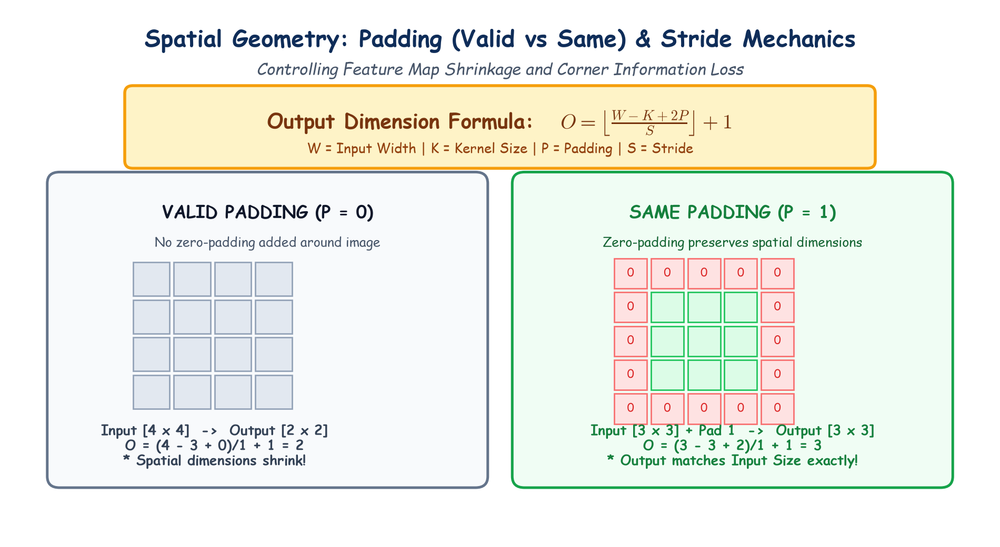

# Submodule 39.07: Spatial Hyperparameters: Padding, Stride & Output Geometry

## 1. The Spatial Shrinkage Dilemma

Whenever a kernel of size $K > 1$ slides across an input image of dimension $W$:
1. **Spatial Shrinkage**: The output feature map is always strictly smaller than the input image. In a deep network with 20 convolutional layers, spatial dimensions rapidly collapse to $1 \times 1$.
2. **Corner & Boundary Pixel Loss**: Center pixels are scanned repeatedly by multiple overlapping kernel positions, whereas corner pixels are scanned only once! Consequently, boundary information is systematically lost.

To control feature map dimensions and prevent edge information loss, we introduce **Padding** and **Stride**.

---

## 2. Padding Types: Valid vs Same

Padding ($P$) adds extra border pixels (typically initialized to zero, known as **zero-padding**) around the perimeter of the input matrix.

```
Zero-Padded 3x3 Image (P = 1) -> Becomes 5x5:
[ 0   0   0   0   0 ]
[ 0  x11 x12 x13  0 ]
[ 0  x21 x22 x23  0 ]
[ 0  x31 x32 x33  0 ]
[ 0   0   0   0   0 ]
```

### 1. Valid Padding ($P = 0$)
- No padding is added to the image boundaries.
- The output spatial dimensions shrink with every layer.

### 2. Same Padding ($P \ge 1$)
- Sufficient zero-padding is added around the border such that the **output feature map retains the exact same spatial dimensions as the input image** (when stride $S=1$):
  $$P = \frac{K - 1}{2} \quad (\text{for odd } K)$$
  - For a $3 \times 3$ kernel: $P = \frac{3-1}{2} = 1$.
  - For a $5 \times 5$ kernel: $P = \frac{5-1}{2} = 2$.

---

## 3. Stride ($S$): The Sliding Step Size

**Stride ($S$)** defines how many pixels the kernel shifts horizontally and vertically between successive receptive windows:
- **$S = 1$ (Default)**: Kernel moves 1 pixel at a time, producing fine-grained, overlapping feature maps.
- **$S = 2$**: Kernel skips every other pixel, effectively downsampling the spatial dimension by half.

---

## 4. The Fundamental Output Dimension Formula

For an input spatial width/height $W$, kernel size $K$, padding $P$, and stride $S$, the output spatial dimension $O$ is given by:

$$O = \left\lfloor \frac{W - K + 2P}{S} \right\rfloor + 1$$

### Worked Examples:
1. **Valid Padding ($P=0$), Input $W=5$, Kernel $K=3$, Stride $S=1$**:
   $$O = \left\lfloor \frac{5 - 3 + 0}{1} \right\rfloor + 1 = 2 + 1 = \mathbf{3} \implies \text{Output: } 3 \times 3$$
2. **Same Padding ($P=1$), Input $W=5$, Kernel $K=3$, Stride $S=1$**:
   $$O = \left\lfloor \frac{5 - 3 + 2(1)}{1} \right\rfloor + 1 = \frac{4}{1} + 1 = \mathbf{5} \implies \text{Output: } 5 \times 5$$
3. **Stride $S=2$, Input $W=28$, Kernel $K=3$, Padding $P=1$**:
   $$O = \left\lfloor \frac{28 - 3 + 2}{2} \right\rfloor + 1 = \left\lfloor \frac{27}{2} \right\rfloor + 1 = 13 + 1 = \mathbf{14} \implies \text{Output: } 14 \times 14$$

---

## 5. Hand-Drawn Educational Diagram: Spatial Geometry

The following diagram illustrates Valid Padding versus Same Padding and demonstrates the output dimension formula with worked examples.


