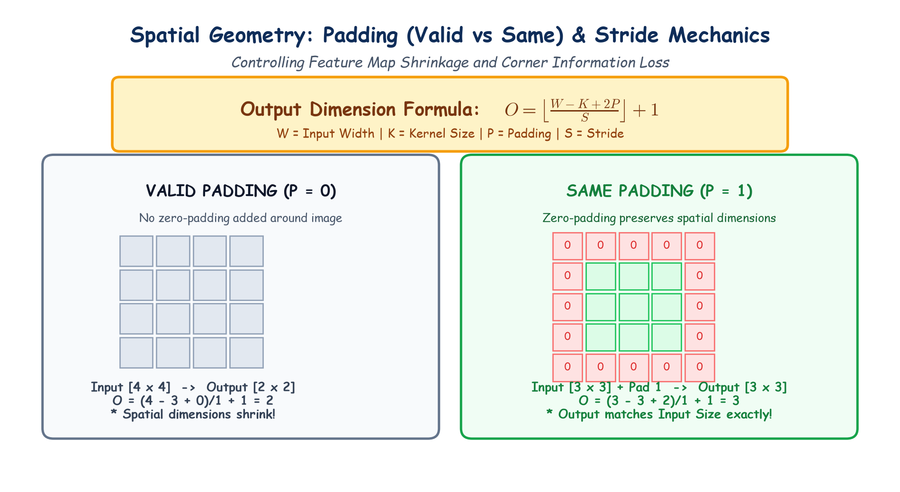

# Submodule 39.07: Spatial Hyperparameters: Padding, Stride aur Output Geometry (Hinglish Guide)

## 1. Feature Map Shrink Hone Ki Problem

Jab bhi hum kisi photo par $3 \times 3$ filter slide karte hain:
1. **Size Chhota Ho Jana**: Output feature map hamesha original image se chhota ho jata hai ($5 \times 5$ image $3 \times 3$ ban jati hai). Agar deep network mein 20 conv layers hongi, toh image ka size shrink hokar $1 \times 1$ ban jayega!
2. **Kinaaron Ki Information Khona**: Beech ke pixels par filter baar-baar chalta hai, lekin kono (corners) aur kinaron par filter sirf ek baar chalta hai. Isse borders ki information loose ho jati hai.

Is problem ko solve karne ke liye hum **Padding** aur **Stride** use karte hain.

---

## 2. Padding Kya Hoti Hai? (Valid vs Same Padding)

Padding ka matlab hota hai image ke chaaron taraf extra border (zeros) add kar dena (Zero Padding):

### 1. Valid Padding ($P = 0$)
- Image ke border par koi zero add nahi kiya jata.
- Har convolution ke baad image ka size **shrink** hota hai.

### 2. Same Padding ($P \ge 1$)
- Image ke chaaron taraf itne zeros add kiye jate hain taaki **output feature map ka size original image ke bilkul barabar rahe** (jab stride $S=1$ ho):
  $$P = \frac{K - 1}{2}$$
  - $3 \times 3$ filter ke liye: $P = 1$
  - $5 \times 5$ filter ke liye: $P = 2$

---

## 3. Stride ($S$) Kya Hai?

**Stride** ka matlab hai ki filter ek baar mein kitne pixels aage jump karega:
- **$S = 1$**: Filter ek-ek pixel aage badhta hai.
- **$S = 2$**: Filter do-do pixels aage badhta hai, jisse output ka size lagbhag aadha ho jata hai.

---

## 4. Output Dimension Ka Universal Formula

Output size $O$ calculate karne ka formula:

$$O = \left\lfloor \frac{W - K + 2P}{S} \right\rfloor + 1$$

Jahan:
- $W$ = Input Width
- $K$ = Filter/Kernel Size
- $P$ = Padding
- $S$ = Stride

### Numerical Calculations:
1. **$5 \times 5$ Image, $3 \times 3$ Kernel, No Padding ($P=0$), Stride $S=1$**:
   $$O = \frac{5 - 3 + 0}{1} + 1 = 2 + 1 = \mathbf{3} \implies 3 \times 3$$
2. **$5 \times 5$ Image, $3 \times 3$ Kernel, Padding $P=1$, Stride $S=1$**:
   $$O = \frac{5 - 3 + 2}{1} + 1 = 4 + 1 = \mathbf{5} \implies 5 \times 5 \text{ (Size unchanged!)}$$

---

## 5. Hand-Drawn Educational Diagram: Spatial Geometry

Neeche diya gaya student-style handwritten diagram Valid Padding, Same Padding aur Stride calculations ko visualize karta hai:

