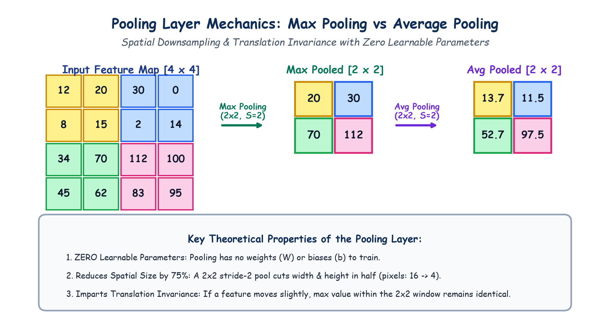

# Submodule 39.08: The Pooling Layer: Downsampling & Invariance Mechanics

## 1. Why Do We Need Pooling?

After passing an image through convolutional and ReLU layers, we obtain rich feature maps. However, feeding full-resolution feature maps directly into fully connected layers introduces two severe bottlenecks:
1. **Computational Complexity**: High-resolution feature maps require massive matrix multiplications in subsequent layers.
2. **Sensitivity to Spatial Micro-Shifts**: We desire our visual representations to be invariant to small translations, tilts, and scale variations.

The **Pooling Layer** performs **spatial downsampling**—progressively reducing the height and width of feature maps while preserving the most prominent, dominant visual features.

---

## 2. Max Pooling vs Average Pooling

```
Input Patch [2 x 2] = [ 12   20 ]
                      [  8   15 ]

- Max Pooling (Strongest Feature):  max(12, 20, 8, 15)  = 20
- Average Pooling (Mean Feature) :  mean(12, 20, 8, 15) = 13.75
```

### 1. Max Pooling (Industry Standard)
- Divides the feature map into non-overlapping local grids (typically $2 \times 2$ with stride $S=2$).
- Takes the **maximum value** within each window.
- **Rationale**: In a ReLU feature map, high positive values indicate strong presence of a detected visual pattern (e.g. an edge or corner). Taking the maximum extracts the **most dominant feature activation**.

### 2. Average Pooling
- Computes the arithmetic mean of all values in the local window.
- Produces smoother feature maps; commonly used in the final layer of modern architectures (Global Average Pooling).

---

## 3. The 3 Golden Rules of Pooling Layers

> [!IMPORTANT]
> **Rule 1: ZERO Learnable Parameters ($\text{Params} = 0$)**
> Pooling layers contain **no weights ($W$) and no biases ($b$)**. It is a fixed, deterministic mathematical operation. Nothing is updated during backpropagation!

> [!NOTE]
> **Rule 2: $75\%$ Spatial Reduction**
> Applying standard $2 \times 2$ Max Pooling with stride $S=2$ cuts both height and width in half:
> $$H_{\text{out}} = \frac{H_{\text{in}}}{2}, \quad W_{\text{out}} = \frac{W_{\text{in}}}{2}$$
> This reduces total spatial area and memory requirements by $75\%$ (e.g. $16 \to 4$ cells).

> [!TIP]
> **Rule 3: Translation Invariance**
> If an object in the input shifts slightly (by 1 or 2 pixels), the maximum value within the $2 \times 2$ pooling window typically remains identical, ensuring robust invariant classification.

---

## 4. Hand-Drawn Educational Diagram: Pooling Layer Mechanics

The following notebook-style diagram illustrates a $4 \times 4$ feature map downsampled into a $2 \times 2$ matrix via Max Pooling and Average Pooling side-by-side.



---

## 5. Channel Invariance

Pooling operates independently on each individual feature map slice:
- If an input volume has depth $C=32$ channels of shape $(32, 28, 28)$, applying $2 \times 2$ Max Pooling with stride $2$ yields an output volume of depth $C=32$ of shape:
$$(32, 14, 14)$$
The number of channels is strictly preserved; only spatial dimensions are downsampled.
