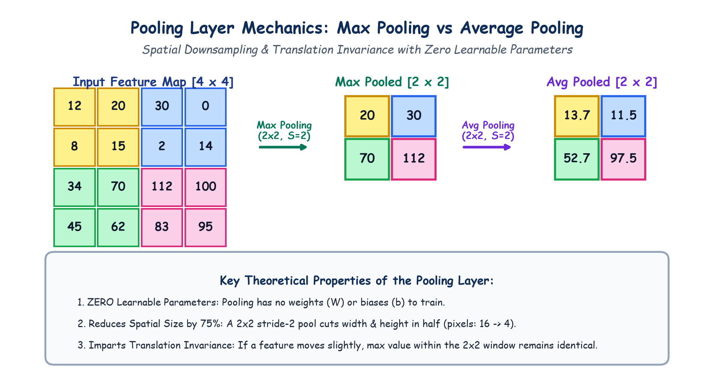

# Submodule 39.08: The Pooling Layer: Downsampling aur Invariance (Hinglish Guide)

## 1. Pooling Layer Ki Zaroorat Kyun Hoti Hai?

Convolution aur ReLU ke baad hamare paas feature maps ban jate hain. Lekin agar hum in bade feature maps ko seedhe aage pass karenge, toh:
1. **Computations Bahut Jyada Badh Jayenge**: System slow ho jayega.
2. **Overfitting Ka Risk**: Model chhote-chhote pixel shifts par confuse ho sakta hai.

**Pooling Layer** ka kaam hota hai **Downsampling** karna—matlab image ke spatial size (height aur width) ko chhota karna, lekin uske **sabse strong aur important features ko bacha kar rakhna**.

---

## 2. Max Pooling vs Average Pooling

```
Input Patch [2 x 2] = [ 12   20 ]
                      [  8   15 ]

- Max Pooling (Sabse Bada Number) : max(12, 20, 8, 15)  = 20
- Average Pooling (Average Number): mean(12, 20, 8, 15) = 13.75
```

### 1. Max Pooling (Sabse Jyada Popular)
- Image ko $2 \times 2$ ke blocks mein baant-ta hai (Stride $S=2$).
- Har block mein se **sabse badi value (maximum)** ko chun leta hai.
- **Logic**: Feature map mein badi positive value ka matlab hota hai ki wahan koi strong feature (jaise edge ya curve) maujood hai. Max pooling us strongest signal ko aage bhej deta hai.

### 2. Average Pooling
- Block ke chaaron numbers ka average nikalta hai.

---

## 3. Pooling Layer Ke 3 Golden Rules

> [!IMPORTANT]
> **Niyam 1: ZERO Learnable Parameters ($\text{Params} = 0$)**
> Pooling layer mein koi weights ($W$) ya bias ($b$) nahi hote! Yeh ek simple mathematical formula hai. Training ke dauran isme kuch bhi learn nahi hota.

> [!NOTE]
> **Niyam 2: 75% Size Ka Reduction**
> $2 \times 2$ Max Pooling (stride 2) lagane se image ki height aur width aadhi ho jati hai. Isse total pixels 75% kam ho jate hain ($16 \to 4$).

> [!TIP]
> **Niyam 3: Translation Invariance**
> Agar tasveer mein billi thodi si hil jaye (1-2 pixel shift ho jaye), tab bhi $2 \times 2$ block ka maximum number wahi rehta hai. Isse model robust banta hai.

---

## 4. Hand-Drawn Educational Diagram: Pooling Layer Mechanics

Neeche diya gaya student-style handwritten diagram $4 \times 4$ feature map par Max Pooling aur Average Pooling ke operations ko step-by-step darshata hai:



---

## 5. Channels Par Asar

Pooling sirf height aur width ko chhota karti hai, channels ki sankhya par koi asar nahi padta:
- Agar input shape $(32, 28, 28)$ hai, toh $2 \times 2$ Max Pool ke baad shape **$(32, 14, 14)$** ho jayegi (32 channels waise ke waise hi rahenge).
