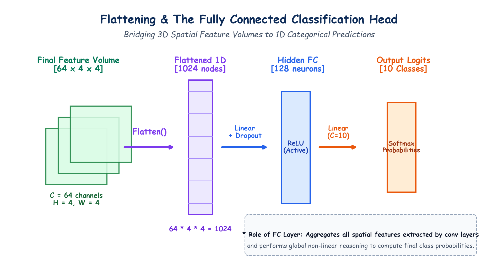

# Submodule 39.09: Flattening, The Fully Connected Classification Head & Regularization

## 1. Bridging Feature Extraction to Classification

After multiple alternating stages of Convolution, ReLU, and Pooling, the network has successfully distilled raw pixels into a compact 3D tensor of high-level semantic feature maps:
$$\mathbf{V} \in \mathbb{R}^{C \times H \times W}$$

Where:
- $C$ is the number of feature channels (e.g., $64$).
- $H \times W$ is the final downsampled spatial resolution (e.g., $4 \times 4$).

However, the final objective is categorical prediction—assigning probabilities across discrete classes (e.g. Zebra vs Horse vs Dog). Categorical decision making requires global reasoning across all spatial channels simultaneously. This bridge is provided by **Flattening** and the **Fully Connected (FC) Layer**.

---

## 2. Flattening: 3D Volume to 1D Feature Vector

The **Flatten** operation collapses the 3-dimensional feature volume $(C, H, W)$ into a single continuous 1-dimensional feature vector of length $N$:

$$N = C \times H \times W$$

For example:
$$\mathbf{V} \in \mathbb{R}^{64 \times 4 \times 4} \xrightarrow{\text{Flatten()}} \mathbf{x}_{\text{flat}} \in \mathbb{R}^{1024}$$

These $1024$ numbers represent the aggregated visual signature of the image.

---

## 3. The Fully Connected (Dense) Layer

The flattened vector $\mathbf{x}_{\text{flat}}$ is fed into one or more standard fully connected layers (`nn.Linear`):

$$\mathbf{h} = \text{ReLU}(\mathbf{W}_{\text{fc}} \mathbf{x}_{\text{flat}} + \mathbf{b}_{\text{fc}})$$

### Role of the Dense Layer:
While convolutional layers extract localized spatial features, the dense layer performs **global non-linear combinations** of all extracted features across the entire image to form high-level semantic hypotheses (e.g., *"If black-and-white stripes AND four legs AND equine head are present, output Zebra"*).

---

## 4. Regularization: Dropout

Because the first fully connected layer connects a large flattened vector ($1024$ nodes) to hidden neurons ($128$ nodes), it contains the vast majority of network parameters and is prone to overfitting.
To prevent overfitting, **Dropout** (typically $p = 0.5$) is applied during training:
- At each training step, $50\%$ of neurons are randomly zeroed out.
- Forces individual neurons to learn robust, independent features rather than relying on co-adaptation with other neurons.
- Disabled during evaluation (`model.eval()`).

---

## 5. Output Layer: Softmax Activation

The final linear layer maps hidden features to $K$ output neurons, where $K$ is the number of target classes:

$$z_1, z_2, \dots, z_K \in \mathbb{R}$$

To convert these raw unnormalized logits into normalized class probabilities that sum to $1.0$, the **Softmax** function is applied:

$$P(y = c | \mathbf{x}) = \frac{e^{z_c}}{\sum_{j=1}^K e^{z_j}}$$

The class with the highest probability is selected as the network's prediction.

---

## 6. Hand-Drawn Educational Diagram: Flattening & FC Classification Head

The following diagram demonstrates the transformation from the 3D feature volume, through 1D flattening, hidden dense layers with dropout, to output class probabilities.

