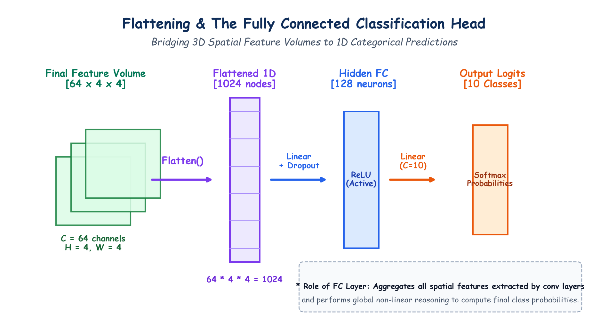

# Submodule 39.09: Flattening, Fully Connected Head aur Regularization (Hinglish Guide)

## 1. Feature Extraction Se Classification Tak Ka Safar

Multiple Convolution aur Pooling layers ke baad hamari photo ek compact 3D tensor ban chuki hoti hai:
$$\mathbf{V} \in \mathbb{R}^{C \times H \times W}$$

Jahan:
- $C$ = Channels ki sankhya (jaise 64)
- $H \times W$ = Chhota spatial size (jaise $4 \times 4$)

Lekin hamara final goal yeh batana hai ki photo Zebra ki hai, Ghode (Horse) ki hai, ya Kutte (Dog) ki. Is categorical decision ke liye hume **Flattening** aur **Fully Connected (FC) Layer** ki zaroorat padti hai.

---

## 2. Flattening Kya Hoti Hai? (3D Se 1D Vector)

**Flatten** operation 3D box ko khol kar ek lamba 1-dimensional vector bana deta hai:

$$N = C \times H \times W$$

Example:
$$64 \times 4 \times 4 \xrightarrow{\text{Flatten()}} \mathbf{1024 \text{ numbers ka 1D vector}}$$

Yeh 1024 numbers hamari photo ke sabse strongest visual features ka summary ban jate hain.

---

## 3. Fully Connected (Dense) Layer Ka Kaam

Yeh flattened vector ek standard ANN dense layer (`nn.Linear`) mein pass hota hai:

$$\mathbf{h} = \text{ReLU}(\mathbf{W} \mathbf{x} + \mathbf{b})$$

### Dense Layer Ka Role:
Conv layers ne local features (aankh, kaan, stripes) dhoondhe the. Dense layer in sabhi features ko ek sath combine karke global decision leti hai:
*"Agar kaali-safed stripes hain + char taangein hain + ghode jaisa chehra hai $\implies$ Yeh ZEBRA hai!"*

---

## 4. Dropout Se Overfitting Rokna

Kyunki FC layer mein bahut sare weights hote hain ($1024 \times 128 = 131,072$ weights), isme overfitting hone ka sabse jyada khatra hota hai.
Iske liye hum **Dropout ($p=0.5$)** lagate hain:
- Har training batch mein 50% neurons ko randomly band kar diya jata hai.
- Isse neurons aapas mein depend hone ke bajaye independently mazboot features seekhte hain.
- Testing (`model.eval()`) ke time Dropout automatically band ho jata hai.

---

## 5. Output Layer aur Softmax

Aakhri layer mein utne neurons hote hain jitni hamari classes hoti hain ($K=3$: Zebra, Horse, Dog).
Logits ko percentages/probabilities mein badalne ke liye **Softmax** lagaya jata hai:

$$P(y = c) = \frac{e^{z_c}}{\sum e^{z_j}}$$

Jis class ka percentage sabse bada hota hai, wahi final prediction ban jati hai!

---

## 6. Hand-Drawn Educational Diagram: Flattening aur FC Layer

Neeche diya gaya student-style handwritten diagram 3D feature maps se 1D flattening, dense layers, aur Softmax probabilities tak ke safar ko visualize karta hai:

