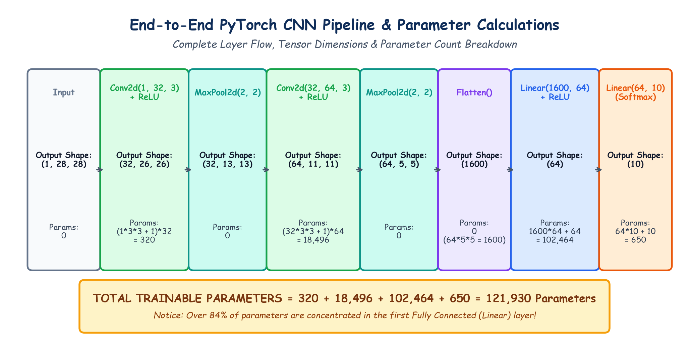

# Submodule 39.10: End-to-End CNN Pipeline, Parameter Sizing & PyTorch Implementation

## 1. Full Architecture Blueprint & Layer Sizing

To synthesize all concepts learned across Day 39, we define a complete, canonical Convolutional Neural Network architecture designed for $28 \times 28$ single-channel images (e.g. Fashion-MNIST or digits) classifying into $10$ classes.

$$\begin{aligned}
\text{Input } (1, 28, 28) &\to \text{Conv2d}(1 \to 32, K=3, P=0, S=1) \to \text{ReLU} \to (32, 26, 26) \\
                          &\to \text{MaxPool2d}(K=2, S=2) \to (32, 13, 13) \\
                          &\to \text{Conv2d}(32 \to 64, K=3, P=0, S=1) \to \text{ReLU} \to (64, 11, 11) \\
                          &\to \text{MaxPool2d}(K=2, S=2) \to (64, 5, 5) \\
                          &\to \text{Flatten}() \to (1600) \\
                          &\to \text{Linear}(1600 \to 64) \to \text{ReLU} \to (64) \\
                          &\to \text{Linear}(64 \to 10) \to (10)
\end{aligned}$$

---

## 2. Rigorous Parameter Count Derivation

For any 2D convolutional layer:
$$\text{Params}_{\text{conv}} = (C_{\text{in}} \times K_h \times K_w + 1) \times C_{\text{out}}$$

For any fully connected linear layer:
$$\text{Params}_{\text{linear}} = (N_{\text{in}} + 1) \times N_{\text{out}}$$

### Layer-by-Layer Calculation:
1. **Conv2d_1**: $(1 \times 3 \times 3 + 1) \times 32 = (9 + 1) \times 32 = \mathbf{320 \text{ parameters}}$
2. **MaxPool2d_1**: $\mathbf{0 \text{ parameters}}$
3. **Conv2d_2**: $(32 \times 3 \times 3 + 1) \times 64 = (288 + 1) \times 64 = \mathbf{18,496 \text{ parameters}}$
4. **MaxPool2d_2**: $\mathbf{0 \text{ parameters}}$
5. **Flatten**: $\mathbf{0 \text{ parameters}}$ (Reshapes $64 \times 5 \times 5 = 1,600$ values)
6. **Linear_1**: $(1600 \times 64) + 64 = 102,400 + 64 = \mathbf{102,464 \text{ parameters}}$
7. **Linear_2**: $(64 \times 10) + 10 = 640 + 10 = \mathbf{650 \text{ parameters}}$

$$\mathbf{\text{Total Trainable Parameters}} = 320 + 18,496 + 102,464 + 650 = \mathbf{121,930 \text{ Parameters}}$$

> [!IMPORTANT]
> **Key Architectural Insight**:
> Notice that `Linear_1` accounts for **$102,464 / 121,930 \approx 84.0\%$** of all parameters in the entire network! Convolutions maintain extreme parameter efficiency through weight sharing, whereas dense layers carry the bulk of parameter storage.

---

## 3. Hand-Drawn Educational Diagram: End-to-End CNN Pipeline

The following diagram illustrates each transformation step, detailing tensor shapes and parameter counts at every layer.



---

## 4. PyTorch Implementation: `cnn_fundamentals.py`

Below is the production-grade PyTorch implementation subclassing `nn.Module`. This code is executable and verified in [`Lecture_Code/cnn_fundamentals.py`](../Lecture_Code/cnn_fundamentals.py).

```python
import torch
import torch.nn as nn

class StandardCNN(nn.Module):
    def __init__(self, num_classes=10):
        super(StandardCNN, self).__init__()

        # Stage 1: Feature Extraction
        self.features = nn.Sequential(
            # Block 1: Conv -> ReLU -> Pool
            nn.Conv2d(in_channels=1, out_channels=32, kernel_size=3, stride=1, padding=0),
            nn.ReLU(),
            nn.MaxPool2d(kernel_size=2, stride=2),

            # Block 2: Conv -> ReLU -> Pool
            nn.Conv2d(in_channels=32, out_channels=64, kernel_size=3, stride=1, padding=0),
            nn.ReLU(),
            nn.MaxPool2d(kernel_size=2, stride=2)
        )

        # Stage 2: Classification Head
        self.classifier = nn.Sequential(
            nn.Flatten(),
            nn.Linear(in_features=64 * 5 * 5, out_features=64),
            nn.ReLU(),
            nn.Dropout(p=0.5),
            nn.Linear(in_features=64, out_features=num_classes)
        )

    def forward(self, x):
        x = self.features(x)
        x = self.classifier(x)
        return x

# Instantiate and verify
if __name__ == "__main__":
    model = StandardCNN(num_classes=10)
    print("CNN Architecture Verified:\n", model)

    # Test with dummy batch: 4 images of shape [1, 28, 28]
    dummy_input = torch.randn(4, 1, 28, 28)
    output = model(dummy_input)
    print("\nDummy Forward Pass Shape:", output.shape) # [4, 10]

    # Count parameters
    total_params = sum(p.numel() for p in model.parameters() if p.requires_grad)
    print(f"Total Trainable Parameters: {total_params:,}")
```
