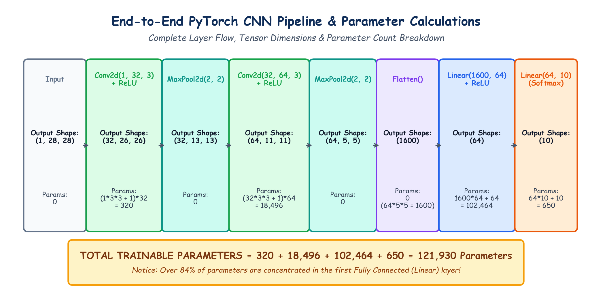

# Submodule 39.10: End-to-End CNN Pipeline aur PyTorch Code (Hinglish Guide)

## 1. Poora Architecture Blueprint aur Layer Dimensions

Day 39 ke sabhi concepts ko integrate karne ke liye, hum ek standard CNN architecture design karte hain jo $28 \times 28$ grayscale images ko 10 classes mein classify karega:

$$\begin{aligned}
\text{Input } (1, 28, 28) &\to \text{Conv2d}(1 \to 32, K=3) \to \text{ReLU} \to (32, 26, 26) \\
                          &\to \text{MaxPool2d}(K=2, S=2) \to (32, 13, 13) \\
                          &\to \text{Conv2d}(32 \to 64, K=3) \to \text{ReLU} \to (64, 11, 11) \\
                          &\to \text{MaxPool2d}(K=2, S=2) \to (64, 5, 5) \\
                          &\to \text{Flatten}() \to (1600) \\
                          &\to \text{Linear}(1600 \to 64) \to \text{ReLU} \to (64) \\
                          &\to \text{Linear}(64 \to 10) \to (10 \text{ classes})
\end{aligned}$$

---

## 2. Learnable Parameters Ka Manual Calculation

Formula:
- Conv Layer: $(\text{Input Channels} \times K_h \times K_w + 1) \times \text{Output Channels}$
- Linear Layer: $(\text{Inputs} + 1) \times \text{Outputs}$

### Layer-Wise Calculation:
1. **Conv2d 1**: $(1 \times 3 \times 3 + 1) \times 32 = (9 + 1) \times 32 = \mathbf{320 \text{ weights}}$
2. **MaxPool 1**: $\mathbf{0 \text{ weights}}$
3. **Conv2d 2**: $(32 \times 3 \times 3 + 1) \times 64 = (288 + 1) \times 64 = \mathbf{18,496 \text{ weights}}$
4. **MaxPool 2**: $\mathbf{0 \text{ weights}}$
5. **Flatten**: $\mathbf{0 \text{ weights}}$ ($64 \times 5 \times 5 = 1600$)
6. **Linear 1**: $1600 \times 64 + 64 = \mathbf{102,464 \text{ weights}}$
7. **Linear 2**: $64 \times 10 + 10 = \mathbf{650 \text{ weights}}$

$$\mathbf{\text{Total Parameters}} = 320 + 18,496 + 102,464 + 650 = \mathbf{121,930 \text{ Parameters}}$$

> [!IMPORTANT]
> **Sabse Bada Insight**:
> Poore network ke **84% parameters akele Linear_1 layer mein hain**! Conv layers weight sharing ki wajah se bohot kam parameters leti hain, jabki FC layers sabse jyada memory consume karti hain.

---

## 3. Hand-Drawn Educational Diagram: End-to-End CNN Pipeline

Neeche diya gaya student-style handwritten diagram har layer ke transformation, tensor shapes aur parameter counts ko visualize karta hai:



---

## 4. PyTorch Code Implementation

Yeh executable code [`Lecture_Code/cnn_fundamentals.py`](../Lecture_Code/cnn_fundamentals.py) mein shamil hai:

```python
import torch
import torch.nn as nn

class StandardCNN(nn.Module):
    def __init__(self, num_classes=10):
        super(StandardCNN, self).__init__()

        # Stage 1: Feature Extraction
        self.features = nn.Sequential(
            nn.Conv2d(1, 32, kernel_size=3, stride=1, padding=0),
            nn.ReLU(),
            nn.MaxPool2d(kernel_size=2, stride=2),

            nn.Conv2d(32, 64, kernel_size=3, stride=1, padding=0),
            nn.ReLU(),
            nn.MaxPool2d(kernel_size=2, stride=2)
        )

        # Stage 2: Classifier
        self.classifier = nn.Sequential(
            nn.Flatten(),
            nn.Linear(64 * 5 * 5, 64),
            nn.ReLU(),
            nn.Dropout(p=0.5),
            nn.Linear(64, num_classes)
        )

    def forward(self, x):
        x = self.features(x)
        x = self.classifier(x)
        return x

if __name__ == "__main__":
    model = StandardCNN(num_classes=10)
    print("Model Architecture:\n", model)
    dummy = torch.randn(4, 1, 28, 28)
    out = model(dummy)
    print("Output Shape:", out.shape) # [4, 10]
```
