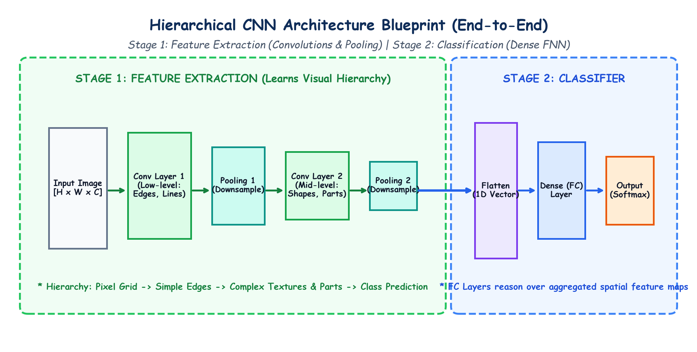

# Lecture 39: Deep Learning (Part-4) — Foundations of Computer Vision & Convolutional Neural Networks (CNN)

Welcome to **Lecture 39** of the Machine Learning & Deep Learning Curriculum. This comprehensive module marks our transition into **Computer Vision (CV)** and establishes the theoretical, mathematical, and architectural foundations of **Convolutional Neural Networks (CNNs)**.

---

## 1. Master Curriculum & Submodule Directory

| Submodule | Focus Area | Key Concepts Covered | Hand-Drawn Educational Diagram |
|---|---|---|---|
| [**Notes_39.01**](Notes_39.01/README.md) | **Deep Learning Architecture Taxonomy** | FNN vs CNN vs RNN vs Transformers, unidirectional flow, tabular vs spatial vs sequential | `deep_learning_architectures_family.png` |
| [**Notes_39.02**](Notes_39.02/README.md) | **Computer Vision Foundations** | Digital images as numeric grids, grayscale matrices ($H \times W \times 1$), RGB tensors ($3, H, W$), pixel normalization | `digital_image_matrix_representation.png` |
| [**Notes_39.03**](Notes_39.03/README.md) | **Core Computer Vision Tasks** | Image Classification, Classification + Localization, Object Detection, Semantic Segmentation, real-world CV systems | `computer_vision_core_tasks.png` |
| [**Notes_39.04**](Notes_39.04/README.md) | **Why Standard ANNs Fail on Images** | The 3 fatal flaws: Parameter Explosion, Destruction of 2D Spatial Structure, Lack of Translation Invariance | `why_ann_fails_on_images.png` |
| [**Notes_39.05**](Notes_39.05/README.md) | **The CNN Architecture Blueprint** | Two-stage blueprint: Feature Extraction vs Classification head, hierarchical feature learning (edges $\to$ textures $\to$ parts) | `cnn_hierarchical_architecture_blueprint.png` |
| [**Notes_39.06**](Notes_39.06/README.md) | **The Convolutional Layer: Mathematics** | Sliding kernels, local receptive fields, element-wise dot product and sum, learnable parameters, ReLU activation | `convolution_mathematics_kernel_sliding.png` |
| [**Notes_39.07**](Notes_39.07/README.md) | **Spatial Geometry: Padding & Stride** | Valid padding ($P=0$) vs Same padding ($P=1$), stride step size, output formula $O = \lfloor\frac{W - K + 2P}{S}\rfloor + 1$ | `padding_and_stride_spatial_geometry.png` |
| [**Notes_39.08**](Notes_39.08/README.md) | **The Pooling Layer: Downsampling** | Max Pooling vs Average Pooling, $75\%$ spatial reduction, translation invariance, ZERO learnable parameters | `pooling_layer_downsampling_mechanics.png` |
| [**Notes_39.09**](Notes_39.09/README.md) | **Flattening & The Fully Connected Head** | Collapsing 3D volumes to 1D vectors, dense non-linear reasoning, Dropout regularization ($p=0.5$), Softmax | `flattening_and_fully_connected_layer.png` |
| [**Notes_39.10**](Notes_39.10/README.md) | **End-to-End CNN Pipeline & PyTorch Code**| Canonical CNN implementation, layer-by-layer tensor shapes, parameter audit (121,930 params), PyTorch verification script | `end_to_end_cnn_pipeline_pytorch.png` |

---

## 2. Global Architecture Blueprint

Below is the master diagram illustrating the hierarchical CNN architecture blueprint, showing how visual features evolve from primitive edges to high-level categorical predictions:

---

## 3. Key Mathematical Takeaways

1. **2D Convolution Output Operation**:
   $$y_{i, j} = \sum_{m} \sum_{n} X_{i+m, j+n} \cdot K_{m, n} + b$$
2. **Universal Output Spatial Dimension**:
   $$O = \left\lfloor \frac{W - K + 2P}{S} \right\rfloor + 1$$
3. **Same Padding Condition (for odd $K$, stride $S=1$)**:
   $$P = \frac{K - 1}{2}$$
4. **Convolutional Layer Learnable Parameters**:
   $$\text{Params}_{\text{conv}} = (C_{\text{in}} \times K_h \times K_w + 1) \times C_{\text{out}}$$
5. **Pooling Layer Parameters**:
   $$\text{Params}_{\text{pool}} \equiv 0$$

---

## 4. Practice Suite & Verified Code Assets

- [**Practice Problems (English)**](Practice_Problems/README.md) | [**Practice Problems (Hinglish)**](Practice_Problems/README_HINGLISH.md)
- [**Full Step-by-Step Solutions (English)**](Practice_Problems/Solutions.md) | [**Full Step-by-Step Solutions (Hinglish)**](Practice_Problems/Solutions_HINGLISH.md)
- **Central Code Repository**: [`lecture_39/Lecture_Code/cnn_fundamentals.py`](Lecture_Code/cnn_fundamentals.py) containing the complete, executable PyTorch model with forward pass verification and parameter audits.
