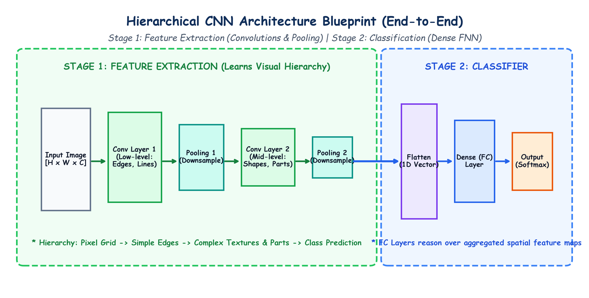

# Lecture 39: Deep Learning (Part-4) — Computer Vision aur Convolutional Neural Networks (CNN) (Hinglish Master Guide)

Deep Learning Curriculum ke **Lecture 39** mein aapka swagat hai! Is comprehensive module mein humne **Computer Vision (CV)** ki shuruat ki hai aur **Convolutional Neural Networks (CNNs)** ke theoretical, mathematical, aur architectural principles ko master kiya hai.

---

## 1. Master Curriculum aur Submodules Index

| Submodule | Topic | Mukhya Concepts | Hand-Drawn Educational Diagram |
|---|---|---|---|
| [**Notes_39.01**](Notes_39.01/README_HINGLISH.md) | **Deep Learning Architecture Taxonomy** | FNN vs CNN vs RNN vs Transformers, unidirectional flow, tabular vs visual data | `deep_learning_architectures_family.png` |
| [**Notes_39.02**](Notes_39.02/README_HINGLISH.md) | **Computer Vision Foundations** | Digital photo as numbers, grayscale matrices ($H \times W \times 1$), RGB tensors ($3, H, W$), pixel normalization | `digital_image_matrix_representation.png` |
| [**Notes_39.03**](Notes_39.03/README_HINGLISH.md) | **Core Computer Vision Tasks** | Classification, Classification + Localization, Object Detection, Semantic Segmentation, real-world systems | `computer_vision_core_tasks.png` |
| [**Notes_39.04**](Notes_39.04/README_HINGLISH.md) | **Images Par ANNs Kyun Fail Hote Hain?**| 3 Badi Kamiyan: Parameter Explosion, 2D Spatial Structure Ka Khatam Hona, Translation Sensitivity | `why_ann_fails_on_images.png` |
| [**Notes_39.05**](Notes_39.05/README_HINGLISH.md) | **The CNN Architecture Blueprint** | Do-Stage Blueprint: Feature Extraction vs Classification head, visual hierarchy (edges $\to$ shapes $\to$ parts) | `cnn_hierarchical_architecture_blueprint.png` |
| [**Notes_39.06**](Notes_39.06/README_HINGLISH.md) | **The Convolutional Layer: Mathematics** | Sliding filters, local receptive field, element-wise dot product aur addition, learnable kernels, ReLU | `convolution_mathematics_kernel_sliding.png` |
| [**Notes_39.07**](Notes_39.07/README_HINGLISH.md) | **Spatial Geometry: Padding & Stride** | Valid padding ($P=0$) vs Same padding ($P=1$), stride jump size, output formula $O = \lfloor\frac{W - K + 2P}{S}\rfloor + 1$ | `padding_and_stride_spatial_geometry.png` |
| [**Notes_39.08**](Notes_39.08/README_HINGLISH.md) | **The Pooling Layer: Downsampling** | Max Pooling vs Average Pooling, 75% spatial size reduction, translation invariance, ZERO parameters | `pooling_layer_downsampling_mechanics.png` |
| [**Notes_39.09**](Notes_39.09/README_HINGLISH.md) | **Flattening & The Fully Connected Head** | 3D box ko 1D vector banana, global non-linear reasoning, Dropout regularization ($p=0.5$), Softmax | `flattening_and_fully_connected_layer.png` |
| [**Notes_39.10**](Notes_39.10/README_HINGLISH.md) | **End-to-End CNN Pipeline & PyTorch Code**| Complete CNN implementation, layer-by-layer shapes, parameter count (121,930 params), PyTorch verification | `end_to_end_cnn_pipeline_pytorch.png` |

---

## 2. Global Architecture Blueprint

Neeche diya gaya diagram CNN ke hierarchical blueprint ko darshata hai—kaise pehli layers simple edges dhoondhti hain aur deep layers complex objects ko pehchanti hain:

---

## 3. Mukhya Mathematical Formulas

1. **2D Convolution Output Operation**:
   $$y_{i, j} = \sum_{m} \sum_{n} X_{i+m, j+n} \cdot K_{m, n} + b$$
2. **Universal Output Spatial Dimension**:
   $$O = \left\lfloor \frac{W - K + 2P}{S} \right\rfloor + 1$$
3. **Same Padding Condition (for odd $K$, stride $S=1$)**:
   $$P = \frac{K - 1}{2}$$
4. **Conv Layer Learnable Parameters**:
   $$\text{Params}_{\text{conv}} = (C_{\text{in}} \times K_h \times K_w + 1) \times C_{\text{out}}$$
5. **Pooling Layer Parameters**:
   $$\text{Params}_{\text{pool}} \equiv 0$$

---

## 4. Practice Suite aur PyTorch Code

- [**Practice Problems (English)**](Practice_Problems/README.md) | [**Practice Problems (Hinglish)**](Practice_Problems/README_HINGLISH.md)
- [**Complete Solutions (English)**](Practice_Problems/Solutions.md) | [**Complete Solutions (Hinglish)**](Practice_Problems/Solutions_HINGLISH.md)
- **Central Code Repository**: [`lecture_39/Lecture_Code/cnn_fundamentals.py`](Lecture_Code/cnn_fundamentals.py) jismein complete, verified PyTorch CNN model shamil hai.
