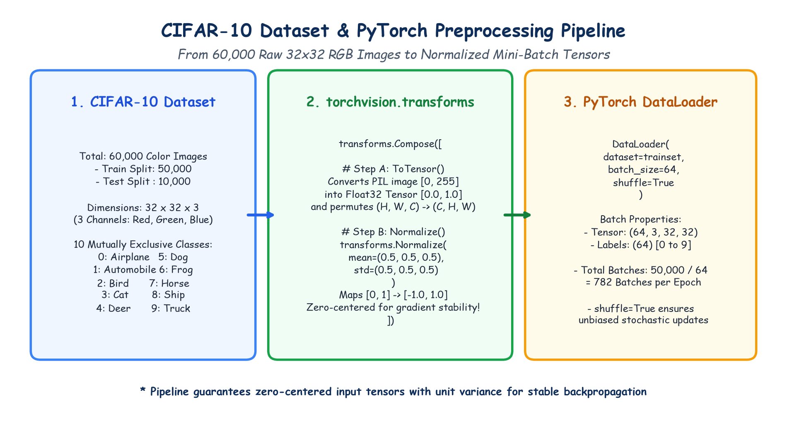

# Submodule 40.01: Minor Project: CIFAR-10 Dataset & PyTorch Preprocessing Pipeline

## 1. Project Overview: CIFAR-10 Benchmarking

In this minor project, we transition from simple grayscale digit benchmarks to **CIFAR-10**—the universally recognized standard benchmark dataset for evaluating Computer Vision and Deep Learning models:
- **Total Images**: $60,000$ natural color photographs.
- **Image Resolution**: $32 \times 32$ pixels.
- **Color Channels**: $3$ (Red, Green, Blue) $\implies$ Tensor shape $(3, 32, 32)$.
- **Splits**:
  - Training Set: $50,000$ images ($5,000$ images per class).
  - Test Set: $10,000$ images ($1,000$ images per class).
- **10 Mutually Exclusive Object Classes**:
  1. `airplane` (Class 0)
  2. `automobile` (Class 1)
  3. `bird` (Class 2)
  4. `cat` (Class 3)
  5. `deer` (Class 4)
  6. `dog` (Class 5)
  7. `frog` (Class 6)
  8. `horse` (Class 7)
  9. `ship` (Class 8)
  10. `truck` (Class 9)

---

## 2. The `torchvision` Ecosystem

In industrial PyTorch workflows, Computer Vision data pipelines leverage **`torchvision`**:
- `torchvision.datasets`: Houses standard benchmark datasets (`CIFAR10`, `MNIST`, `FashionMNIST`, `ImageNet`) with automated caching and integrity verification.
- `torchvision.transforms`: Provides composable image preprocessing and data augmentation primitives.

```python
import torchvision
from torchvision.datasets import CIFAR10
import torchvision.transforms as transforms
```

---

## 3. The Transformation Pipeline: `transforms.Compose`

Raw images on disk are PIL Image objects with integer pixel values in range $[0, 255]$ with channels-last layout $(H, W, C)$. Deep neural networks require zero-centered Float32 tensors with channels-first layout $(C, H, W)$.

We define a two-stage preprocessing pipeline:

```python
transform = transforms.Compose([
    transforms.ToTensor(),
    transforms.Normalize((0.5, 0.5, 0.5), (0.5, 0.5, 0.5))
])
```

### Stage A: `transforms.ToTensor()`
1. Converts the PIL image or NumPy array with values in $[0, 255]$ into a `torch.FloatTensor`.
2. Automatically normalizes intensities into the range $[0.0, 1.0]$ via division by $255.0$.
3. Permutes dimensions from $(H, W, C)$ to PyTorch standard **$(C, H, W)$**.

### Stage B: `transforms.Normalize(mean, std)`
Applies channel-wise z-score standardization:
$$\text{Output} = \frac{\text{Input} - \text{mean}}{\text{std}}$$
Using $\mu = 0.5$ and $\sigma = 0.5$ for all three channels maps $[0.0, 1.0]$ into **$[-1.0, 1.0]$**:
$$x_{\text{norm}} = \frac{x - 0.5}{0.5} = 2x - 1$$
- When $x = 0.0 \implies x_{\text{norm}} = -1.0$ (Black)
- When $x = 0.5 \implies x_{\text{norm}} = 0.0$ (Midpoint Gray)
- When $x = 1.0 \implies x_{\text{norm}} = +1.0$ (White)

> [!IMPORTANT]
> **Why Zero-Centered Normalization Matters**:
> If input values are strictly positive ($[0, 1]$), the gradients of weights entering the first hidden layer always share the same sign ($\nabla_{\mathbf{W}} L \propto \mathbf{x} > 0$). This forces weight updates to either all increase or all decrease simultaneously, causing severe zig-zagging and sluggish convergence during gradient descent! Zero-centering ($[-1, 1]$) eliminates this constraint.

---

## 4. Hand-Drawn Educational Diagram: CIFAR-10 Data Pipeline

The following student-style handwritten diagram illustrates the transformation funnel from raw 32x32 RGB arrays to mini-batch tensors in the DataLoader.



---

## 5. DataLoader Construction & Mini-Batching

```python
from torch.utils.data import DataLoader

trainset = CIFAR10(root="./data", train=True, download=True, transform=transform)
testset = CIFAR10(root="./data", train=False, download=True, transform=transform)

trainloader = DataLoader(trainset, batch_size=64, shuffle=True)
testloader = DataLoader(testset, batch_size=64, shuffle=False)
```

### Batch Dimensions:
- Each iteration from `trainloader` yields:
  - `images`: Tensor of shape **$(64, 3, 32, 32)$**
  - `labels`: 1D LongTensor of shape **$(64)$** with integer class IDs $0 \dots 9$.
- Total training batches per epoch:
  $$\text{Total Batches} = \left\lceil \frac{50,000}{64} \right\rceil = \mathbf{782 \text{ batches}}$$
