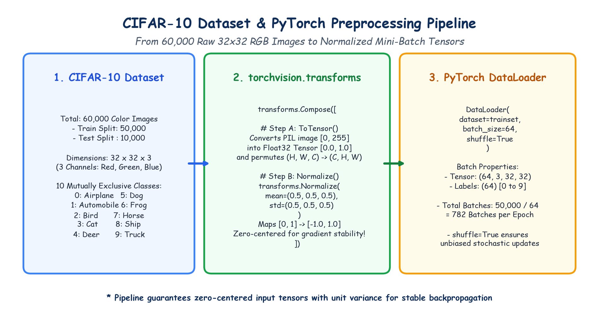

# Submodule 40.01: Minor Project: CIFAR-10 Dataset aur Preprocessing Pipeline (Hinglish Guide)

## 1. Project Overview: CIFAR-10 Dataset Kya Hai?

Is minor project mein hum ek real-world image classification problem solve karenge using **CIFAR-10 dataset**—jo deep learning aur computer vision ki duniya ka sabse popular benchmark dataset hai:
- **Total Photos**: $60,000$ natural color photos.
- **Resolution**: $32 \times 32$ pixels.
- **Color Channels**: $3$ (Red, Green, Blue) $\implies (3, 32, 32)$.
- **Dataset Splits**:
  - Training Set: $50,000$ photos ($5,000$ photos per class).
  - Testing Set: $10,000$ photos ($1,000$ photos per class).
- **10 Object Categories (Classes)**:
  1. `airplane` (Hawai Jahaj)
  2. `automobile` (Car)
  3. `bird` (Chidiya)
  4. `cat` (Billi)
  5. `deer` (Hiran)
  6. `dog` (Kutta)
  7. `frog` (Mendhak)
  8. `horse` (Ghoda)
  9. `ship` (Pani Ka Jahaj)
  10. `truck` (Truck)

---

## 2. `torchvision` Library Ka Upyog

PyTorch ke andar images ke sath deal karne ke liye official package hota hai **`torchvision`**:
- `torchvision.datasets`: Isme CIFAR-10 jaise popular datasets pehle se bane hote hain jo single line of code se download ho jate hain.
- `torchvision.transforms`: Isme images ko normalize aur augment karne ke tools hote hain.

---

## 3. Data Transformation Pipeline: `transforms.Compose`

Disk par jo photos hoti hain wo PIL images hoti hain jinki values $0$ se $255$ tak hoti hain. Neural network mein bhejte waqt inko **zero-centered float tensors** mein convert karna zaroori hota hai:

```python
transform = transforms.Compose([
    transforms.ToTensor(),
    transforms.Normalize((0.5, 0.5, 0.5), (0.5, 0.5, 0.5))
])
```

### 1. `transforms.ToTensor()`
- Raw photo ke $0 - 255$ integer pixels ko $255.0$ se divide karke $[0.0, 1.0]$ floating range mein badalta hai.
- Format ko channels-last $(H, W, C)$ se badal kar PyTorch format **$(C, H, W)$** mein convert karta hai.

### 2. `transforms.Normalize((0.5, 0.5, 0.5), (0.5, 0.5, 0.5))`
Formula:
$$x_{\text{norm}} = \frac{x - \mu}{\sigma} = \frac{x - 0.5}{0.5} = 2x - 1$$
Yeh values ko $[0.0, 1.0]$ se badal kar **$[-1.0, 1.0]$** mein shift kar deta hai!
- $0.0 \to -1.0$ (Pure Black)
- $0.5 \to 0.0$ (Medium Gray)
- $1.0 \to +1.0$ (Pure White)

> [!IMPORTANT]
> **Zero-Centered Normalization Kyun Zaroori Hai?**
> Agar sabhi input values positive ($>0$) rahengi, toh pehli layer ke weights ke saare gradients ek hi sign (+ ya -) ke ho jayenge. Isse gradient descent seedhe aage badhne ke bajaye zig-zag oscillate karne lagta hai. Zero-centering ($[-1, 1]$) training ko bohot smooth aur tezz bana deta hai!

---

## 4. Hand-Drawn Educational Diagram: CIFAR-10 Data Pipeline

Neeche diya gaya student-style handwritten diagram raw 32x32 images se lekar mini-batch tensors tak ke data pipeline ko step-by-step darshata hai:



---

## 5. DataLoader aur Batches Ka Math

```python
trainloader = DataLoader(trainset, batch_size=64, shuffle=True)
testloader = DataLoader(testset, batch_size=64, shuffle=False)
```

- Har training batch ka shape: **$(64, 3, 32, 32)$**
- Har batch ke labels: **$(64)$**
- Total Batches:
  $$\frac{50,000}{64} = \mathbf{782 \text{ batches per epoch}}$$
