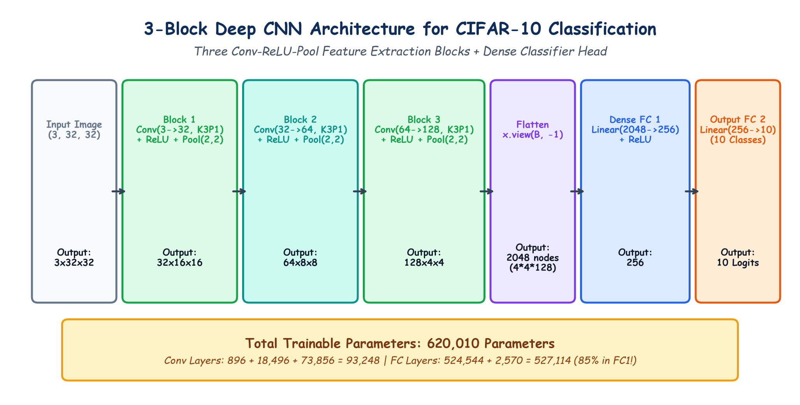

# Submodule 40.02: Building the 3-Block Deep CNN Architecture in PyTorch

## 1. Architectural Strategy for $32 \times 32$ RGB Images

Unlike simple single-layer toy models, natural color image classification requires sufficient hierarchical depth to extract multiscale features.
We construct a **3-Block Deep Convolutional Neural Network**:
- Each convolutional block progressively **doubles the number of feature filters** ($32 \to 64 \to 128$) to capture increasingly complex semantic features.
- Each block applies a $2 \times 2$ Max Pooling layer with stride $S=2$ to progressively **halve spatial dimensions** ($32 \to 16 \to 8 \to 4$).
- The distilled 3D feature maps are flattened and classified using a 2-layer Fully Connected Multilayer Perceptron.

---

## 2. Spatial Dimension Derivation Across Layers

Recall the universal spatial output dimension formula:
$$O = \left\lfloor \frac{W - K + 2P}{S} \right\rfloor + 1$$

Throughout our convolutional blocks, we use:
- Kernel Size $K = 3$
- Padding $P = 1$
- Stride $S = 1$

Therefore, the convolution operation **maintains the exact spatial dimensions** of the input:
$$O = \frac{W - 3 + 2(1)}{1} + 1 = W$$

Spatial reduction occurs exclusively inside the `MaxPool2d(2, 2)` layers, which downsample both width and height by a factor of 2.

```
Input: (3, 32, 32)
  |
  +--> [Conv 3->32, K3, P1] + ReLU   --> Shape: (32, 32, 32)
  +--> [MaxPool 2x2, S2]             --> Shape: (32, 16, 16)   <-- BLOCK 1
  |
  +--> [Conv 32->64, K3, P1] + ReLU  --> Shape: (64, 16, 16)
  +--> [MaxPool 2x2, S2]             --> Shape: (64, 8, 8)     <-- BLOCK 2
  |
  +--> [Conv 64->128, K3, P1] + ReLU --> Shape: (128, 8, 8)
  +--> [MaxPool 2x2, S2]             --> Shape: (128, 4, 4)    <-- BLOCK 3
  |
  +--> Flatten: x.view(B, -1)        --> Vector: 128 * 4 * 4 = 2,048 nodes
  +--> [Linear 2048->256] + ReLU     --> Vector: 256
  +--> [Linear 256->10]              --> Logits: 10 Classes
```

---

## 3. Trainable Parameter Count Derivation

Formula for 2D Convolutions:
$$\text{Params}_{\text{conv}} = (C_{\text{in}} \times K_h \times K_w + 1) \times C_{\text{out}}$$

Formula for Fully Connected Linear Layers:
$$\text{Params}_{\text{linear}} = (N_{\text{in}} + 1) \times N_{\text{out}}$$

### Exact Layer-by-Layer Audit:
1. **Conv2d_1**: $(3 \times 3 \times 3 + 1) \times 32 = (27 + 1) \times 32 = \mathbf{896 \text{ parameters}}$
2. **Conv2d_2**: $(32 \times 3 \times 3 + 1) \times 64 = (288 + 1) \times 64 = \mathbf{18,496 \text{ parameters}}$
3. **Conv2d_3**: $(64 \times 3 \times 3 + 1) \times 128 = (576 + 1) \times 128 = \mathbf{73,856 \text{ parameters}}$
4. **FC Layer 1 (`Linear(2048, 256)`)**: $(2048 \times 256) + 256 = \mathbf{524,544 \text{ parameters}}$
5. **FC Layer 2 (`Linear(256, 10)`)**: $(256 \times 10) + 10 = \mathbf{2,570 \text{ parameters}}$

$$\mathbf{\text{Total Trainable Parameters}} = 896 + 18,496 + 73,856 + 524,544 + 2,570 = \mathbf{620,362 \text{ Parameters}}$$

> [!NOTE]
> All 3 convolutional blocks combined require only $93,248$ parameters ($\approx 15.0\%$). The first fully connected layer alone consumes **$524,544$ parameters ($\approx 84.6\%$)**, demonstrating how weight sharing shields convolutional layers from parameter bloat.

---

## 4. Hand-Drawn Educational Diagram: 3-Block CNN Architecture

The following notebook diagram visualizes the flow of tensors through the 3 feature extraction blocks and the dense classification head.



---

## 5. PyTorch Implementation Class

```python
import torch
import torch.nn as nn

class CNN(nn.Module):
    def __init__(self):
        super(CNN, self).__init__()

        # Feature Extraction: 3 Conv-ReLU-Pool Blocks
        self.conv_layers = nn.Sequential(
            # Block 1
            nn.Conv2d(in_channels=3, out_channels=32, kernel_size=3, padding=1),
            nn.ReLU(),
            nn.MaxPool2d(kernel_size=2, stride=2),

            # Block 2
            nn.Conv2d(in_channels=32, out_channels=64, kernel_size=3, padding=1),
            nn.ReLU(),
            nn.MaxPool2d(kernel_size=2, stride=2),

            # Block 3
            nn.Conv2d(in_channels=64, out_channels=128, kernel_size=3, padding=1),
            nn.ReLU(),
            nn.MaxPool2d(kernel_size=2, stride=2)
        )

        # Classification Head: 2 Dense Layers
        self.fc_layers = nn.Sequential(
            nn.Linear(in_features=4 * 4 * 128, out_features=256),
            nn.ReLU(),
            nn.Linear(in_features=256, out_features=10)
        )

    def forward(self, x):
        x = self.conv_layers(x)
        x = x.view(x.size(0), -1) # Flattening: (Batch, 2048)
        x = self.fc_layers(x)
        return x
```
