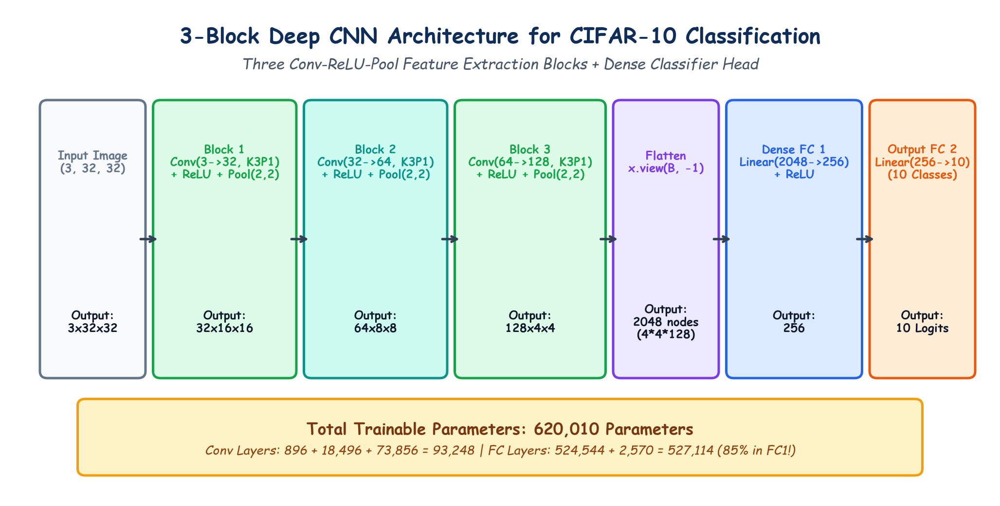

# Submodule 40.02: PyTorch Mein 3-Block Deep CNN Architecture Banana (Hinglish Guide)

## 1. CIFAR-10 Ke Liye 3-Block Architecture Ki Strategy

Color images ($32 \times 32 \times 3$) ko classify karne ke liye hum ek deep network design karte hain jisme **3 Convolutional Blocks** hote hain:
- Har block mein filters ki sankhya double hoti jati hai ($32 \to 64 \to 128$) taaki network pehle simple edges aur fir complex patterns seekh sake.
- Har block ke end mein $2 \times 2$ Max Pooling lagti hai jo spatial dimensions ko aadha karti chali jati hai ($32 \to 16 \to 8 \to 4$).
- Aakhri feature maps ko flatten karke ek 2-layer Fully Connected MLP mein bheja jata hai jo 10 classes ke scores nikalta hai.

---

## 2. Layer-by-Layer Dimensions Ka Calculation

Formula:
$$O = \frac{W - K + 2P}{S} + 1$$

Kyunki humne $K=3, P=1, S=1$ liya hai:
$$O = \frac{W - 3 + 2}{1} + 1 = W$$
Matlab Conv layer ke baad image ka size **unchanged** rehta hai. Size sirf `MaxPool2d(2, 2)` ke baad aadha hota hai:

```
Input: (3, 32, 32)
  |
  +--> [Conv 3->32] + ReLU + [MaxPool 2x2]  --> Shape: (32, 16, 16)   <-- BLOCK 1
  |
  +--> [Conv 32->64] + ReLU + [MaxPool 2x2] --> Shape: (64, 8, 8)     <-- BLOCK 2
  |
  +--> [Conv 64->128] + ReLU + [MaxPool 2x2]--> Shape: (128, 4, 4)    <-- BLOCK 3
  |
  +--> Flatten (x.view(B, -1))              --> 128 * 4 * 4 = 2,048 nodes
  +--> [Linear 2048->256] + ReLU            --> 256 nodes
  +--> [Linear 256->10]                     --> 10 Class Logits
```

---

## 3. Total Parameters Ka Derivation

- **Conv2d 1**: $(3 \times 3 \times 3 + 1) \times 32 = \mathbf{896}$
- **Conv2d 2**: $(32 \times 3 \times 3 + 1) \times 64 = \mathbf{18,496}$
- **Conv2d 3**: $(64 \times 3 \times 3 + 1) \times 128 = \mathbf{73,856}$
- **Linear 1**: $2048 \times 256 + 256 = \mathbf{524,544}$
- **Linear 2**: $256 \times 10 + 10 = \mathbf{2,570}$

$$\mathbf{\text{Total Trainable Parameters}} = \mathbf{620,362 \text{ Parameters}}$$

> [!NOTE]
> Teeno Conv layers milkar sirf $93,248$ parameters leti hain ($\approx 15\%$), jabki akele Linear_1 layer mein **$524,544$ parameters ($\approx 84.6\%$)** hain! Yeh darshata hai ki Convolutional layers parameter-efficient kyun hoti hain.

---

## 4. Hand-Drawn Educational Diagram: 3-Block Architecture

Neeche diya gaya student-style handwritten diagram 3 Conv-ReLU-Pool blocks aur dense classification head ke complete tensor flow ko depict karta hai:



---

## 5. PyTorch Implementation Code

```python
class CNN(nn.Module):
    def __init__(self):
        super(CNN, self).__init__()

        self.conv_layers = nn.Sequential(
            nn.Conv2d(3, 32, kernel_size=3, padding=1),
            nn.ReLU(),
            nn.MaxPool2d(2, 2),

            nn.Conv2d(32, 64, kernel_size=3, padding=1),
            nn.ReLU(),
            nn.MaxPool2d(2, 2),

            nn.Conv2d(64, 128, kernel_size=3, padding=1),
            nn.ReLU(),
            nn.MaxPool2d(2, 2)
        )

        self.fc_layers = nn.Sequential(
            nn.Linear(4 * 4 * 128, 256),
            nn.ReLU(),
            nn.Linear(256, 10)
        )

    def forward(self, x):
        x = self.conv_layers(x)
        x = x.view(x.size(0), -1) # Flattening: (Batch, 2048)
        x = self.fc_layers(x)
        return x
```
