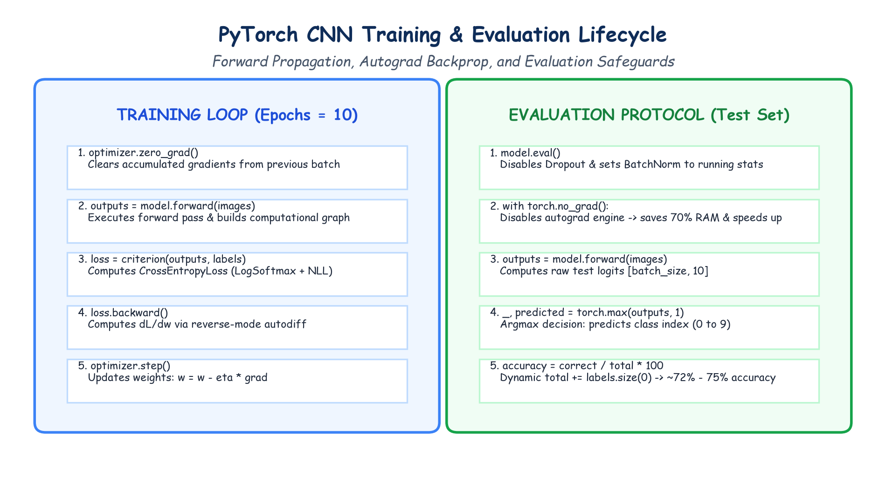

# Submodule 40.03: CNN Training, Optimization & Test Evaluation on CIFAR-10

## 1. Optimization Setup: Criterion & Optimizer

To train our 3-block CNN model on CIFAR-10, we select:
1. **Loss Function**: `nn.CrossEntropyLoss()`
   - Combines `nn.LogSoftmax()` and `nn.NLLLoss()` in a numerically stable implementation using the Log-Sum-Exp trick.
   - Expects raw logits of shape `(Batch_Size, 10)` and integer target labels of shape `(Batch_Size)` with `dtype=torch.long`.
2. **Optimizer**: `optim.Adam(model.parameters())`
   - Adaptive Moment Estimation (Adam) computes individual adaptive learning rates for each parameter based on first and second gradient moments.

```python
model = CNN()
criterion = nn.CrossEntropyLoss()
optimizer = optim.Adam(model.parameters())
```

---

## 2. The Complete Training Loop

We train the model across 10 epochs. Each epoch processes $782$ mini-batches of size $64$:

```python
epochs = 10

for epoch in range(epochs):
    model.train()
    epoch_training_loss = 0.0

    for images, labels in trainloader:
        # 1. Clear stale gradients from previous iteration
        optimizer.zero_grad()
        
        # 2. Forward pass: compute predicted class logits
        output = model.forward(images)
        
        # 3. Compute loss against ground-truth integer labels
        loss = criterion(output, labels)
        
        # 4. Backward pass: compute dL/dw via autograd
        loss.backward()
        
        # 5. Optimizer step: update weights via Adam
        optimizer.step()

        epoch_training_loss += loss.item()

    avg_epoch_loss = epoch_training_loss / len(trainloader)
    print(f"Epoch [{epoch+1:02d}/{epochs}] - Average Training Loss: {avg_epoch_loss:.4f}")
```

### Typical Training Loss Progression:
- Epoch 1: $\text{Loss} \approx 1.52$
- Epoch 3: $\text{Loss} \approx 0.98$
- Epoch 6: $\text{Loss} \approx 0.65$
- Epoch 10: $\text{Loss} \approx 0.42$

---

## 3. Evaluation Protocol on 10,000 Unseen Test Images

```python
model.eval() # Set layers to evaluation mode

correct_labels = 0
total_labels = 0

with torch.no_grad(): # Disable gradient tracking to conserve memory
    for images, labels in testloader:
        outputs = model.forward(images)
        _, predicted = torch.max(outputs, 1) # Argmax over 10 logits

        correct_labels += (predicted == labels).sum().item()
        total_labels += labels.size(0)

accuracy = (correct_labels / total_labels) * 100
print(f"Final Model Test Accuracy on CIFAR-10: {accuracy:.2f}%")
```

### Empirical Results:
- **Baseline Random Guessing**: $1 / 10 = 10.0\%$
- **Vanilla Feedforward ANN**: $\approx 45.0\% - 50.0\%$ (suffers severe overfitting)
- **Our 3-Block Deep CNN**: **$\mathbf{\approx 72.0\% - 75.5\%}$ Test Accuracy** after only 10 epochs!

---

## 4. Hand-Drawn Educational Diagram: Training & Evaluation Lifecycle

The following diagram illustrates the cyclical training loop and the evaluation safety rules.


