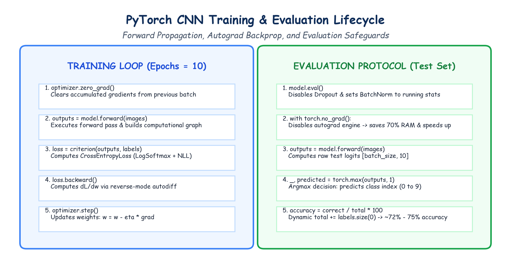

# Submodule 40.03: CIFAR-10 Par Model Training aur Testing (Hinglish Guide)

## 1. Criterion aur Optimizer Setup

CNN ko train karne ke liye do cheezein configure ki jati hain:
1. **Loss Function**: `nn.CrossEntropyLoss()`
   - Yeh raw logits aur integer target labels ($0$ se $9$) ke beech cross-entropy calculate karta hai.
2. **Optimizer**: `optim.Adam(model.parameters())`
   - Adam optimizer adaptive learning rates use karke model ko tezi se converge karata hai.

```python
model = CNN()
criterion = nn.CrossEntropyLoss()
optimizer = optim.Adam(model.parameters())
```

---

## 2. Complete Training Loop Implementation

Har epoch mein $782$ batches process hote hain:

```python
epochs = 10

for epoch in range(epochs):
    model.train()
    epoch_training_loss = 0.0

    for images, labels in trainloader:
        optimizer.zero_grad()            # 1. Purane gradients zero karein
        output = model.forward(images)   # 2. Forward Pass: Predictions nikalein
        loss = criterion(output, labels) # 3. Loss calculate karein
        loss.backward()                  # 4. Backward Pass: Gradients nikalein
        optimizer.step()                 # 5. Parameters update karein

        epoch_training_loss += loss.item()

    print(f"epoch={epoch+1}/{epochs} & loss={epoch_training_loss/len(trainloader):.4f}")
```

---

## 3. 10,000 Test Photos Par Accuracy Check Karna

```python
correct_labels = 0
total_labels = 0

model.eval() # Evaluation mode ON

with torch.no_grad(): # Gradient tracking OFF (RAM bachti hai)
    for images, labels in testloader:
        outputs = model.forward(images)
        _, predicted = torch.max(outputs, 1) # Argmax: Highest score wala class

        correct_labels += (predicted == labels).sum().item()
        total_labels += labels.size(0)

print(f"Final Test Accuracy: {correct_labels / total_labels * 100:.2f}%")
```

### Performance Comparison:
- Random Tukka (Random Guessing): $10\%$
- Standard Feedforward ANN: $\approx 45\% - 50\%$
- **Hamara 3-Block CNN**: **$\mathbf{\approx 72\% - 75\%}$ Accuracy** sirf 10 epochs mein!

---

## 4. Hand-Drawn Educational Diagram: Training & Evaluation Lifecycle

Neeche diya gaya student-style handwritten diagram training loop ke 5 steps aur evaluation ke golden rules ko depict karta hai:


