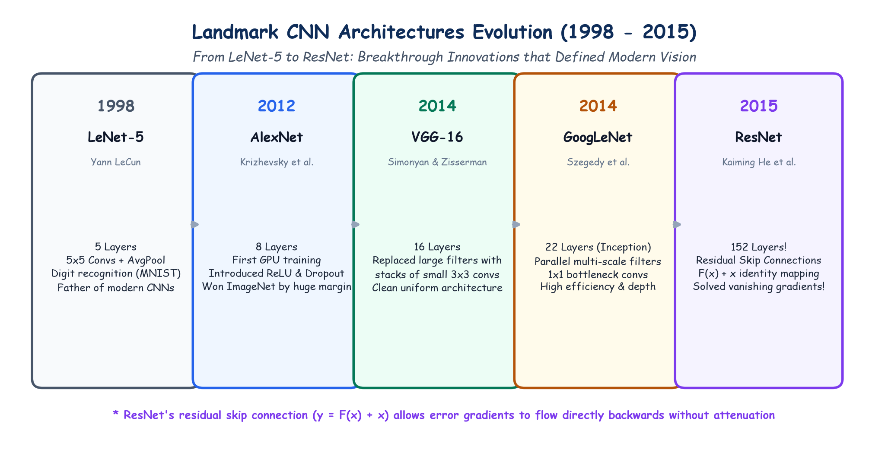

# Submodule 40.04: Landmark CNN Architectures: From LeNet-5 to ResNet

## 1. The Timeline of Deep Vision Breakthroughs

The history of Computer Vision is defined by milestone architectures that introduced foundational design patterns used across modern deep learning.

```
1998            2012            2014            2014             2015
LeNet-5 ------> AlexNet ------> VGG-16 -------> GoogLeNet -----> ResNet
(Yann LeCun)    (Krizhevsky)    (Simonyan)      (Inception)      (Kaiming He)
```

---

## 2. Deep Dive into the 5 Landmark Architectures

### 1. LeNet-5 (1998, Yann LeCun et al.)
- **Pioneering Achievement**: First commercially successful convolutional neural network, deployed by US banks to read handwritten checks on the MNIST dataset.
- **Key Structure**: 2 Conv layers with $5 \times 5$ filters + Average Pooling + 2 Fully Connected layers.
- **Activation**: Sigmoid / Tanh functions (predating ReLU).

### 2. AlexNet (2012, Alex Krizhevsky, Ilya Sutskever, Geoffrey Hinton)
- **The ImageNet Revolution**: Won the ImageNet Large Scale Visual Recognition Challenge (ILSVRC 2012) by an unprecedented margin, cutting the top-5 error rate from $26\%$ to $15.3\%$.
- **Key Innovations**:
  1. First major model trained entirely on parallel **NVIDIA GPUs** (using custom CUDA kernels).
  2. Adopted **ReLU** instead of Sigmoid, accelerating training convergence by $6\times$.
  3. Introduced **Dropout ($p=0.5$)** to combat catastrophic overfitting in dense layers.
  4. Data Augmentation (random crops, horizontal flips, color jittering).

### 3. VGG-16 / VGG-19 (2014, Visual Geometry Group, Oxford)
- **Core Philosophy**: Extreme simplicity and architectural uniformity.
- **The $3 \times 3$ Factorization Principle**:
  - Replaced large kernels ($5 \times 5$ and $7 \times 7$) with stacks of small **$3 \times 3$** kernels with stride 1 and padding 1.
  - **Mathematical Proof of Advantage**:
    Two stacked $3 \times 3$ convolutions have the exact same effective receptive field as a single $5 \times 5$ convolution:
    $$\text{Receptive Field} = 1 + (3 - 1) + (3 - 1) = 5$$
    - Parameters for two $3 \times 3$ filters: $2 \times (3 \times 3 \times C^2) = \mathbf{18 C^2}$
    - Parameters for one $5 \times 5$ filter: $1 \times (5 \times 5 \times C^2) = \mathbf{25 C^2}$
    - **Result**: $28\%$ fewer parameters AND two non-linear ReLU activations instead of one!

### 4. GoogLeNet / Inception-v1 (2014, Google)
- **Key Innovation**: The **Inception Module**—processing features at multiple spatial scales simultaneously.
- Rather than choosing between $1 \times 1, 3 \times 3$, or $5 \times 5$ filters, the Inception module runs all of them in parallel and concatenates their output feature maps!
- Introduced **$1 \times 1$ Bottleneck Convolutions** to reduce channel dimensions before costly $3 \times 3$ and $5 \times 5$ convolutions, keeping parameter count to just $5\text{ Million}$ (vs AlexNet's 60M).

### 5. ResNet (2015, Kaiming He et al., Microsoft Research)
- **The Problem of Network Degradation**:
  As neural networks grow deeper (e.g. 50 to 100+ layers), accuracy saturates and degrades rapidly. This is NOT caused by overfitting (training error also degrades!), but by **vanishing gradients** and extreme optimization difficulty.
- **The Solution: Residual Skip Connections**:
  Instead of forcing stacked layers to fit a desired underlying mapping $\mathcal{H}(\mathbf{x})$, ResNet forces them to fit a **residual mapping** $\mathcal{F}(\mathbf{x}) = \mathcal{H}(\mathbf{x}) - \mathbf{x}$:
  $$\mathbf{y} = \mathcal{F}(\mathbf{x}, \{W_i\}) + \mathbf{x}$$
  - $\mathbf{x}$ is the **identity shortcut connection** (skipping one or more layers).
  - During backpropagation:
    $$\frac{\partial L}{\partial \mathbf{x}} = \frac{\partial L}{\partial \mathbf{y}} \frac{\partial \mathcal{F}}{\partial \mathbf{x}} + \mathbf{\frac{\partial L}{\partial \mathbf{y}}}$$
  - The second term ($+ \frac{\partial L}{\partial \mathbf{y}}$) acts as an unobstructed **gradient highway**! Gradients flow directly backward without decaying, enabling networks with **152+ layers** to be trained stably.

---

## 3. Hand-Drawn Educational Diagram: Architectural Evolution

The following notebook-style diagram traces the evolutionary breakthroughs across all 5 landmark architectures.



---

## 4. Summary Comparison Table

| Architecture | Year | Total Layers | Key Architectural Breakthrough | Top-5 ImageNet Error |
|---|---|---|---|---|
| **LeNet-5** | 1998 | 5 | First practical CNN pipeline (Conv + Pool) | N/A (MNIST) |
| **AlexNet** | 2012 | 8 | GPU training, ReLU activation, Dropout regularization | 15.3% |
| **VGG-16** | 2014 | 16 | Factorization into homogeneous stacks of $3 \times 3$ convs | 7.3% |
| **GoogLeNet** | 2014 | 22 | Parallel Inception modules + $1 \times 1$ bottleneck convs | 6.7% |
| **ResNet-152**| 2015 | 152 | Residual skip connections ($F(x) + x$) | **3.57%** (Surpassed Human Vision!) |
