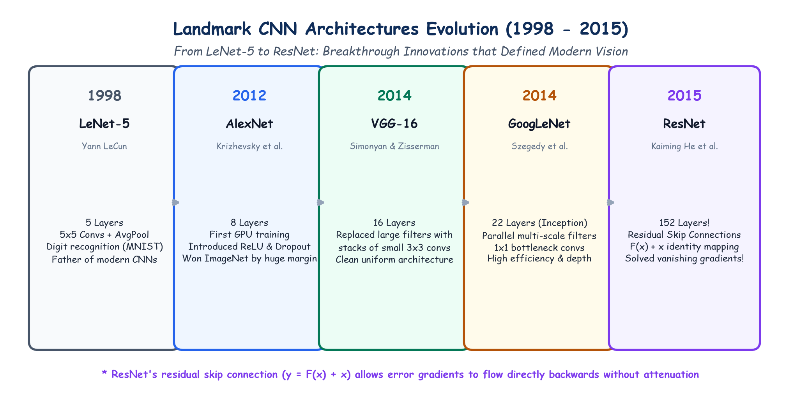

# Submodule 40.04: Landmark CNN Architectures: LeNet Se ResNet Tak (Hinglish Guide)

## 1. Deep Learning Ka Itihaas

Computer Vision ka modern revolution 5 sabse mashhoor architectures ki wajah se aaya:

```
1998            2012            2014            2014             2015
LeNet-5 ------> AlexNet ------> VGG-16 -------> GoogLeNet -----> ResNet
(Yann LeCun)    (Krizhevsky)    (Simonyan)      (Inception)      (Kaiming He)
```

---

## 2. In 5 Landmark Models Ki Mukhya Khoj

### 1. LeNet-5 (1998, Yann LeCun)
- **Kaam**: Duniya ka pehla safal CNN model jo US banks mein bank checks ke handwritten numbers (MNIST) padhne ke liye use hua.
- **Structure**: 2 Conv layers ($5 \times 5$) + Average Pooling + 2 Dense layers.

### 2. AlexNet (2012, Alex Krizhevsky & Geoffrey Hinton)
- **Deep Learning Ka Big Bang**: ImageNet competition ko 10% ke historic margin se jeeta.
- **Badi Inventions**:
  1. Pehli baar model ko **NVIDIA GPUs** par train kiya.
  2. Sigmoid ki jagah **ReLU** use kiya (jisse training $6\times$ tezz ho gayi).
  3. Overfitting rokne ke liye **Dropout ($p=0.5$)** invent kiya.

### 3. VGG-16 (2014, Oxford University)
- **$3 \times 3$ Factorization Rule**:
  - Bade filters ($5 \times 5$ ya $7 \times 7$) hata kar sirf chhote **$3 \times 3$ filters ke stacks** use kiye.
  - **Kyun behtar hai?**:
    Do $3 \times 3$ filters milkar ek $5 \times 5$ filter jitna area dekhte hain, lekin parameters **28% kam** lagte hain aur do baar ReLU lagne se non-linearity badh jati hai!

### 4. GoogLeNet / Inception (2014, Google)
- **Inception Module**: Multiple filter sizes ($1 \times 1, 3 \times 3, 5 \times 5$) ko alag-alag chunne ke bajaye parallel mein ek sath execute kiya aur unke outputs ko jod diya.
- Parameters ko kam rakhne ke liye **$1 \times 1$ Bottleneck Convolutions** use kiye.

### 5. ResNet (2015, Kaiming He - Microsoft Research)
- **Vanishing Gradients Ki Problem**:
  Jab network 50-100 layers lamba hota hai, toh backpropagation mein gradients multiply hote-hote zero ban jate hain (Vanishing Gradients).
- **ResNet Ka Solution: Skip Connection (Residual Highway)**:
  $$\mathbf{y} = \mathcal{F}(\mathbf{x}) + \mathbf{x}$$
  - Input $\mathbf{x}$ ko do layers ke upar se jump kara kar aage seedhe add kar diya jata hai.
  - Isse backpropagation ke dauran error gradients bina kisi attenuation ke seedhe pichli layers tak pahunchte hain.
  - Is invention ki wajah se **152 layers deep** network train ho paya aur isne pehli baar **Human Visual Accuracy (5%) ko maat de di (3.57% error)!**

---

## 3. Hand-Drawn Educational Diagram: Architectural Evolution

Neeche diya gaya student-style handwritten diagram in 5 landmark models ke timeline aur unki key innovations ko visualize karta hai:



---

## 4. Summary Table

| Model | Saal | Layers | Sabse Badi Khoj | Error Rate |
|---|---|---|---|---|
| **LeNet-5** | 1998 | 5 | Pehla CNN digit reader | MNIST |
| **AlexNet** | 2012 | 8 | GPU + ReLU + Dropout | 15.3% |
| **VGG-16** | 2014 | 16 | Small $3 \times 3$ filter stacks | 7.3% |
| **GoogLeNet**| 2014 | 22 | Multi-scale Inception modules | 6.7% |
| **ResNet** | 2015 | 152 | Residual Skip Connections ($F(x) + x$) | **3.57%** (Beats Humans!) |
