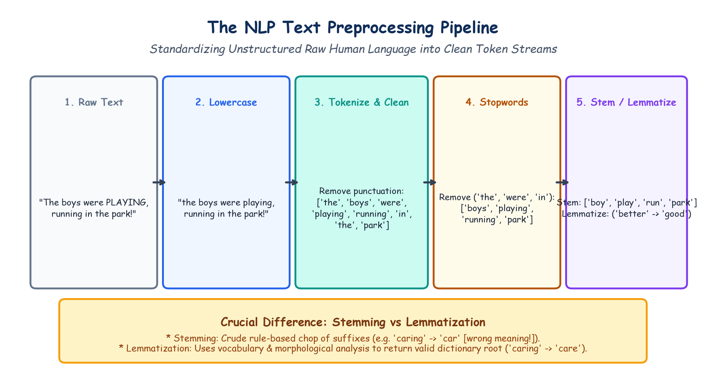

# Submodule 40.05: Foundations of Natural Language Processing (NLP) & Text Preprocessing

## 1. What is Natural Language Processing?

**Natural Language Processing (NLP)** is the subfield of Artificial Intelligence and Machine Learning focused on enabling computational systems to read, decipher, understand, and generate human languages.

Human language presents unique computational challenges distinct from images or tabular datasets:
- **Tabular Data**: Independent numerical coordinates.
- **Images**: Fixed 2D/3D grids with local spatial correlation.
- **Text**: Discrete, symbolic, variable-length sequences governed by linguistic grammar, syntax, cultural idiom, and contextual semantics.

```
+-------------------------------------------------------------+
|                     HUMAN LANGUAGE DUALITY                  |
+------------------------------+------------------------------+
| SYNTAX (Grammatical Form)    | SEMANTICS (Contextual Meaning)|
+------------------------------+------------------------------+
| Word order, part-of-speech,  | "The bank gave a loan"       |
| punctuation, morphology.     | vs "Sitting by river bank"   |
+------------------------------+------------------------------+
```

---

## 2. Why Computers Cannot Process Raw Text Directly

Computers perform mathematical operations (matrix multiplications, dot products). A word like `"elephant"` has no intrinsic numerical value, coordinate space, or distance metric.
To feed text into deep learning algorithms, unstructured strings must be systematically cleaned and mapped into **numerical vector spaces**.

---

## 3. The 5-Step Text Preprocessing Pipeline

Raw human text is inherently noisy, inconsistent, and unstructured. We clean and normalize it through a 5-step funnel:

```
[ Raw Human Text ]
       |
       v
1. Case Folding (Lowercasing)
       |
       v
2. Tokenization (Splitting into tokens)
       |
       v
3. Punctuation & Special Character Removal
       |
       v
4. Stopword Removal ("the", "is", "at")
       |
       v
5. Stemming or Lemmatization
       |
       v
[ Clean Normalized Tokens ]
```

### Step 1: Case Folding (Lowercasing)
Converts all characters to lowercase (`"Deep Learning"` $\to$ `"deep learning"`). Prevents the vocabulary from treating `"Apple"`, `"apple"`, and `"APPLE"` as three distinct independent words.

### Step 2: Tokenization
Splits a continuous stream of text into discrete linguistic units called **tokens**:
- **Word Tokenization**: `"I love AI"` $\to$ `['I', 'love', 'AI']`.
- **Sentence Tokenization**: Breaks long documents into individual sentence units.

### Step 3: Punctuation & Noise Removal
Strips punctuation marks (`!`, `?`, `,`, `.`), emojis, HTML tags, and non-alphanumeric symbols using regular expressions.

### Step 4: Stopword Removal
Filters out ubiquitous, high-frequency functional words that convey almost zero domain-specific topical semantics (e.g. `"the"`, `"is"`, `"at"`, `"which"`, `"on"`). In Python, standard stopword lists are provided by `nltk.corpus.stopwords`.

### Step 5: Morphological Normalization: Stemming vs Lemmatization

| Attribute | Stemming (e.g. Porter, Snowball) | Lemmatization (WordNet) |
|---|---|---|
| **Mechanism** | Crude heuristic truncation of prefixes/suffixes. | Full morphological & lexical analysis using a dictionary vocabulary. |
| **Output Validity**| Often produces non-words (e.g. `"studies"` $\to$ `"studi"`). | Always produces a valid dictionary base word (**lemma**). |
| **Context Aware** | NO (blindly strips characters). | YES (utilizes Part-of-Speech tags). |
| **Example 1** | `"caring"` $\to$ `"car"` *(Corrupts meaning!)* | `"caring"` $\to$ `"care"` *(Correct)* |
| **Example 2** | `"better"` $\to$ `"better"` | `"better"` (adj) $\to$ `"good"` *(True root)* |
| **Speed** | Extremely fast and lightweight. | Slower due to lexical lookups. |

---

## 4. Hand-Drawn Educational Diagram: The NLP Preprocessing Funnel

The following diagram demonstrates the step-by-step transformation of a noisy human sentence into clean, normalized word tokens.


