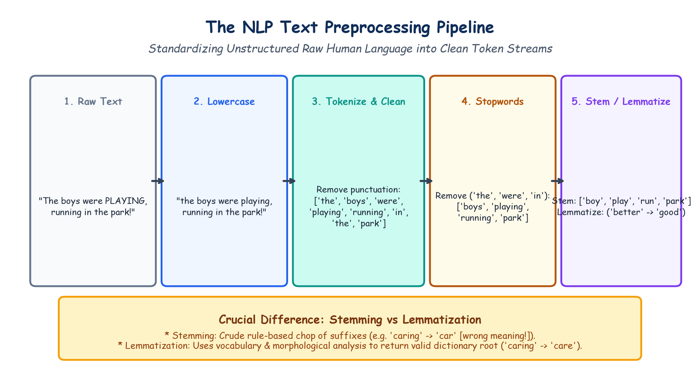

# Submodule 40.05: Natural Language Processing (NLP) aur Text Preprocessing (Hinglish Guide)

## 1. Natural Language Processing (NLP) Kya Hai?

**Natural Language Processing (NLP)** Artificial Intelligence ki woh branch hai jo computers ko insani bhasha (English, Hindi, etc.) padhne, samajhne, aur generate karne ki ability deti hai.

Images aur Tabular data ke mukable Text data alag hota hai:
- Photo mein pixels hote hain jinhe numbers mein naapa ja sakta hai.
- Lekin text ke andar **words discrete symbols hote hain**. Computer ko yeh nahi pata hota ki "Cat" aur "Dog" mein kya relation hai, ya "Bank" ka matlab paise jama karne wali jagah hai ya nadi ka kinara (River bank).

---

## 2. Text Preprocessing Ke 5 Mukhya Kadam

Computer ko text sikhane se pehle text ko clean karna padta hai:

```
[ Raw Uncleaned Text ]
       |
       v
1. Lowercasing (Sabhi letters ko chhota karna)
       |
       v
2. Tokenization (Shabdon ko alag-alag todna)
       |
       v
3. Punctuation Removal (Symbols hatana)
       |
       v
4. Stopwords Removal ('the', 'is', 'in' hatana)
       |
       v
5. Stemming ya Lemmatization (Root form nikalna)
       |
       v
[ Clean Words List ]
```

### 1. Lowercasing
Sabhi words ko chhota karna taaki `"Apple"`, `"apple"`, aur `"APPLE"` ko computer teen alag-alag words na samjhe.

### 2. Tokenization
Sentence ko shabdon ke tukdon mein todna:
`"I love AI"` $\to$ `['I', 'love', 'AI']`.

### 3. Punctuation Removal
Symbols (`!`, `?`, `,`, `.`) aur HTML tags ko hatana.

### 4. Stopwords Removal
Aise aam words jo bhasha mein baar-baar aate hain lekin unka koi khas matlab nahi hota (jaise `"is"`, `"the"`, `"at"`, `"which"`, `"on"`). Inhe hatane se data ka size kam hota hai.

### 5. Stemming vs Lemmatization (Root Word Nikalna)

| Feature | Stemming (Porter Stemmer) | Lemmatization (WordNet) |
|---|---|---|
| **Kaise Kaam Karta Hai?**| Shabdon ke aakhri letters ko bina soche kaat deta hai. | Dictionary aur grammar ke mutabiq asli root word nikalta hai. |
| **Output Word** | Aksar aadha-adhura word banta hai jo dictionary mein nahi hota (`"studies"` $\to$ `"studi"`). | Hamesha ek valid dictionary word banta hai (**Lemma**). |
| **Example 1** | `"caring"` $\to$ `"car"` *(Matlab hi badal gaya!)* | `"caring"` $\to$ `"care"` *(Bilkul sahi)* |
| **Example 2** | `"better"` $\to$ `"better"` | `"better"` $\to$ `"good"` *(Asli root)* |
| **Speed** | Bohot fast hota hai. | Thoda slow hota hai kyunki dictionary check karta hai. |

---

## 3. Hand-Drawn Educational Diagram: NLP Preprocessing Funnel

Neeche diya gaya student-style handwritten diagram raw text se lekar clean tokens tak ke preprocessing steps ko step-by-step darshata hai:


