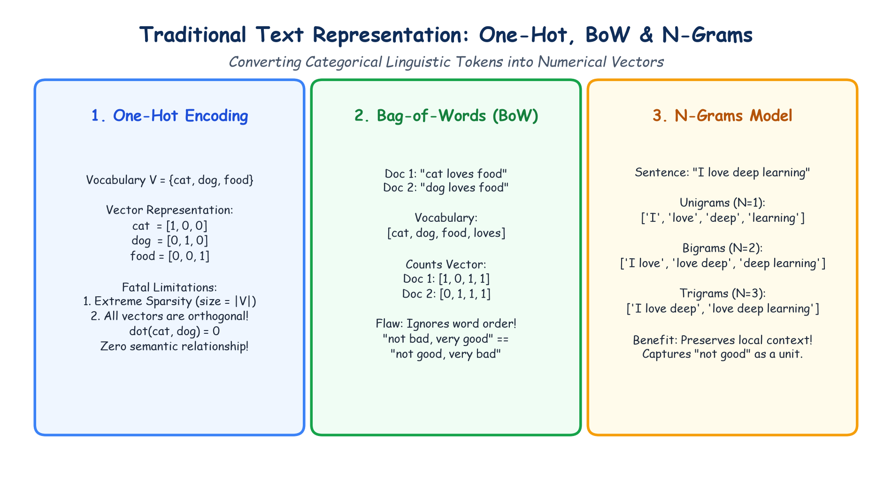

# Module 40.06: Text Representation: One-Hot Encoding, Bag-of-Words (BoW) & N-Grams

## 1. The Representation Bottleneck in Natural Language Processing

Machine learning algorithms and neural networks are fundamentally mathematical optimization engines operating on numerical vector spaces ($\mathbb{R}^d$). They cannot directly compute loss functions, matrix multiplications, or gradient updates on raw strings or characters. 

The central challenge of text representation is mapping discrete, variable-length, unstructured sequences of linguistic tokens into fixed-size, continuous or discrete numeric vectors while preserving semantic meaning, syntactic structure, and contextual relevance:

$$f: \mathcal{T}^* \to \mathbb{R}^d$$

where $\mathcal{T}^*$ represents the set of all possible sequences of tokens over a vocabulary $\mathcal{V}$, and $\mathbb{R}^d$ is a feature space of dimensionality $d$.

---

## 2. Notebook-Friendly Architecture Diagram



*Figure 40.06: Structural comparison of classical text vectorization methods: Sparse One-Hot vectors, Count-based Bag-of-Words Document-Term Matrices, and Context-Aware N-Gram feature representations.*

---

## 3. One-Hot Encoding of Words

### 3.1 Mathematical Definition
Let $\mathcal{V} = \{w_1, w_2, \dots, w_{|V|}\}$ be a fixed vocabulary of unique words sorted in arbitrary lexicographical order, where $|\mathcal{V}|$ represents the total vocabulary size. 

In **One-Hot Encoding**, each unique word $w_i$ is represented as an orthogonal, binary basis vector $\mathbf{e}_i \in \{0, 1\}^{|\mathcal{V}|}$, where exactly one entry is 1 (corresponding to the word's index $i$) and all other entries are 0:

$$\mathbf{e}_i[k] = \begin{cases} 1 & \text{if } k = i \\ 0 & \text{if } k \neq i \end{cases}$$

For example, given $\mathcal{V} = [\text{"cat"}, \text{"dog"}, \text{"food"}, \text{"likes"}]$:
- $\mathbf{v}_{\text{cat}} = [1, 0, 0, 0]^T$
- $\mathbf{v}_{\text{dog}} = [0, 1, 0, 0]^T$
- $\mathbf{v}_{\text{food}} = [0, 0, 1, 0]^T$
- $\mathbf{v}_{\text{likes}} = [0, 0, 0, 1]^T$

### 3.2 Critical Shortcomings
1. **Severe Sparsity & High Dimensionality:** In real-world English corpora, $|\mathcal{V}| \ge 50,000$ to $1,000,000$. A sentence of 20 words requires storing a matrix of size $20 \times 1,000,000$, where $99.999\%$ of values are zeros.
2. **Total Semantic Blindness (Orthogonality):** The dot product between any two distinct one-hot word vectors is strictly zero:
   $$\mathbf{e}_i \cdot \mathbf{e}_j = \mathbf{e}_i^T \mathbf{e}_j = 0 \quad (\forall i \neq j)$$
   Consequently, the cosine similarity between "cat" and "dog" is identically 0, identical to the similarity between "cat" and "refrigerator". One-hot vectors cannot measure semantic proximity.
3. **Out-of-Vocabulary (OOV) Inflexibility:** Any new word encountered at inference time has no assigned index and requires expanding the vector space dimension for all existing data.

---

## 4. Bag-of-Words (BoW) Model

### 4.1 Concept and Mechanics
The **Bag-of-Words (BoW)** model represents an entire document as a single vector of length $|\mathcal{V}|$, summarizing the frequency of each vocabulary word within that document. It discards word order and grammar, treating the document as an unordered collection ("bag") of tokens.

For a document $d$ and vocabulary $\mathcal{V}$:
$$\mathbf{v}_d = [c(w_1, d), c(w_2, d), \dots, c(w_{|V|}, d)]^T$$
where $c(w_i, d)$ is the count (raw term frequency) of word $w_i$ in document $d$.

### 4.2 Document-Term Matrix (DTM)
When applied across a corpus of $M$ documents, BoW produces a **Document-Term Matrix** $\mathbf{X} \in \mathbb{R}^{M \times |\mathcal{V}|}$, where row $i$ corresponds to document $d_i$ and column $j$ corresponds to word $w_j$:

$$\mathbf{X}_{i, j} = c(w_j, d_i)$$

#### Worked Numerical Example:
Consider a toy corpus of 3 documents:
- $D_1$: "Deep learning is deep."
- $D_2$: "Machine learning is powerful."
- $D_3$: "Deep machine models learn."

After lowercasing and tokenization, vocabulary $\mathcal{V}$ (alphabetical, size 7):
`['deep', 'is', 'learn', 'learning', 'machine', 'models', 'powerful']`

| Document | deep | is | learn | learning | machine | models | powerful |
| :--- | :---: | :---: | :---: | :---: | :---: | :---: | :---: |
| **$D_1$** | 2 | 1 | 0 | 1 | 0 | 0 | 0 |
| **$D_2$** | 0 | 1 | 0 | 1 | 1 | 0 | 1 |
| **$D_3$** | 1 | 0 | 1 | 0 | 1 | 1 | 0 |

### 4.3 Strengths & Weaknesses of BoW
- **Strengths:** Simple to compute, interpretable, effective baseline for topic modeling, spam detection, and linear classification (logistic regression, Naive Bayes).
- **Weaknesses:**
  - **Loss of Sequential Context:** "Not good, very bad" and "Not bad, very good" yield identical BoW representations despite opposite sentiments.
  - **Frequency Bias:** High-frequency functional words ("the", "is", "at") dominate the counts unless aggressive stopword filtering is applied.

---

## 5. N-Gram Language Modeling

### 5.1 Formal Definition
An **N-Gram** is a contiguous sequence of $n$ items (words or characters) extracted from a given window of text.
- $n = 1$: **Unigram** (standard BoW: individual words)
- $n = 2$: **Bigram** (word pairs: preserves immediate predecessor context)
- $n = 3$: **Trigram** (triplets: captures local idiomatic phrasing)
- $n \ge 4$: Higher-order N-grams

For a sentence consisting of $T$ words: $S = (w_1, w_2, \dots, w_T)$, the total number of extracted $n$-grams is:
$$N_{\text{grams}} = T - n + 1 \quad (\text{for } T \ge n)$$

### 5.2 Capturing Context & Negation
Consider the sentence: *"The food was not good."*
- **Unigrams ($n=1$):** `['the', 'food', 'was', 'not', 'good']` $\to$ contains "not" and "good" independently. A linear classifier might assign positive weight to "good".
- **Bigrams ($n=2$):** `['the food', 'food was', 'was not', 'not good']` $\to$ explicitly isolates the bigram `"not good"`, enabling the classifier to capture negation!

### 5.3 The Curse of Dimensionality in N-Grams
While N-grams preserve local context, their vocabulary size grows exponentially with $n$:
$$|\mathcal{V}_n| \le |\mathcal{V}_1|^n$$
For $|\mathcal{V}| = 10^5$, the theoretical number of bigrams is $10^{10}$, causing severe parameter explosion, memory strain, and extreme matrix sparsity ($> 99.9999\%$). In practice, practitioners restrict $n \in \{1, 2, 3\}$ and use `max_features` or frequency thresholds (`min_df`).

---

## 6. Hands-On Python Implementation

```python
import numpy as np
from sklearn.feature_extraction.text import CountVectorizer

corpus = [
    "Deep learning is deep.",
    "Machine learning is powerful.",
    "Deep machine models learn."
]

# 1. Standard Bag-of-Words (Unigrams)
bow_vectorizer = CountVectorizer()
X_bow = bow_vectorizer.fit_transform(corpus)

print("--- 1. Bag-of-Words (Unigrams) ---")
print("Vocabulary:", bow_vectorizer.get_feature_names_out())
print("DTM Matrix:\n", X_bow.toarray())

# 2. Bigrams & Unigrams Combined (ngram_range=(1, 2))
ngram_vectorizer = CountVectorizer(ngram_range=(1, 2), min_df=1)
X_ngram = ngram_vectorizer.fit_transform(corpus)

print("\n--- 2. Unigram + Bigram Representation ---")
print(f"Total Features: {len(ngram_vectorizer.get_feature_names_out())}")
print("Feature Names:", ngram_vectorizer.get_feature_names_out()[:8], "...")
print("Shape of DTM:", X_ngram.shape)
```

---

## 7. Comparative Summary of Classical Representations

| Representation | Vector Dimensionality | Sparsity | Word Order Preserved? | Captures Semantics? | Typical Applications |
| :--- | :--- | :--- | :--- | :--- | :--- |
| **One-Hot** | $|\mathcal{V}|$ per word | Extreme ($1$ non-zero) | No | No (Orthogonal) | Categorical variable encoding |
| **Bag-of-Words** | $|\mathcal{V}|$ per document | High ($>95\%$ zero) | No | No (Counts only) | Document classification, Naive Bayes |
| **N-Grams** | $|\mathcal{V}|^n$ per document | Ultra High ($>99.9\%$) | Local context ($n$ tokens) | Weak local context | Sentiment analysis, spell check |
