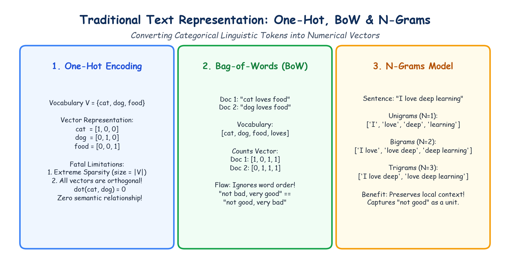

# Module 40.06 (Hinglish): Text Representation: One-Hot Encoding, Bag-of-Words (BoW) & N-Grams

## 1. Natural Language Processing me Text Representation ki Zarurat

Machine learning models aur neural networks numbers ke sath kaam karte hain. Wo direct text strings ya raw characters par matrix multiplication ya loss calculation perform nahi kar sakte. 

Isliye hamara primary objective text ko **numerical feature vectors** ($\mathbb{R}^d$) me convert karna hota hai:

$$f: \text{Raw Text} \to \text{Numerical Vector}$$

Is process ko **Text Representation** ya **Vectorization** kaha jata hai.

---

## 2. Notebook-Friendly Hand-Drawn Architecture Diagram



*Figure 40.06: Classical Text Representation techniques ka clear hand-drawn comparison: One-Hot sparse vectors, Bag-of-Words count matrix, aur N-Grams context modeling.*

---

## 3. One-Hot Encoding

### 3.1 Working Mechanism
Agar hamare paas ek vocabulary $\mathcal{V}$ hai jisme $|\mathcal{V}|$ unique words hain, toh har word ko ek binary vector diya jata hai jisme sirf ek position par 1 hota hai aur baaki sabhi positions par 0 hota hai:

$$\mathbf{v}_i = [0, 0, \dots, 1, \dots, 0]^T$$

Example: $\mathcal{V} = [\text{"cat"}, \text{"dog"}, \text{"food"}]$:
- `"cat"` $\to [1, 0, 0]$
- `"dog"` $\to [0, 1, 0]$
- `"food"` $\to [0, 0, 1]$

### 3.2 Limitations & Shortcomings
1. **Severe Sparsity:** Agar vocabulary size $50,000$ hai, toh har ek word ka vector $50,000$ dimension ka hoga jisme $49,999$ elements 0 honge. Isse RAM aur compute waste hota hai.
2. **Zero Semantic Relationship:** Kisi bhi do one-hot vectors ka dot product zero hota hai:
   $$\mathbf{v}_{\text{cat}} \cdot \mathbf{v}_{\text{dog}} = 0$$
   Model ke liye "cat" aur "dog" me utna hi distance hai jitna "cat" aur "airplane" me.
3. **Out-of-Vocabulary (OOV):** Naya word aane par pura vector dimension modify karna padta hai.

---

## 4. Bag-of-Words (BoW) Model

### 4.1 Concept
Bag-of-Words model me hum pura document ek single vector se represent karte hain jisme vocabulary ke har word ki **frequency count** store hoti hai. Yahan grammar aur sentence structure ko ignore kar diya jata hai (jaise words ko ek bag me daal kar mix kar diya ho).

$$\mathbf{X}_{i, j} = \text{Count of word } j \text{ in document } i$$

### 4.2 Document-Term Matrix (DTM) Example
Supposing hamare paas 3 sentences hain:
- $D_1$: "Deep learning is deep."
- $D_2$: "Machine learning is powerful."
- $D_3$: "Deep machine models learn."

Vocabulary: `['deep', 'is', 'learn', 'learning', 'machine', 'models', 'powerful']`

| Document | deep | is | learn | learning | machine | models | powerful |
| :--- | :---: | :---: | :---: | :---: | :---: | :---: | :---: |
| **$D_1$** | 2 | 1 | 0 | 1 | 0 | 0 | 0 |
| **$D_2$** | 0 | 1 | 0 | 1 | 1 | 0 | 1 |
| **$D_3$** | 1 | 0 | 1 | 0 | 1 | 1 | 0 |

**Problem:** 
- "Not good, very bad" aur "Not bad, very good" dono ka BoW vector bilkul identical banega jabki unka sentiment ek-dusre ke opposite hai! Word order lost ho jata hai.

---

## 5. N-Gram Representation

### 5.1 Definition & Types
Local context aur word order preserve karne ke liye hum consecutive $n$ words ka grouping banate hain:
- **Unigram ($n=1$):** Single words (`"deep"`, `"learning"`)
- **Bigram ($n=2$):** Two consecutive words (`"deep learning"`, `"machine learning"`)
- **Trigram ($n=3$):** Three consecutive words (`"artificial neural network"`)

### 5.2 Negation Handling
Sentence: *"The movie was not good."*
- Unigram me `"not"` aur `"good"` alag ho jate hain, jisse model confuse ho sakta hai.
- Bigram me `"not good"` ek single token banta hai, jisse negative sentiment clearly capture hota hai.

### 5.3 Drawback: Vocabulary Explosion
Jab $n$ badhta hai, toh possible combinations exponentially explode karte hain ($|\mathcal{V}|^n$). Isliye industry me generally Unigrams + Bigrams (`ngram_range=(1, 2)`) hi use kiye jaate hain.

---

## 6. Python Scikit-Learn Code Implementation

```python
from sklearn.feature_extraction.text import CountVectorizer

corpus = [
    "Deep learning is deep.",
    "Machine learning is powerful.",
    "Deep machine models learn."
]

# BoW (Unigrams)
cv = CountVectorizer()
X = cv.fit_transform(corpus)
print("Features:", cv.get_feature_names_out())
print("DTM:\n", X.toarray())

# Bigrams
cv_bi = CountVectorizer(ngram_range=(1, 2))
X_bi = cv_bi.fit_transform(corpus)
print("\nUnigram + Bigram Features Count:", len(cv_bi.get_feature_names_out()))
```
