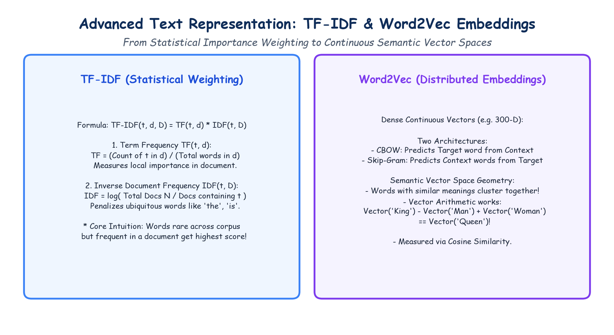

# Module 40.07: Advanced Text Representation: TF-IDF & Distributed Word Embeddings (Word2Vec)

## 1. Motivation: Moving Beyond Raw Term Frequencies

Classical Bag-of-Words representations suffer from a fundamental statistical flaw: **word frequency does not equate to informative significance**. In any natural language corpus, generic functional words ("the", "is", "which", "system") occur with high frequency across nearly all documents. Under BoW, these uninformative tokens receive the largest numerical weights, overshadowing rare, domain-specific keywords ("backpropagation", "convolution", "gradient").

To overcome this, natural language processing introduced two major breakthroughs:
1. **TF-IDF (Statistical Term Weighting):** Discounts universally common words while emphasizing distinctive, document-specific tokens.
2. **Distributed Word Embeddings (Word2Vec):** Learns dense, low-dimensional continuous vectors where semantic similarity corresponds to geometric proximity in vector space.

---

## 2. Notebook-Friendly Architecture Diagram



*Figure 40.07: Comprehensive hand-drawn educational visual: TF-IDF calculation mechanics vs Word2Vec dense geometric representations (CBOW and Skip-Gram architectures) with semantic vector arithmetic.*

---

## 3. TF-IDF (Term Frequency - Inverse Document Frequency)

### 3.1 Mathematical Formulation
TF-IDF assigns a weight to term $t$ in document $d$ proportional to its local frequency, penalized by its corpus-wide prevalence:

$$\text{TF-IDF}(t, d, D) = \text{TF}(t, d) \times \text{IDF}(t, D)$$

#### 1. Term Frequency (TF):
Measures how frequently term $t$ occurs in document $d$:
$$\text{TF}(t, d) = \frac{f_{t, d}}{\sum_{t' \in d} f_{t', d}}$$
where $f_{t, d}$ is the raw count of term $t$ in document $d$.

#### 2. Inverse Document Frequency (IDF):
Measures how much information term $t$ provides across the corpus $D$ of $N$ total documents:
$$\text{IDF}(t, D) = \log\left(\frac{N}{|\{d \in D : t \in d\}|}\right)$$

In Scikit-Learn, **smooth IDF** is implemented to prevent division by zero and ensure non-negative weights:
$$\text{IDF}_{\text{smooth}}(t) = \log\left(\frac{1 + N}{1 + \text{DF}(t)}\right) + 1$$
where $\text{DF}(t)$ is the document frequency of term $t$.

#### 3. Vector Normalization:
To prevent longer documents from having artificially inflated Euclidean lengths, the resulting TF-IDF vector $\mathbf{v}_d$ is $L_2$-normalized:
$$\mathbf{v}_{\text{norm}} = \frac{\mathbf{v}_d}{\|\mathbf{v}_d\|_2} = \frac{\mathbf{v}_d}{\sqrt{\sum_{k} v_{d, k}^2}}$$

### 3.2 Key Intuition of TF-IDF
- If a word appears frequently in **one document** but rarely across others (e.g., "PyTorch"), its TF is high, IDF is high $\to$ **High TF-IDF weight** (Highly Informative).
- If a word appears in **every document** (e.g., "data"), its TF may be high, but $\text{DF} \approx N \implies \text{IDF} \approx \log(1) = 0 \to$ **Near-zero TF-IDF weight** (Suppressed).

---

## 4. Distributed Word Embeddings & The Distributional Hypothesis

### 4.1 The Distributional Hypothesis
Formulated by linguist J.R. Firth (1957):
> *"You shall know a word by the company it keeps."*

Words that appear in similar textual contexts tend to have similar semantic meanings. Rather than representing words as isolated, orthogonal basis vectors ($[0, \dots, 1, \dots, 0]$), distributed representations map words to continuous vectors in $\mathbb{R}^d$ ($d \approx 100-300$), where semantic meaning is distributed across all dimensions.

---

## 5. Word2Vec: CBOW and Skip-Gram (Mikolov et al., 2013)

Word2Vec is a two-layer neural network architecture trained on an unlabelled text corpus to predict context words from center words or vice versa.

### 5.1 Continuous Bag-of-Words (CBOW)
- **Objective:** Predict the target center word $w_t$ given its surrounding context words within a sliding window of radius $c$:
  $$\{w_{t-c}, \dots, w_{t-1}, w_{t+1}, \dots, w_{t+c}\}$$
- **Mechanism:** Context word vectors are averaged, projected through a shared projection layer, and classified via softmax over vocabulary $\mathcal{V}$.
- **Performance:** Faster to train, slightly better accuracy on frequent words.

### 5.2 Continuous Skip-Gram
- **Objective:** Predict the surrounding context words given a single input center word $w_t$:
  $$\max \sum_{t=1}^T \sum_{-c \le j \le c, j \neq 0} \log P(w_{t+j} \mid w_t)$$
- **Mechanism:** Center word vector is multiplied by weight matrices to produce probability distributions for each context position.
- **Performance:** Slower to train than CBOW, but significantly better at capturing rare words and fine-grained semantic nuances.

### 5.3 Geometric Vector Space Properties
Word2Vec spaces exhibit linear algebraic properties:

#### 1. Semantic & Syntactic Vector Arithmetic:
$$\vec{v}_{\text{King}} - \vec{v}_{\text{Man}} + \vec{v}_{\text{Woman}} \approx \vec{v}_{\text{Queen}}$$
$$\vec{v}_{\text{Paris}} - \vec{v}_{\text{France}} + \vec{v}_{\text{Germany}} \approx \vec{v}_{\text{Berlin}}$$

#### 2. Cosine Similarity Metric:
Semantic closeness is measured using the cosine of the angle between two embedding vectors:
$$\text{Cosine Similarity}(\mathbf{u}, \mathbf{v}) = \frac{\mathbf{u} \cdot \mathbf{v}}{\|\mathbf{u}\|_2 \|\mathbf{v}\|_2} = \frac{\sum_{i=1}^d u_i v_i}{\sqrt{\sum_{i=1}^d u_i^2} \sqrt{\sum_{i=1}^d v_i^2}} \in [-1, 1]$$

---

## 6. Python Implementations: TF-IDF and Gensim Word2Vec

```python
# -------------------------------------------------------------
# Part 1: TF-IDF Vectorization with Scikit-Learn
# -------------------------------------------------------------
from sklearn.feature_extraction.text import TfidfVectorizer

docs = [
    "Convolutional neural networks classify images efficiently.",
    "Recurrent neural networks process sequential temporal data.",
    "Transformers and neural networks dominate modern AI."
]

tfidf = TfidfVectorizer()
X_tfidf = tfidf.fit_transform(docs)

print("TF-IDF Features:", tfidf.get_feature_names_out())
print("TF-IDF Array Shape:", X_tfidf.shape)

# -------------------------------------------------------------
# Part 2: Word2Vec Word Similarity with Gensim
# -------------------------------------------------------------
from gensim.models import Word2Vec

tokenized_sentences = [
    ["deep", "learning", "is", "a", "subset", "of", "machine", "learning"],
    ["neural", "networks", "are", "used", "in", "deep", "learning"],
    ["convolutional", "neural", "networks", "process", "images"],
    ["recurrent", "neural", "networks", "model", "sequential", "text"]
]

# Train Word2Vec Model (CBOW: sg=0, Skip-Gram: sg=1)
w2v_model = Word2Vec(
    sentences=tokenized_sentences,
    vector_size=50,
    window=3,
    min_count=1,
    sg=1,
    epochs=100
)

# Semantic similarity query
sim = w2v_model.wv.similarity("neural", "networks")
print(f"\nCosine Similarity between 'neural' and 'networks': {sim:.4f}")
print("Vector dimension for 'learning':", w2v_model.wv["learning"].shape)
```
