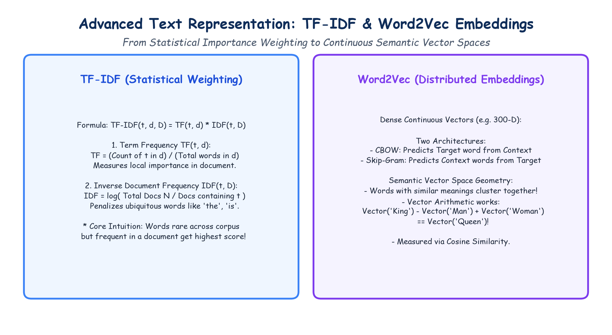

# Module 40.07 (Hinglish): Advanced Text Representation: TF-IDF & Distributed Word Embeddings (Word2Vec)

## 1. Classical Methods ki Kami aur Modern Approach

Bag-of-Words aur Count Vectors me sabse badi kami ye thi ki wo har word ko equal importance dete hain ya fir high frequency wale words ("the", "is", "a") sabse zyada weight le lete hain, jabki wo documents ko distinguish karne ke liye useless hote hain.

Is problem ko solve karne ke liye do critical concepts introduce hue:
1. **TF-IDF:** Statistical weighting jo common words ko suppress karti hai aur important keywords ko highlight karti hai.
2. **Word Embeddings (Word2Vec):** Dense continuous vectors ($\mathbb{R}^d$) jo words ke semantic meaning aur context ko geometric space me capture karte hain.

---

## 2. Notebook-Friendly Hand-Drawn Architecture Diagram

*Figure 40.07: Hand-drawn diagram explaining TF-IDF statistical weighting formula and Word2Vec continuous embedding geometry (CBOW vs Skip-Gram).*

---

## 3. TF-IDF Formula aur Mechanics

TF-IDF do components ka product hota hai:

$$\text{TF-IDF}(t, d) = \text{TF}(t, d) \times \text{IDF}(t)$$

### 1. Term Frequency (TF):
Word $t$ us specific document $d$ me kitni baar aaya hai:
$$\text{TF}(t, d) = \frac{\text{Count of } t \text{ in } d}{\text{Total words in } d}$$

### 2. Inverse Document Frequency (IDF):
Word $t$ pura corpus (saare documents) me kitna rare ya common hai:
$$\text{IDF}(t) = \log\left(\frac{N}{\text{Number of documents containing } t}\right)$$
- Agar koi word har document me hai (jaise "is", "the"), toh $\text{IDF} = \log(1) = 0 \implies \text{TF-IDF} = 0$.
- Agar koi word sirf 1 ya 2 specific documents me hai (jaise "backpropagation"), toh uska IDF bohot high hoga $\implies$ **High Importance Weight**!

---

## 4. Word2Vec: Dense Semantic Embeddings

### 4.1 One-Hot vs Word Embeddings
- **One-Hot:** Sparse, huge dimension ($50,000+$), orthogonal (no relationship, $\cos \theta = 0$).
- **Word Embeddings:** Dense, low dimension ($100$ to $300$), continuous real numbers. Semantically related words vector space me ek-dusre ke pass hote hain.

### 4.2 Word2Vec ke Do Models (Mikolov et al., 2013)
1. **CBOW (Continuous Bag-of-Words):**
   - Surrounding context words se target **center word predict** karta hai.
   - Faster training, frequent words par accha kaam karta hai.
2. **Skip-Gram:**
   - Single center word se aas-paas ke **context words predict** karta hai.
   - Rare words aur complex semantic relationships ke liye best hai.

### 4.3 Vector Math (Analogy)
Word2Vec space me linear arithmetic kaam karta hai:
$$\vec{\text{King}} - \vec{\text{Man}} + \vec{\text{Woman}} \approx \vec{\text{Queen}}$$

Dono vectors ke beech similarity measure karne ke liye **Cosine Similarity** use hoti hai:
$$\cos(\theta) = \frac{\mathbf{u} \cdot \mathbf{v}}{\|\mathbf{u}\| \|\mathbf{v}\|}$$
