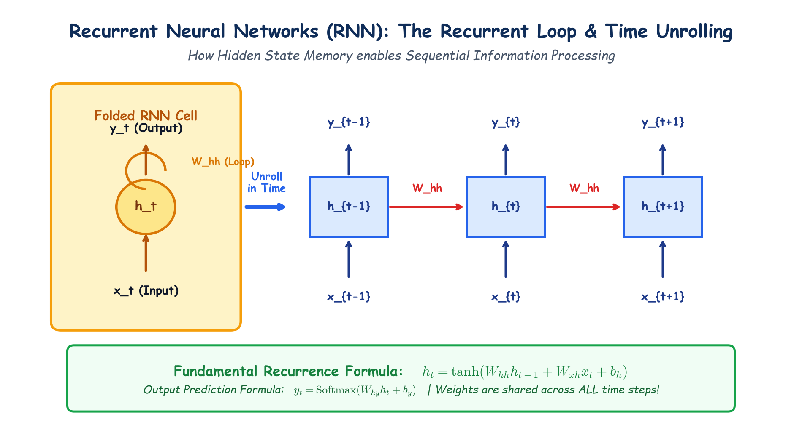

# Module 40.08: Recurrent Neural Networks (RNN): The Recurrent Loop & Time Unrolling

## 1. Why Feedforward Neural Networks Fail on Sequential Data

Standard Feedforward Neural Networks (MLPs) and Convolutional Neural Networks operate under two fundamental structural assumptions:
1. **Fixed-Size Inputs and Outputs:** Inputs $\mathbf{x} \in \mathbb{R}^{d_{\text{in}}}$ and outputs $\hat{\mathbf{y}} \in \mathbb{R}^{d_{\text{out}}}$ must have fixed spatial dimensions predetermined at model design time.
2. **Independent and Identically Distributed (I.I.D.) Assumption:** Samples are assumed to be statistically independent. The network has no temporal memory; processing sample $\mathbf{x}^{(i)}$ has zero influence on sample $\mathbf{x}^{(i+1)}$.

### The Sequential Data Challenge
Real-world sequential data violates both assumptions:
- **Variable Lengths:** Sentences, audio clips, video streams, stock prices, and sensor readings have varying temporal lengths $T$.
- **Temporal Order Matters:** The meaning of a sequence is strictly governed by order:
  $$\text{"Dog bites man"} \neq \text{"Man bites dog"}$$
- **Long-Term Temporal Dependencies:** A token at step $t=100$ may grammatically or semantically depend on step $t=1$ (e.g., subject-verb agreement across subordinate clauses).

---

## 2. Notebook-Friendly Architecture Diagram



*Figure 40.08: Structural diagram of an RNN neuron with self-recurrent feedback loop, unrolled across time steps $t-1, t, t+1$, showing parameter sharing ($W_{xh}, W_{hh}, W_{hy}$) and hidden state recurrence.*

---

## 3. The Recurrent Neuron & Time Unrolling

### 3.1 The Hidden State Recurrence
To handle sequences, an **RNN** introduces a recurrent feedback loop that maintains an internal memory called the **hidden state vector** $\mathbf{h}_t \in \mathbb{R}^{d_h}$. At each discrete time step $t \in \{1, 2, \dots, T\}$, the recurrent cell consumes two inputs:
1. The current external input token vector: $\mathbf{x}_t \in \mathbb{R}^{d_x}$
2. The previous hidden state vector: $\mathbf{h}_{t-1} \in \mathbb{R}^{d_h}$

### 3.2 Core Mathematical Formulation
The hidden state update and output prediction are governed by:

$$\mathbf{a}_t = \mathbf{W}_{xh} \mathbf{x}_t + \mathbf{W}_{hh} \mathbf{h}_{t-1} + \mathbf{b}_h$$

$$\mathbf{h}_t = \tanh(\mathbf{a}_t)$$

$$\hat{\mathbf{y}}_t = \operatorname{softmax}(\mathbf{W}_{hy} \mathbf{h}_t + \mathbf{b}_y) \quad \text{or} \quad \mathbf{W}_{hy} \mathbf{h}_t + \mathbf{b}_y$$

Where:
- $\mathbf{W}_{xh} \in \mathbb{R}^{d_h \times d_x}$: Weight matrix connecting current input to hidden state.
- $\mathbf{W}_{hh} \in \mathbb{R}^{d_h \times d_h}$: Recurrent weight matrix connecting previous hidden state to current hidden state.
- $\mathbf{W}_{hy} \in \mathbb{R}^{d_y \times d_h}$: Projection weight matrix connecting hidden state to output.
- $\mathbf{b}_h \in \mathbb{R}^{d_h}, \mathbf{b}_y \in \mathbb{R}^{d_y}$: Bias vectors.
- $\tanh(\cdot)$: Hyperbolic tangent activation function ensuring activations remain bounded within $(-1, 1)$.

### 3.3 The Principle of Parameter Sharing
A critical property of RNNs is that **the weight matrices ($\mathbf{W}_{xh}, \mathbf{W}_{hh}, \mathbf{W}_{hy}$) and biases ($\mathbf{b}_h, \mathbf{b}_y$) are strictly identical across all time steps $t$**. 
- The network does not learn new weights for step $t=10$ versus step $t=1$.
- This enables the model to generalize to arbitrary sequence lengths $T$ while keeping the parameter count independent of $T$.

---

## 4. Karpathy's Taxonomy of Sequence Architectures

RNNs provide flexible computational graphs adapted to diverse real-world tasks:

```
1. One-to-One     2. One-to-Many      3. Many-to-One      4. Many-to-Many (Sync)    5. Many-to-Many (Seq2Seq)
   [x] -> [y]        [x]                 [x1][x2][x3]        [x1]  [x2]  [x3]          [x1] [x2] [x3]
                      |                        \               |     |     |             |    |    |
                     [RNN] -> [y1][y2][y3]     [RNN] -> [y]   [RNN] [RNN] [RNN]         [Encoder RNN]
                                                               |     |     |                 |
                                                              [y1]  [y2]  [y3]          [Decoder RNN]
                                                                                             |    |    |
                                                                                            [y1] [y2] [y3]
```

1. **One-to-One:** Standard non-sequential feedforward mapping (e.g., Tabular classification).
2. **One-to-Many:** Single static input producing a sequential output (e.g., Image Captioning: Image $\to$ "A cat sitting on a mat").
3. **Many-to-One:** Variable-length sequence collapsed into a single decision vector (e.g., Sentiment Analysis, Video action classification).
4. **Many-to-Many (Synchronized):** Sequence in, sequence out with aligned temporal lengths $T_x = T_y$ (e.g., Part-of-Speech tagging, Named Entity Recognition, Frame-by-frame video segmentation).
5. **Many-to-Many (Seq2Seq / Encoder-Decoder):** Variable-length sequence in, different-length sequence out $T_x \neq T_y$ (e.g., Machine Translation: English $\to$ French; Speech Recognition, Text Summarization).

---

## 5. PyTorch Implementation of Vanilla RNN

```python
import torch
import torch.nn as nn

class VanillaRNNClassifier(nn.Module):
    def __init__(self, vocab_size, embed_dim, hidden_dim, output_dim):
        super(VanillaRNNClassifier, self).__init__()
        # Embedding layer: word index -> dense vector
        self.embedding = nn.Embedding(vocab_size, embed_dim)
        
        # Recurrent Layer: batch_first=True -> shape (Batch, Seq_Len, Dim)
        self.rnn = nn.RNN(
            input_size=embed_dim,
            hidden_size=hidden_dim,
            num_layers=1,
            nonlinearity='tanh',
            batch_first=True
        )
        
        # Fully connected readout head
        self.fc = nn.Linear(hidden_dim, output_dim)
        
    def forward(self, x):
        # x shape: (batch_size, seq_len)
        embedded = self.embedding(x)  # (batch_size, seq_len, embed_dim)
        
        # out: (batch_size, seq_len, hidden_dim)
        # h_n: (num_layers, batch_size, hidden_dim) - final hidden state
        out, h_n = self.rnn(embedded)
        
        # Many-to-One: take the final hidden state
        final_hidden = h_n.squeeze(0)  # (batch_size, hidden_dim)
        logits = self.fc(final_hidden) # (batch_size, output_dim)
        return logits

# Verification
model = VanillaRNNClassifier(vocab_size=1000, embed_dim=64, hidden_dim=128, output_dim=2)
dummy_seq = torch.randint(0, 1000, (4, 15)) # Batch=4, Sequence Length=15
logits = model(dummy_seq)
print("Output Logits Shape:", logits.shape) # torch.Size([4, 2])
```
