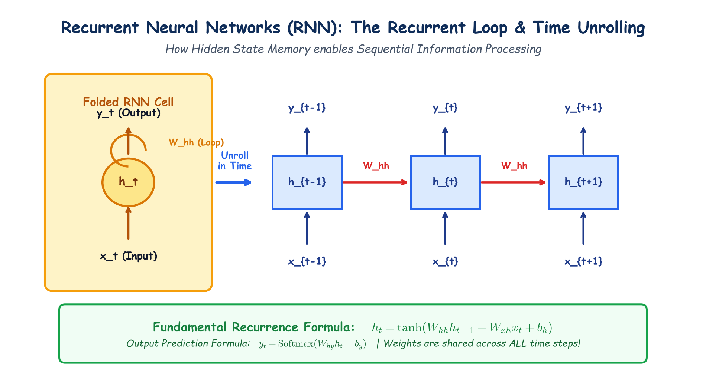

# Module 40.08 (Hinglish): Recurrent Neural Networks (RNN): The Recurrent Loop & Time Unrolling

## 1. Feedforward Networks Sequential Data par Fail Kyu Hote Hain?

Traditional Artificial Neural Networks (ANN/MLP) aur CNN do assumptions par kaam karte hain:
1. **Fixed Input/Output Size:** Network ko pehle se pata hona chahiye ki input kitne dimensions ka hai (jaise $32 \times 32$ image ya 10 tabular columns).
2. **Independence (No Memory):** Har sample ko independent maana jata hai. Step $t=1$ par kya hua, uska step $t=2$ se koi lena dena nahi hota.

Lekin real-world sequential data me:
- Sentences ki length variable hoti hai (kisi me 5 words, kisi me 25).
- **Words ka sequence bohot matter karta hai:** *"Dog bites man"* aur *"Man bites dog"* ka meaning completely different hai.
- Context aur memory ki sakht zarurat hoti hai.

---

## 2. Notebook-Friendly Hand-Drawn Architecture Diagram



*Figure 40.08: RNN ka feedback loop aur time ke saath unrolling ($t-1, t, t+1$). Parameter sharing ($W_{xh}, W_{hh}, W_{hy}$) visually clear notebook drawing style me.*

---

## 3. Recurrent Cell aur Time Unrolling ka Concept

### 3.1 Hidden State (Memory)
RNN me ek feedback connection hota hai jo purani information ko **Hidden State** ($\mathbf{h}_t$) ke roop me aage pass karta hai.

Har time step $t$ par RNN do cheezein leta hai:
1. Current word/token vector: $\mathbf{x}_t$
2. Pichle step ka hidden state: $\mathbf{h}_{t-1}$

### 3.2 Mathematical Formulas
$$\mathbf{h}_t = \tanh(\mathbf{W}_{xh} \mathbf{x}_t + \mathbf{W}_{hh} \mathbf{h}_{t-1} + \mathbf{b}_h)$$
$$\hat{\mathbf{y}}_t = \operatorname{softmax}(\mathbf{W}_{hy} \mathbf{h}_t + \mathbf{b}_y)$$

- $\mathbf{W}_{xh}$: Input to hidden weights
- $\mathbf{W}_{hh}$: Hidden to hidden recurrent weights (pichli memory process karne ke liye)
- $\mathbf{W}_{hy}$: Hidden to output weights
- $\tanh$: Activation function jo values ko $[-1, 1]$ ke beech bound rakhta hai.

### 3.3 Parameter Sharing
Sabse important point: **$\mathbf{W}_{xh}, \mathbf{W}_{hh}, \mathbf{W}_{hy}$ har time step par bilkul SAME rehte hain**. Model har word ke liye alag weights nahi seekhta, balki wahi same weights reuse karta hai, jisse model kitni bhi lambi sequence ko process kar sakta hai.

---

## 4. RNN ke 5 Major Sequence Types (Karpathy's Architecture)

1. **One-to-One:** Standard ANN (Image classification).
2. **One-to-Many:** Single Image input $\to$ Caption sequence output ("A dog running on grass").
3. **Many-to-One:** Sentence sequence input $\to$ Single sentiment output (Positive / Negative).
4. **Many-to-Many (Synchronized):** Same length sequence in and out (POS Tagging, Named Entity Recognition).
5. **Many-to-Many (Seq2Seq / Encoder-Decoder):** Different length in and out (Machine Translation: English sentence $\to$ Hindi sentence).

---

## 5. PyTorch Code Implementation

```python
import torch
import torch.nn as nn

# Simple Many-to-One RNN Model
class SentimentRNN(nn.Module):
    def __init__(self, vocab_size, embed_dim, hidden_dim, num_classes):
        super(SentimentRNN, self).__init__()
        self.embedding = nn.Embedding(vocab_size, embed_dim)
        self.rnn = nn.RNN(embed_dim, hidden_dim, batch_first=True)
        self.fc = nn.Linear(hidden_dim, num_classes)
        
    def forward(self, x):
        emb = self.embedding(x)          # (batch, seq_len, embed_dim)
        out, h_n = self.rnn(emb)         # h_n: final memory state
        logits = self.fc(h_n.squeeze(0)) # classify using final state
        return logits
```
