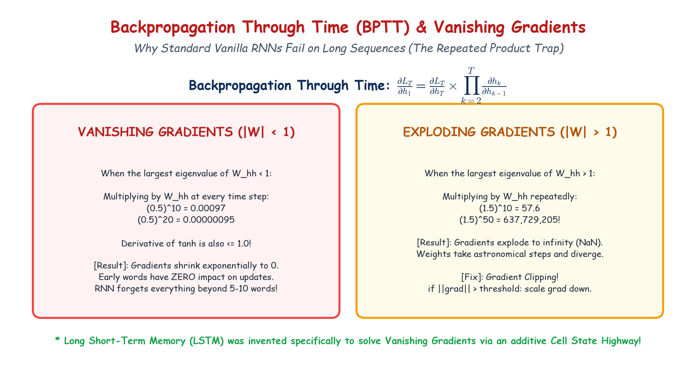

# Module 40.09: Backpropagation Through Time (BPTT), Vanishing & Exploding Gradients

## 1. Backpropagation Through Time (BPTT) Formulation

To optimize the shared parameter matrices ($\mathbf{W}_{xh}, \mathbf{W}_{hh}, \mathbf{W}_{hy}$) in an unrolled RNN, gradient descent requires calculating the partial derivatives of the cumulative temporal loss with respect to each weight matrix. This extension of the standard backpropagation algorithm across unrolled time steps is known as **Backpropagation Through Time (BPTT)**.

### 1.1 Total Cumulative Sequence Loss
For a sequence of length $T$, the total loss $\mathcal{L}$ is the sum of losses incurred at each individual step:
$$\mathcal{L} = \sum_{t=1}^T \mathcal{L}_t(\hat{\mathbf{y}}_t, \mathbf{y}_t)$$

### 1.2 Applying the Generalized Chain Rule
To calculate the gradient with respect to the recurrent weight matrix $\mathbf{W}_{hh}$, we observe that $\mathbf{W}_{hh}$ affects the loss at time $t$ through the sequence of preceding hidden states $\mathbf{h}_t, \mathbf{h}_{t-1}, \dots, \mathbf{h}_1$:

$$\frac{\partial \mathcal{L}}{\partial \mathbf{W}_{hh}} = \sum_{t=1}^T \frac{\partial \mathcal{L}_t}{\partial \mathbf{W}_{hh}}$$

Focusing on the loss at a specific time step $t$, the chain rule expands over all previous steps $k \le t$:
$$\frac{\partial \mathcal{L}_t}{\partial \mathbf{W}_{hh}} = \sum_{k=1}^t \frac{\partial \mathcal{L}_t}{\partial \mathbf{h}_t} \left( \frac{\partial \mathbf{h}_t}{\partial \mathbf{h}_k} \right) \frac{\partial \mathbf{h}_k}{\partial \mathbf{W}_{hh}}$$

where the intermediate temporal Jacobian product expands as:
$$\frac{\partial \mathbf{h}_t}{\partial \mathbf{h}_k} = \prod_{j=k+1}^t \frac{\partial \mathbf{h}_j}{\partial \mathbf{h}_{j-1}}$$

---

## 2. Notebook-Friendly Architecture Diagram



*Figure 40.09: Hand-drawn visual analysis of the BPTT computational chain: Jacobian multiplication decay causing Vanishing Gradients ($|\lambda| < 1$) and gradient explosion ($|\lambda| > 1$) with gradient clipping.*

---

## 3. The Mathematics of Vanishing and Exploding Gradients

### 3.1 The Hidden State Jacobian
Recall the hidden state update equation: $\mathbf{h}_j = \tanh(\mathbf{W}_{hh} \mathbf{h}_{j-1} + \mathbf{W}_{xh} \mathbf{x}_j + \mathbf{b}_h)$.
The Jacobian matrix of $\mathbf{h}_j$ with respect to $\mathbf{h}_{j-1}$ is given by:

$$\frac{\partial \mathbf{h}_j}{\partial \mathbf{h}_{j-1}} = \operatorname{diag}\left(1 - \mathbf{h}_j^2\right) \mathbf{W}_{hh}^T$$

where $\operatorname{diag}(1 - \mathbf{h}_j^2)$ is the derivative of the $\tanh$ activation function, bounded strictly between $0$ and $1$:
$$0 < \frac{d\tanh(z)}{dz} = 1 - \tanh^2(z) \le 1$$

### 3.2 The Product of $T-k$ Matrices
Substituting back into the long-range temporal gradient:
$$\frac{\partial \mathbf{h}_t}{\partial \mathbf{h}_k} = \prod_{j=k+1}^t \operatorname{diag}\left(1 - \mathbf{h}_j^2\right) \mathbf{W}_{hh}^T$$

Let $\lambda_{\max}$ be the largest eigenvalue (spectral radius) of $\mathbf{W}_{hh}$:

#### Case 1: The Vanishing Gradient Dilemma ($\lambda_{\max} < 1$)
Because the derivative of $\tanh$ is at most $1$ (and often significantly less than 1), if the spectral radius of $\mathbf{W}_{hh} < 1$:
$$\lim_{t - k \to \infty} \left\| \prod_{j=k+1}^t \frac{\partial \mathbf{h}_j}{\partial \mathbf{h}_{j-1}} \right\| \to 0$$
- **Consequence:** The gradient flowing backward from step $t$ decays exponentially fast as it travels back to step $k$. 
- For $t - k > 8-10$ steps, $\frac{\partial \mathcal{L}_t}{\partial \mathbf{h}_k} \approx \mathbf{0}$.
- **Practical Impact:** The network cannot learn long-term temporal dependencies. It acts like a "short-term memory" model that only remembers the last few tokens.

#### Case 2: The Exploding Gradient Dilemma ($\lambda_{\max} > 1$)
If the weights in $\mathbf{W}_{hh}$ are large such that $\lambda_{\max} > 1$:
$$\lim_{t - k \to \infty} \left\| \prod_{j=k+1}^t \frac{\partial \mathbf{h}_j}{\partial \mathbf{h}_{j-1}} \right\| \to \infty$$
- **Consequence:** Gradients grow exponentially large, resulting in massive weight updates that destabilize training, cause numerical overflow, and produce `NaN` weights.

---

## 4. Mitigation Strategies & Architectural Solutions

| Issue | Mitigation Technique | Operational Mechanism |
| :--- | :--- | :--- |
| **Exploding Gradients** | **Gradient Clipping** | Rescales the gradient vector if its $L_2$ norm exceeds a threshold $\theta$: $\mathbf{g} \leftarrow \theta \frac{\mathbf{g}}{\|\mathbf{g}\|_2}$ |
| **Vanishing Gradients** | **Truncated BPTT (TBPTT)** | Bounds backpropagation depth to a fixed window of $k_1$ steps rather than full sequence $T$ |
| **Both** | **Orthogonal Initialization** | Initializes $\mathbf{W}_{hh}$ with orthogonal matrices whose eigenvalues have absolute value exactly $1$ |
| **Fundamental Fix** | **Gated Architectures (LSTM / GRU)** | Introduces linear additive cell state pipelines and multiplicative gates to eliminate exponential decay |

---

## 5. PyTorch Gradient Clipping Implementation

```python
import torch
import torch.nn as nn

# Training loop step demonstrating Gradient Clipping
def train_step_with_clipping(model, optimizer, criterion, x_batch, y_batch, max_norm=1.0):
    model.train()
    optimizer.zero_grad()
    
    # Forward pass
    outputs = model(x_batch)
    loss = criterion(outputs, y_batch)
    
    # Backward pass (computes BPTT gradients)
    loss.backward()
    
    # -------------------------------------------------------------
    # Gradient Norm Clipping to prevent Exploding Gradients
    # -------------------------------------------------------------
    total_norm = torch.nn.utils.clip_grad_norm_(model.parameters(), max_norm=max_norm)
    
    # Optimizer step
    optimizer.step()
    
    return loss.item(), total_norm
```
