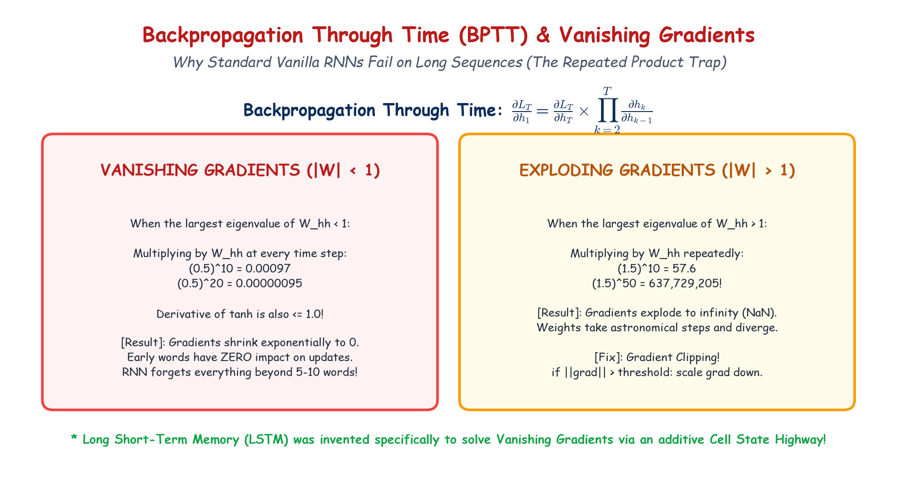

# Module 40.09 (Hinglish): Backpropagation Through Time (BPTT), Vanishing & Exploding Gradients

## 1. Backpropagation Through Time (BPTT) Kya Hai?

RNN me sequence ke har time step $t$ par predictions hoti hain aur errors generate hote hain. Saare time steps ke total loss ko minimize karne ke liye jab hum gradients ko unrolled time steps ke peeche propagate karte hain, toh is process ko **Backpropagation Through Time (BPTT)** kehte hain.

$$\mathcal{L}_{\text{total}} = \sum_{t=1}^T \mathcal{L}_t$$

Jab hum gradient $\frac{\partial \mathcal{L}_t}{\partial \mathbf{W}_{hh}}$ calculate karte hain, toh chain rule time step $t$ se step $1$ tak multiply hota jata hai:

$$\frac{\partial \mathbf{h}_t}{\partial \mathbf{h}_k} = \prod_{j=k+1}^t \frac{\partial \mathbf{h}_j}{\partial \mathbf{h}_{j-1}}$$

---

## 2. Notebook-Friendly Hand-Drawn Architecture Diagram

*Figure 40.09: BPTT chain rule visualization, Vanishing Gradient decay problem ($|\lambda| < 1$), Exploding Gradient problem ($|\lambda| > 1$), aur Gradient Clipping solution.*

---

## 3. Vanishing Gradient aur Exploding Gradient Problem

### 3.1 Vanishing Gradient Problem ($|\lambda| < 1$)
- $\tanh$ activation function ka derivative hamesha $0$ aur $1$ ke beech hota hai ($0 < \tanh' \le 1$).
- Agar weight matrix $\mathbf{W}_{hh}$ ke eigenvalues $1$ se chhote hain, toh baar-baar multiply hone par:
  $$0.8 \times 0.8 \times 0.8 \dots (20 \text{ times}) \approx 0.00115$$
- Gradient exponentially zero ki taraf shrink ho jata hai.
- **Natija:** Pehle ke time steps ($t=1, 2$) tak koi gradient nahi pahunchta. RNN puraane words ya long-term context ko **bhool jata hai** (Short-term memory loss).

### 3.2 Exploding Gradient Problem ($|\lambda| > 1$)
- Agar weights $1$ se bade hote hain, toh baar-baar multiply hone par gradient exponentially explode kar jata hai:
  $$1.5 \times 1.5 \times 1.5 \dots (20 \text{ times}) \approx 3325.2$$
- **Natija:** Gradients huge ban jate hain, weights unstable ho jate hain, aur training me `NaN` (Not a Number) error aa jata hai.

---

## 4. Solutions aur Fixes

### 1. Gradient Clipping (Exploding Gradients ka solution):
Agar gradient ka norm kisi threshold $\theta$ (jaise $1.0$ ya $5.0$) se bada ho jaye, toh use scale down kar diya jata hai:
$$\mathbf{g} \leftarrow \theta \frac{\mathbf{g}}{\|\mathbf{g}\|}$$
PyTorch me: `torch.nn.utils.clip_grad_norm_(model.parameters(), max_norm=1.0)`.

### 2. Gated Architectures (LSTM / GRU):
Vanishing gradient problem ko permanently solve karne ke liye **LSTM (Long Short-Term Memory)** aur **GRU** invent kiye gaye, jisme **linear additive cell state** use hota hai jisse gradients bina decay hue flow kar sakte hain.
