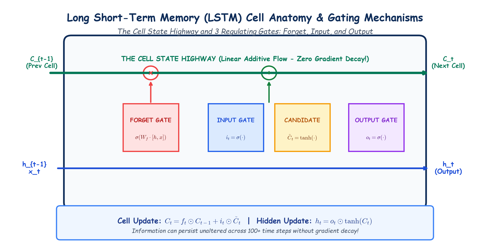

# Module 40.10: Long Short-Term Memory (LSTM) Networks: Cell State & Gating Architecture

## 1. The Architectural Breakthrough: Constant Error Carousel (CEC)

Introduced by Sepp Hochreiter and Jürgen Schmidhuber in 1997, the **Long Short-Term Memory (LSTM)** network fundamentally solved the vanishing gradient problem that cripples vanilla RNNs. 

The breakthrough insight of LSTM lies in separating memory storage from memory modification:
1. **Cell State ($\mathbf{C}_t$):** An internal, linear transmission highway (the "Constant Error Carousel") running directly across time steps with minimal non-linear interactions.
2. **Hidden State ($\mathbf{h}_t$):** The filtered, non-linear output vector exposed to external layers at time $t$.
3. **Multiplicative Gating Mechanism:** Three sigmoid-activated gates ($\sigma(z) \in [0, 1]$) that act as differential valves, dynamically deciding how much information to forget, write, and read.

---

## 2. Notebook-Friendly Architecture Diagram



*Figure 40.10: Detailed hand-drawn schematic of the internal LSTM cell architecture: Forget Gate, Input Gate & Candidate State, Linear Cell State Highway update, and Output Gate.*

---

## 3. Detailed Anatomy of the LSTM Cell

At each time step $t$, the LSTM cell receives three inputs:
- $\mathbf{x}_t \in \mathbb{R}^{d_x}$: Current input vector.
- $\mathbf{h}_{t-1} \in \mathbb{R}^{d_h}$: Previous hidden state vector (working memory).
- $\mathbf{C}_{t-1} \in \mathbb{R}^{d_h}$: Previous cell state vector (long-term memory highway).

It updates its state and emits two outputs ($\mathbf{C}_t, \mathbf{h}_t$) through 4 distinct computational stages:

```
                  [ C_{t-1} ] --------------------(x)----------------(+)---------------------> [ C_t ]
                                                   |                  ^
                                                   |                  |
                                                   |            [i_t] * [~C_t]
                                                   |                  |
                                                [ f_t ]               |
                                                   ^                  ^
                  [ h_{t-1} ] ---+                 |                  |                  [ o_t ] ---+
                                 |---> [concat] ---+------------------+---------------------+        |
                  [   x_t   ] ---+                                                                   |
                                                                                                     v
                                                                             tanh(C_t) -------------(x)
                                                                                                     |
                                                                                                     v
                                                                                                  [ h_t ]
```

---

## 4. Complete Mathematical Equations of the LSTM Cell

### Step 1: The Forget Gate ($\mathbf{f}_t$)
Decides what percentage of old information from the previous cell state $\mathbf{C}_{t-1}$ should be erased:
$$\mathbf{f}_t = \sigma\left(\mathbf{W}_f \cdot [\mathbf{h}_{t-1}, \mathbf{x}_t] + \mathbf{b}_f\right)$$
- If $\mathbf{f}_t[k] \approx 0$: Completely forget coordinate $k$.
- If $\mathbf{f}_t[k] \approx 1$: Completely retain coordinate $k$.

### Step 2: The Input Gate ($\mathbf{i}_t$) & Candidate Cell State ($\tilde{\mathbf{C}}_t$)
Decides what new information should be stored into the long-term memory:
1. **Input Gate Valve:** Determines which coordinates to update:
   $$\mathbf{i}_t = \sigma\left(\mathbf{W}_i \cdot [\mathbf{h}_{t-1}, \mathbf{x}_t] + \mathbf{b}_i\right)$$
2. **Candidate Values:** Generates new candidate memories scaled between $(-1, 1)$:
   $$\tilde{\mathbf{C}}_t = \tanh\left(\mathbf{W}_c \cdot [\mathbf{h}_{t-1}, \mathbf{x}_t] + \mathbf{b}_c\right)$$

### Step 3: Cell State Update ($\mathbf{C}_t$)
The old cell state is multiplied element-wise ($\odot$) by the forget gate and added to the scaled candidate values:
$$\mathbf{C}_t = \mathbf{f}_t \odot \mathbf{C}_{t-1} + \mathbf{i}_t \odot \tilde{\mathbf{C}}_t$$
> **Mathematical Insight:** Notice that this update is **linear and additive**! When backpropagating, $\frac{\partial \mathbf{C}_t}{\partial \mathbf{C}_{t-1}} = \mathbf{f}_t$. If the forget gate is near 1, gradients flow backward across hundreds of time steps without decaying!

### Step 4: The Output Gate ($\mathbf{o}_t$) & Hidden State Update ($\mathbf{h}_t$)
Decides what information from the updated cell state should be emitted as the working hidden state $\mathbf{h}_t$:
$$\mathbf{o}_t = \sigma\left(\mathbf{W}_o \cdot [\mathbf{h}_{t-1}, \mathbf{x}_t] + \mathbf{b}_o\right)$$
$$\mathbf{h}_t = \mathbf{o}_t \odot \tanh(\mathbf{C}_t)$$

---

## 5. Architectural Comparison: Vanilla RNN vs LSTM vs GRU

| Characteristic | Vanilla RNN | LSTM | GRU (Gated Recurrent Unit) |
| :--- | :--- | :--- | :--- |
| **Number of Gates** | 0 | 3 (Forget, Input, Output) | 2 (Reset, Update) |
| **Internal Memory States** | 1 ($\mathbf{h}_t$) | 2 ($\mathbf{C}_t$ Cell, $\mathbf{h}_t$ Hidden) | 1 ($\mathbf{h}_t$) |
| **Long-Term Dependency** | Poor ($<10$ steps) | Exceptional ($>1000$ steps) | Excellent ($>500$ steps) |
| **Parameter Count** | Smallest ($O(d^2)$) | $4 \times$ Vanilla RNN ($4 \times (d_h^2 + d_h d_x)$) | $3 \times$ Vanilla RNN ($3 \times (d_h^2 + d_h d_x)$) |
| **Training Speed** | Fastest | Computationally heavy | $\approx 25\%$ faster than LSTM |

---

## 6. PyTorch Implementation: Sequence Classification with LSTM

```python
import torch
import torch.nn as nn

class LSTMTextClassifier(nn.Module):
    def __init__(self, vocab_size, embed_dim, hidden_dim, num_classes, num_layers=2, dropout=0.2):
        super(LSTMTextClassifier, self).__init__()
        
        self.embedding = nn.Embedding(vocab_size, embed_dim)
        
        # PyTorch nn.LSTM handles all 4 gates internally
        self.lstm = nn.LSTM(
            input_size=embed_dim,
            hidden_size=hidden_dim,
            num_layers=num_layers,
            batch_first=True,
            dropout=dropout if num_layers > 1 else 0.0
        )
        
        self.dropout = nn.Dropout(dropout)
        self.fc = nn.Linear(hidden_dim, num_classes)
        
    def forward(self, x):
        # x shape: (batch_size, seq_len)
        embedded = self.dropout(self.embedding(x)) # (batch_size, seq_len, embed_dim)
        
        # out: (batch_size, seq_len, hidden_dim)
        # h_n, c_n: (num_layers, batch_size, hidden_dim)
        out, (h_n, c_n) = self.lstm(embedded)
        
        # Use top-layer final hidden state for sequence classification
        final_h = h_n[-1] # (batch_size, hidden_dim)
        logits = self.fc(self.dropout(final_h))
        return logits

# Verification
model = LSTMTextClassifier(vocab_size=5000, embed_dim=128, hidden_dim=256, num_classes=5)
dummy_batch = torch.randint(0, 5000, (8, 30)) # Batch=8, Sequence=30 words
logits = model(dummy_batch)
print("LSTM Output Logits Shape:", logits.shape) # torch.Size([8, 5])
```
