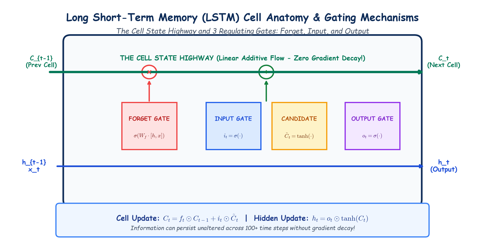

# Module 40.10 (Hinglish): Long Short-Term Memory (LSTM) Networks: Cell State & Gating Architecture

## 1. LSTM ki Khoj aur Need

Vanilla RNN ki sabse badi kami thi **Vanishing Gradient Problem**, jiski wajah se wo lambe sentences ya sequences ke pichle words ko bhool jata tha (short-term memory).

Is problem ko 1997 me **Sepp Hochreiter aur Jürgen Schmidhuber** ne solve kiya jab unhone **Long Short-Term Memory (LSTM)** introduce kiya.

LSTM ka core breakthrough tha:
1. **Cell State ($\mathbf{C}_t$):** Ek conveyor belt / highway jo lambe samay tak memory ko bina change kiye aage le jata hai.
2. **Gates:** 3 special gates jo decide karte hain ki kitni information retain karni hai, kitni add karni hai, aur kitni output karni hai.

---

## 2. Notebook-Friendly Hand-Drawn Architecture Diagram



*Figure 40.10: LSTM Cell ka complete internal architecture: Forget Gate, Input Gate, Candidate Memory, Cell State Highway, aur Output Gate ek clean hand-drawn visual style me.*

---

## 3. LSTM ke 3 Gates aur Step-by-Step Equations

LSTM cell ke andar 4 critical steps hote hain:

### Step 1: Forget Gate ($\mathbf{f}_t$) — Purani information kitni bhoolni hai?
Pichle hidden state $\mathbf{h}_{t-1}$ aur current input $\mathbf{x}_t$ ko dekh kar sigmoid function 0 se 1 ke beech value deta hai:
$$\mathbf{f}_t = \sigma(\mathbf{W}_f \cdot [\mathbf{h}_{t-1}, \mathbf{x}_t] + \mathbf{b}_f)$$
- Agar value $0$ aayi $\to$ Purani information ko completely bhool jao (forget).
- Agar value $1$ aayi $\to$ Purani information ko poora yaad rakho (retain).

### Step 2: Input Gate ($\mathbf{i}_t$) aur Candidate State ($\tilde{\mathbf{C}}_t$) — Nayi information kitni add karni hai?
1. **Input Gate:** Decide karta hai ki kin values ko update karna hai:
   $$\mathbf{i}_t = \sigma(\mathbf{W}_i \cdot [\mathbf{h}_{t-1}, \mathbf{x}_t] + \mathbf{b}_i)$$
2. **Candidate State:** Naye candidate memory vectors generate karta hai:
   $$\tilde{\mathbf{C}}_t = \tanh(\mathbf{W}_c \cdot [\mathbf{h}_{t-1}, \mathbf{x}_t] + \mathbf{b}_c)$$

### Step 3: Cell State Update ($\mathbf{C}_t$) — Long-Term Memory Update
Ab old cell state $\mathbf{C}_{t-1}$ ko forget gate se multiply karte hain aur nayi candidate memory add karte hain:
$$\mathbf{C}_t = \mathbf{f}_t \odot \mathbf{C}_{t-1} + \mathbf{i}_t \odot \tilde{\mathbf{C}}_t$$
**Important:** Yeh operation **linear aur additive** hai! Is wajah se gradient backpropagate hote waqt shrink nahi hota aur vanishing gradient problem khatam ho jati hai!

### Step 4: Output Gate ($\mathbf{o}_t$) aur Hidden State ($\mathbf{h}_t$) — Output kya dena hai?
Output gate decide karta hai ki cell state ka kaun sa hissa current output me dikhana hai:
$$\mathbf{o}_t = \sigma(\mathbf{W}_o \cdot [\mathbf{h}_{t-1}, \mathbf{x}_t] + \mathbf{b}_o)$$
$$\mathbf{h}_t = \mathbf{o}_t \odot \tanh(\mathbf{C}_t)$$

---

## 4. Summary Table: Vanilla RNN vs LSTM vs GRU

| Feature | Vanilla RNN | LSTM | GRU |
| :--- | :--- | :--- | :--- |
| **Total Gates** | 0 | 3 (Forget, Input, Output) | 2 (Reset, Update) |
| **Memory Pathways** | 1 ($\mathbf{h}_t$) | 2 ($\mathbf{C}_t$ Highway + $\mathbf{h}_t$) | 1 ($\mathbf{h}_t$) |
| **Vanishing Gradients?** | Severe | Solved completely | Solved completely |
| **Parameters** | Minimum | $4 \times$ Weights | $3 \times$ Weights |
| **Training Speed** | Fastest | Slowest | Fast ($\approx 25\%$ faster than LSTM) |

---

## 5. PyTorch LSTM Code Example

```python
import torch
import torch.nn as nn

class LSTMClassifier(nn.Module):
    def __init__(self, vocab_size, embed_dim, hidden_dim, num_classes):
        super(LSTMClassifier, self).__init__()
        self.embedding = nn.Embedding(vocab_size, embed_dim)
        # PyTorch handles all 3 gates automatically
        self.lstm = nn.LSTM(embed_dim, hidden_dim, batch_first=True)
        self.fc = nn.Linear(hidden_dim, num_classes)
        
    def forward(self, x):
        emb = self.embedding(x)
        # out: all hidden states, (h_n, c_n): final hidden and cell states
        out, (h_n, c_n) = self.lstm(emb)
        logits = self.fc(h_n[-1])
        return logits
```
