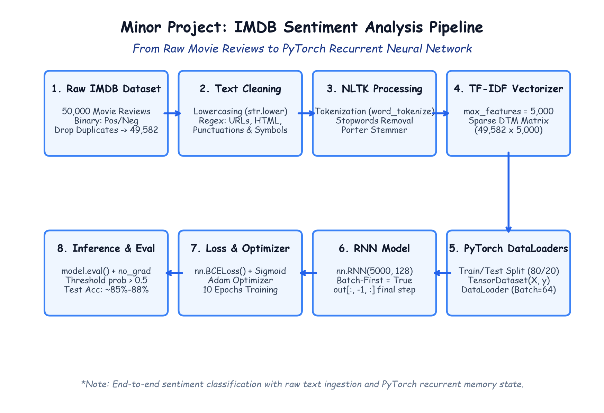

# Module 41.01: Minor Project: Sentiment Analysis on IMDB Reviews with PyTorch RNN

## 1. Project Overview & The Sentiment Classification Objective

Sentiment analysis is a fundamental problem in Natural Language Processing (NLP) where an automated model evaluates unstructured natural language text and determines the underlying emotional polarity or subjective opinion expressed by the author. In this comprehensive minor project, we design, build, optimize, and evaluate an end-to-end Deep Learning pipeline using a **PyTorch Recurrent Neural Network (RNN)** on the benchmark **IMDB Large Movie Review Dataset**.

$$\mathcal{D} = \{ (x^{(i)}, y^{(i)}) \}_{i=1}^{M}, \quad x^{(i)} \in \mathcal{T}^*, \quad y^{(i)} \in \{0, 1\}$$

Where:
- $x^{(i)}$ represents an arbitrary-length string sequence of characters and words (e.g., *"This movie had brilliant acting and stunning cinematography, a masterpiece!"*).
- $y^{(i)}$ represents the ground-truth binary sentiment label:
  - $y = 1$: **Positive Sentiment** (The author recommends or praises the movie).
  - $y = 0$: **Negative Sentiment** (The author criticizes or dislikes the movie).

---

## 2. Notebook-Friendly Architecture Diagram



*Figure 41.01: End-to-end engineering pipeline: Raw IMDB text reviews, Exploratory Data Analysis, Deduplication, Regex cleaning, NLTK tokenization & stopwords filtering, Porter Stemming, TF-IDF vectorization, PyTorch TensorDatasets, Recurrent Neural Network, BCELoss, Adam optimization, and inference.*

---

## 3. The 8-Stage NLP Deep Learning Pipeline

Building production-ready NLP systems requires an ordered multi-stage data processing and modeling workflow:

```
[Raw IMDB Reviews] 
       │
       ▼ (Stage 1: Exploratory Data Analysis & Deduplication)
[Nulls Verified (0), Duplicates Dropped: 50,000 -> 49,582 reviews]
       │
       ▼ (Stage 2: Lexical Normalization & Regex Preprocessing)
[Lowercased, URLs Stripped, HTML Tags Removed, Punctuations Cleaned]
       │
       ▼ (Stage 3: Tokenization & Linguistic Stopwords Removal)
[NLTK word_tokenize, English Stopwords Corpus Filtering (Zipf's Law)]
       │
       ▼ (Stage 4: Morphological Normalization - Porter Stemmer)
[Words Reduced to Base Stems: running -> run, wonderful -> wonder]
       │
       ▼ (Stage 5: Statistical Text Vectorization - TF-IDF)
[Top 5,000 Informative Vocabulary Features, Sparse-to-Dense Matrix]
       │
       ▼ (Stage 6: PyTorch Data Pipeline & Batching)
[Train/Test Split (80/20), TensorDataset, DataLoader (Batch Size = 64)]
       │
       ▼ (Stage 7: Recurrent Neural Network Modeling)
[nn.RNN(5000, 128) -> Final Timestep Hidden State out[:, -1, :] -> Linear(128, 1)]
       │
       ▼ (Stage 8: Binary Cross-Entropy Optimization & Evaluation)
[nn.BCELoss(), Adam Optimizer, 10 Epochs Training, Test Accuracy ~85%-88%]
```

---

## 4. Exploratory Data Analysis (EDA) & Data Ingestion

The benchmark IMDB dataset contains $50,000$ movie reviews. Prior to applying machine learning transformations, we inspect data integrity, verify class balance, and eliminate duplicate records.

```python
import pandas as pd

# Load dataset
df = pd.read_csv("IMDB Dataset.csv")
print("Initial Dataset Shape:", df.shape)  # (50000, 2)
print("Columns:", df.columns.tolist())     # ['review', 'sentiment']

# 1. Inspect Class Distribution
print("\nClass Distribution:")
print(df["sentiment"].value_counts())
# positive: 25,000 | negative: 25,000 (Perfect 50/50 balance)

# 2. Check for Missing / Null Values
null_count = df.isnull().sum()
print("\nMissing Values per Column:\n", null_count)
# review: 0, sentiment: 0 (No imputation needed)

# 3. Deduplication
initial_count = len(df)
df.drop_duplicates(inplace=True)
final_count = len(df)
print(f"\nDuplicates Dropped: {initial_count - final_count}") # 418 duplicates
print(f"Remaining Clean Samples: {final_count}")              # 49,582 reviews
```

### Why Deduplication is Crucial:
If duplicate reviews exist across both training and test partitions (data leakage), the model will memorize verbatim strings rather than learning generalizable linguistic semantic patterns, artificially inflating test metrics. Dropping duplicates ensures valid generalization testing.

---

## 5. Summary of Project Pipeline Deliverables

| Pipeline Phase | Primary Objective | Libraries / Modules Used | Key Code Reference |
| :--- | :--- | :--- | :--- |
| **Data Ingestion** | Load 50K reviews, deduplicate to 49,582 | `pandas` | `df.drop_duplicates(inplace=True)` |
| **Noise Cleaning** | Strip URLs, HTML tags, special symbols | `re` (Regex) | `re.sub(r'http\S+', '', text)` |
| **Linguistic Filtering**| Tokenize words, drop English stopwords | `nltk` (`punkt`, `stopwords`) | `nltk.download('stopwords')` |
| **Stemming** | Reduce words to root stems | `nltk.stem.PorterStemmer` | `ps.stem(token)` |
| **Vectorization** | Extract 5,000 TF-IDF statistical features | `sklearn.feature_extraction.text` | `TfidfVectorizer(max_features=5000)` |
| **DataLoaders** | Convert dense arrays to PyTorch batches | `torch.utils.data` | `DataLoader(train_set, batch_size=64)` |
| **RNN Model** | Recurrent hidden state loop + Linear head | `torch.nn` | `nn.RNN(5000, 128, batch_first=True)` |
| **Optimization** | Minimize Binary Cross-Entropy via Adam | `torch.optim.Adam`, `nn.BCELoss` | `loss.backward()`, `optimizer.step()` |
