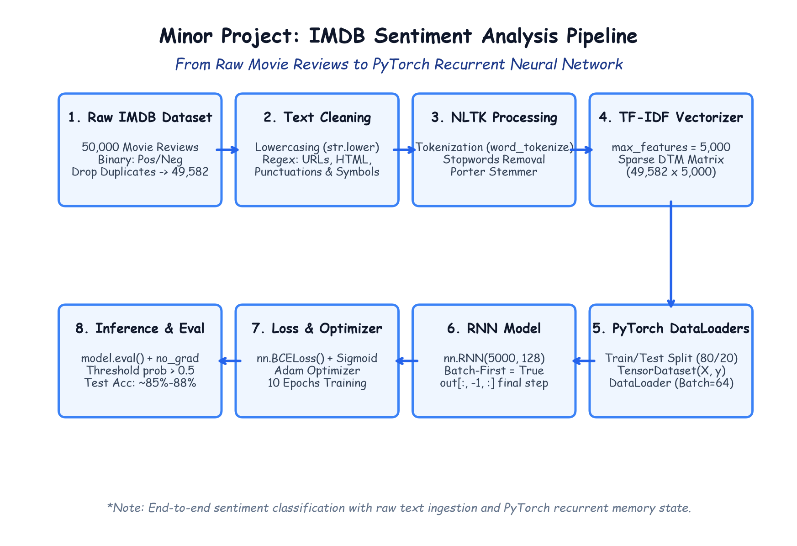

# Module 41.01 (Hinglish): Minor Project: Sentiment Analysis on IMDB Reviews with PyTorch RNN

## 1. Project Overview aur Sentiment Analysis ka Objective

Sentiment Analysis Natural Language Processing (NLP) ka ek classic aur essential task hai. Isme model raw text review ko read karke yeh decide karta hai ki review likhne wale ka sentiment **Positive** hai ya **Negative**. 

Is minor project me hum benchmark **IMDB Movie Reviews Dataset** par ek end-to-end Deep Learning system develop karenge jisme text preprocessing, feature vectorization, PyTorch DataLoaders, aur **Recurrent Neural Network (RNN)** ka pura workflow scratch se implemented hoga.

$$\mathcal{D} = \{ (x^{(i)}, y^{(i)}) \}, \quad y \in \{0 (\text{Negative}), 1 (\text{Positive})\}$$

---

## 2. Notebook-Friendly Hand-Drawn Architecture Diagram



*Figure 41.01: IMDB Sentiment Analysis ka complete pipeline: Raw text ingestion, Exploratory Data Analysis, Deduplication, Regex cleaning, NLTK stopwords removal, Porter Stemming, TF-IDF vectorization, PyTorch DataLoaders, RNN model architecture, BCELoss, aur live evaluation.*

---

## 3. Pura NLP Deep Learning Pipeline 8 Steps Me

1. **Data Ingestion & EDA:** 50,000 reviews load karna, null values check karna, aur duplicates drop karna ($50,000 \to 49,582$).
2. **Text Normalization:** Sabhi reviews ko lowercase me convert karna taaki "Great", "GREAT", "great" same maane jayein.
3. **Regex Noise Removal:** Web links (`http...`), HTML tags (`<br />`), aur extra punctuations (`!`, `?`, `#`) ko clean karna.
4. **Tokenization & Stopwords:** NLTK se sentence ko individual words me todna aur common words ("the", "is", "at") ko filter karna.
5. **Stemming:** Porter Stemmer se words ko root form me convert karna (`running` $\to$ `run`, `wonderful` $\to$ `wonder`).
6. **TF-IDF Vectorization:** Text ko 5,000 dimensional numerical vectors me convert karna (`max_features=5000`).
7. **PyTorch TensorDataset & DataLoader:** Data ko train/test split (80/20) karke 64 batch size ke mini-batches banana.
8. **RNN Training & Evaluation:** `nn.RNN(5000, 128)` train karna, `BCELoss` aur Adam optimizer use karke $\approx 85\%-88\%$ test accuracy achieve karna.

---

## 4. Exploratory Data Analysis (EDA) Code

```python
import pandas as pd

# Dataset load karna
df = pd.read_csv("IMDB Dataset.csv")
print("Dataset Shape:", df.shape) # (50000, 2)

# 1. Class distribution check karna
print(df["sentiment"].value_counts())
# positive: 25000, negative: 25000 (Perfect balanced dataset)

# 2. Null values check karna
print("Null count:\n", df.isnull().sum()) # Zero missing values

# 3. Duplicate values drop karna
df.drop_duplicates(inplace=True)
print("Deduplicated Shape:", df.shape) # (49582, 2)
```

**Deduplication kyu zaroori hai?**
Agar train set aur test set me same movie review repeat ho gaya, toh model use memorize (overfit) kar lega aur test accuracy fake high dikhayega. Duplicate drop karne se model ka real generalization test hota hai.
