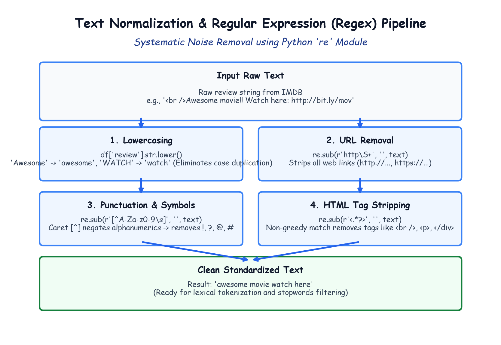

# Module 41.02: Text Normalization & Regex Preprocessing (Case Folding, URLs, Punctuations & HTML)

## 1. The Critical Need for Text Normalization

Real-world text scraped from web platforms (such as movie reviews on IMDB, tweets, or forum discussions) is rife with non-semantic noise:
- Hyperlinks and advertising URLs (`http://...`, `https://...`)
- Web markup artifacts (`<br />`, `<p>`, `</div>`)
- Special symbols, emoticons, and excessive punctuation marks (`!!!`, `???`, `***`)
- Arbitrary casing variations (`"EXCELLENT"`, `"Excellent"`, `"excellent"`)

If raw text is passed directly to vectorizers without cleaning:
1. Every casing variation is treated as an entirely separate vocabulary coordinate in $\mathbb{R}^d$, diluting term frequency statistics.
2. Web URLs and HTML syntax create thousands of meaningless unique tokens, causing vocabulary bloat and memory exhaustion.
3. Punctuation glued to words (`"movie!"` vs `"movie"`) prevents tokens from matching identical semantic roots.

---

## 2. Notebook-Friendly Architecture Diagram



*Figure 41.02: Step-by-step cleaning flow using Python's 're' module: Lowercasing, URL removal, caret negation punctuation stripping, and non-greedy HTML tag extraction.*

---

## 3. Case Folding (Lowercasing)

The simplest yet most impactful normalization step is converting all text characters to lowercase:

$$\text{toLowerCase}: s \mapsto s' \quad \text{where } \forall c \in s, \ c' = \operatorname{lower}(c)$$

In Python with Pandas:
```python
df["review"] = df["review"].str.lower()
```
- *"Great plot and AMAZING acting"* $\implies$ *"great plot and amazing acting"*.
- Eliminates duplicate vocabulary entries for identical words with different letter cases.

---

## 4. Regular Expressions (Regex) with Python `re` Module

The Python standard library `re` provides high-performance regular expression matching and substitution via `re.sub(pattern, replacement, string)`.

### 4.1 Removing Web URLs (`re.sub(r"http\S+", "", text)`)
Web links provide zero sentiment information about the movie and contain unique hashes that corrupt vocabulary statistics.

```python
import re

def remove_urls(text):
    # Pattern: 'http' followed by one or more non-whitespace characters (\S+)
    return re.sub(r"http\S+", "", text)

df["review"] = df["review"].apply(remove_urls)
```
- **Regex Syntax Breakdown:**
  - `http`: Matches the literal string "http" (matching both "http://" and "https://").
  - `\S`: Special regex escape character matching any **non-whitespace** character (letters, numbers, slashes, dots).
  - `+`: Greedy quantifier meaning *"one or more occurrences"*.
  - Matches until the first whitespace (space, tab, or newline) is encountered.

---

### 4.2 Removing HTML Markup Tags (`re.sub(r"<.*?>", "", text)`)
The IMDB dataset frequently contains `<br />` line breaks and `<p>` paragraph formatting tags.

```python
def remove_html(text):
    # Pattern: '<' followed by any characters lazily (*?) ending with '>'
    return re.sub(r"<.*?>", "", text)

df["review"] = df["review"].apply(remove_html)
```
- **Regex Syntax Breakdown:**
  - `<`: Matches opening angle bracket.
  - `.`: Matches any character except newline.
  - `*?`: **Non-greedy (lazy) quantifier**. Matches the minimum number of characters required to satisfy the closing bracket `>`.
  > **Crucial Warning:** If you use greedy `re.sub(r"<.*>", "", text)`, a string like `<br />Good movie<br />` will match from the first `<` to the very last `>`, accidentally deleting the entire text *"Good movie"*! The `?` makes it non-greedy.

---

### 4.3 Removing Punctuations & Special Characters (`re.sub(r"[^A-Za-z0-9\s]", "", text)`)
Punctuation characters (`!`, `?`, `$`, `@`, `#`, `%`, `*`, `(`, `)`) add dimensionality without aiding linear TF-IDF vectorization.

```python
def remove_punctuations(text):
    # Pattern: Any character NOT in A-Z, a-z, 0-9, or whitespace (\s)
    return re.sub(r"[^A-Za-z0-9\s]", "", text)

df["review"] = df["review"].apply(remove_punctuations)
```
- **Regex Syntax Breakdown:**
  - `[...]`: Character class matching any single character inside the brackets.
  - `^`: **Caret Negation Operator**. When placed as the very first character inside `[...]`, it inverts the match to *"any character NOT in this set"*.
  - `A-Za-z`: All uppercase and lowercase English alphabets.
  - `0-9`: All numeric digits.
  - `\s`: All whitespace characters (spaces, tabs, newlines).
  - Substitution: Any symbol not in this set is replaced with an empty string `""`.

---

## 5. End-to-End Cleaning Verification

```python
sample_raw = "<br />This movie was AMAZING!!! Check trailer: http://bit.ly/mov123 #BestFilm"

clean = sample_raw.lower()
clean = remove_urls(clean)
clean = remove_html(clean)
clean = remove_punctuations(clean)

print("Before:", sample_raw)
print("After: ", clean.strip())
# Output: 'this movie was amazing check trailer  bestfilm'
```
