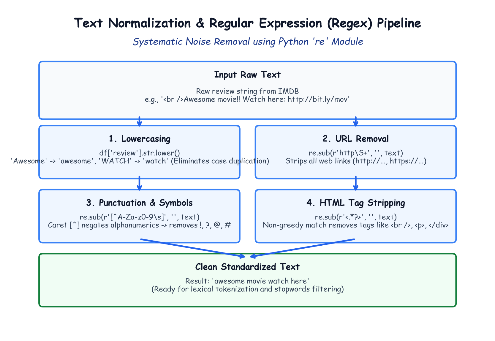

# Module 41.02 (Hinglish): Text Normalization & Regex Preprocessing (Case Folding, URLs, Punctuations & HTML)

## 1. Text Normalization Kyu Zaroori Hai?

Jab hum internet (IMDB, Twitter, YouTube comments) se raw text collect karte hain, toh usme bohot sara noise hota hai:
- Website URLs (`http://google.com`, `https://...`)
- HTML tags (`<br />`, `<p>`, `</div>`)
- Special symbols aur excessive punctuation marks (`!!!`, `???`, `@`, `#`)
- Capital vs small letters (`"Good"`, `"GOOD"`, `"good"`)

Agar is raw text ko bina clean kiye neural network me bhejenge toh:
1. Model "Good" aur "good" ko do completely alag words samjhega.
2. Web links aur HTML tags se hazaron useless tokens vocabulary me jud jayenge.
3. Memory waste hogi aur training accuracy drop karegi.

---

## 2. Notebook-Friendly Hand-Drawn Architecture Diagram



*Figure 41.02: Python `re` module se step-by-step cleaning: Lowercasing, URLs stripping, caret negation se punctuation hatana, aur non-greedy HTML tag extraction.*

---

## 3. Step 1: Lowercasing (str.lower)

Sabse pehla aur standard step:
```python
df["review"] = df["review"].str.lower()
```
- `"Awesome MOVIE!"` $\implies$ `"awesome movie!"`
- Isse case sensitivity ka issue solve ho jata hai.

---

## 4. Step 2: Regular Expressions (Regex) se Cleaning

Python ki standard library `import re` me `re.sub(pattern, replacement, string)` function use hota hai jo pattern match hone par text ko replace karta hai.

### 4.1 URLs Remove Karna (`http\S+`)
Movie reviews ke beech me jo links hote hain unka sentiment se koi lena dena nahi hota.
```python
import re

def remove_urls(text):
    # http ke baad jab tak non-whitespace (\S+) mile, sabko hata do
    return re.sub(r"http\S+", "", text)

df["review"] = df["review"].apply(remove_urls)
```
- `http`: matches "http" ya "https".
- `\S`: Non-whitespace characters (letters, numbers, slashes).
- `+`: One or more characters.

---

### 4.2 HTML Tags Remove Karna (`<.*?>`)
IMDB dataset me line breaks ke liye `<br />` aur `<p>` tags bohot aate hain.
```python
def remove_html(text):
    return re.sub(r"<.*?>", "", text)

df["review"] = df["review"].apply(remove_html)
```
- `<`: Opening tag.
- `.` : Any character.
- `*?`: **Non-greedy match**. Yeh pehle aane wale `>` par stop ho jata hai.
- **Important:** Agar `?` nahi lagayenge toh greedy matching ho jayegi aur pure sentence ka beech ka saara text delete ho sakta hai!

---

### 4.3 Punctuations & Special Symbols Remove Karna (`[^A-Za-z0-9\s]`)
Exclamation marks (`!`), question marks (`?`), brackets, aur hashtags hatane ke liye:
```python
def remove_punctuations(text):
    # Caret [^] ka matlab hai: A-Z, a-z, 0-9 aur space (\s) ko CHHODKAR baaki sab hata do
    return re.sub(r"[^A-Za-z0-9\s]", "", text)

df["review"] = df["review"].apply(remove_punctuations)
```
- `^` at start of `[...]`: Negation operator (jo set me nahi hai use match karo).
- `A-Za-z0-9`: Normal alphanumeric characters preserve hote hain.
- `\s`: Normal spaces preserve rehte hain.
