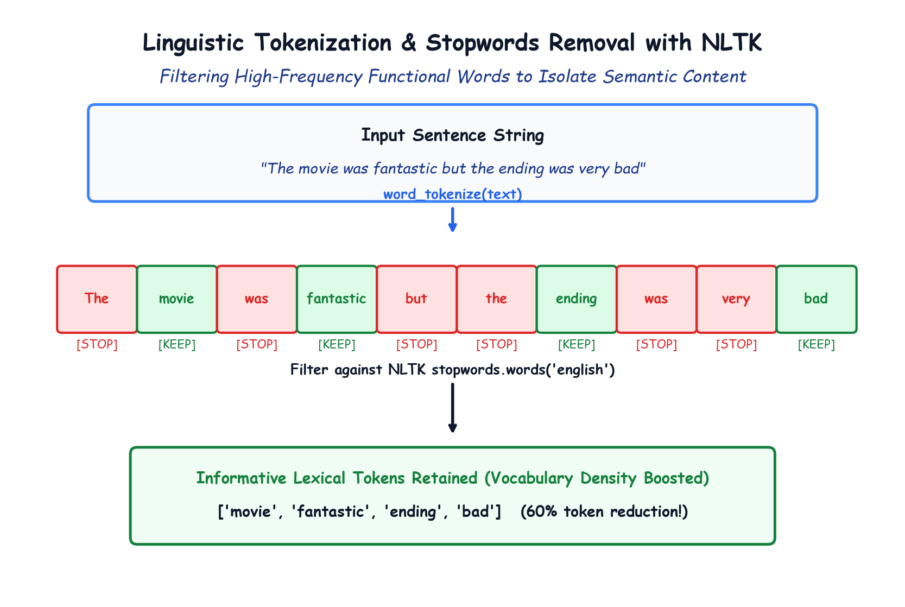

# Module 41.03: Linguistic Tokenization & Stopwords Removal with NLTK

## 1. Tokenization: Breaking Text into Discrete Lexical Units

Before a machine learning model can analyze text, continuous sequences of characters must be segmented into atomic linguistic units called **tokens** (typically individual words, numbers, or morphemes):

$$\text{Tokenize}: \text{"I enjoyed coding in python"} \mapsto [\text{"I"}, \text{"enjoyed"}, \text{"coding"}, \text{"in"}, \text{"python"}]$$

### Why Not Just Use Python's `.split()`?
While Python's built-in `str.split(" ")` divides strings by whitespace, it fails on complex linguistic edge cases:
- Contractions: `"don't"` $\to$ should be split into `["do", "n't"]` for grammatical analysis.
- Hyphenated words: `"state-of-the-art"`.
- Abbreviations and periods: `"Dr. Smith visited Washington D.C."`.

The **Natural Language Toolkit (NLTK)** provides a pre-trained unsupervised sentence and word tokenizer based on the **Punkt Algorithm** (Kiss and Strunk, 2006).

```python
import nltk
nltk.download("punkt")
nltk.download("punkt_tab")

from nltk.tokenize import word_tokenize

sample = "I like coding in python!"
tokens = word_tokenize(sample)
print(tokens) # ['I', 'like', 'coding', 'in', 'python', '!']
```

---

## 2. Notebook-Friendly Architecture Diagram



*Figure 41.03: Flow of text through NLTK word_tokenize and English stopwords corpus filtering, eliminating uninformative functional words and boosting vocabulary density.*

---

## 3. Stopwords Removal & Zipf's Law

### 3.1 What are Stopwords?
In any natural human language, **stopwords** are high-frequency grammatical or functional words (e.g., articles, prepositions, pronouns, auxiliary verbs):
`["the", "is", "at", "which", "on", "a", "an", "this", "it", "to", "for", "in"]`

### 3.2 The Theoretical Foundation: Zipf's Law
Linguist George Zipf observed that the frequency of any word in a corpus is inversely proportional to its rank in the frequency table:

$$f(w) \propto \frac{1}{\operatorname{rank}(w)}$$

- The most frequent word ("the") accounts for roughly $7\%$ of all word occurrences in English text.
- The top 100 most frequent words account for nearly $50\%$ of any document's total word count!
- **Key Insight for Sentiment Analysis:** These functional tokens appear with virtually identical frequencies in both positive and negative reviews. They carry **zero discriminative sentiment polarity**. Retaining them dilutes term frequency signals and wastes compute.

---

## 4. Implementing Stopwords Filtering with NLTK

NLTK provides a curated corpus of 179 English stopwords:

```python
nltk.download("stopwords")
from nltk.corpus import stopwords

stop_words = set(stopwords.words("english"))
print(f"Total English Stopwords: {len(stop_words)}")
print("Sample Stopwords:", list(stop_words)[:10])

def remove_stopwords(text):
    tokens = word_tokenize(text)
    # Filter out tokens present in the stop_words set
    filtered_tokens = [w for w in tokens if w not in stop_words]
    return " ".join(filtered_tokens)

# Verification
sentence = "The movie was fantastic but the ending was very bad"
clean_sentence = remove_stopwords(sentence)
print("Before:", sentence)
print("After: ", clean_sentence)
# Output: 'movie fantastic ending bad' (50% reduction in token count!)
```

---

## 5. Quantitative Impact on NLP Pipelines

| Metric | Before Stopwords Removal | After Stopwords Removal | Impact |
| :--- | :--- | :--- | :--- |
| **Average Review Length** | $\approx 230$ tokens | $\approx 110$ tokens | **$> 52\%$ token reduction** |
| **Corpus Total Tokens** | $\approx 11.5$ Million | $\approx 5.5$ Million | **$6$ Million tokens eliminated** |
| **Vocabulary Diversity** | Dominated by functional grammar | High density of sentiment adjectives | **Significantly boosted SNR (Signal-to-Noise Ratio)** |
| **Compute & Memory** | High memory allocation | Fast vectorization | **$> 2\times$ training speedup** |
