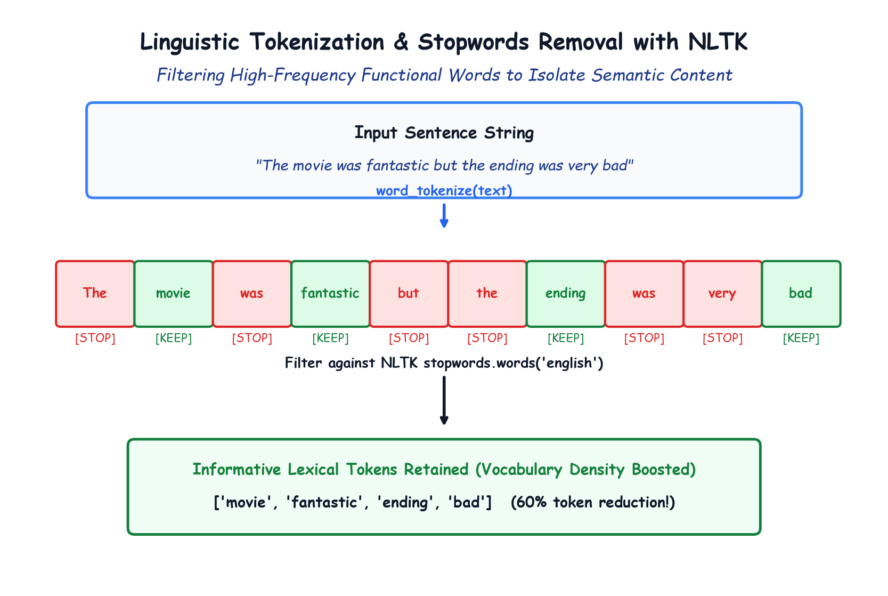

# Module 41.03 (Hinglish): Linguistic Tokenization & Stopwords Removal with NLTK

## 1. Tokenization Kya Hai aur Kyu Zaroori Hai?

Jab bhi hum NLP task perform karte hain, toh machine pura sentence ek saath nahi padh sakti. Sentence ko individual meaningful words (yaani **tokens**) me todna padta hai. Is process ko **Tokenization** kehte hain:

$$\text{"I like coding in python"} \to [\text{"I"}, \text{"like"}, \text{"coding"}, \text{"in"}, \text{"python"}]$$

### Python `.split()` kyu kaafi nahi hai?
Agar hum `text.split(" ")` use karein, toh punctuation words ke sath chipak jate hain (`"python!"`), aur complex contractions (`"don't"` $\to$ `"do"`, `"n't"`) handle nahi ho paate. Isliye standard NLP library **NLTK (Natural Language Toolkit)** ka `word_tokenize` use kiya jata hai.

---

## 2. Notebook-Friendly Hand-Drawn Architecture Diagram



*Figure 41.03: NLTK tokenization aur stopwords filtering workflow: Sentence tokenize hota hai, high-frequency common words filter hote hain, aur informative sentiment tokens retain hote hain.*

---

## 3. Stopwords Kya Hote Hain? (Zipf's Law)

Har human language me kuch aise words hote hain jo grammar banane ke liye har sentence me baar-baar aate hain:
`["the", "is", "at", "which", "on", "a", "an", "this", "it", "to", "for", "in"]`

In words ko **Stopwords** kaha jata hai.

### Sentiment Analysis me Stopwords ka Role:
- "The movie was great" aur "The movie was terrible" — dono sentences me `"the"`, `"was"` common hain.
- Yeh words movie achhi hai ya buri, yeh batane me **zero help** karte hain.
- **Zipf's Law** kehta hai ki text me sabse common words $50\%$ jagah gherte hain lekin unme koi useful information nahi hoti. Agar hum inko hata dein, toh vocabulary size half ho jata hai aur model ka focus sirf important words (`"fantastic"`, `"terrible"`, `"waste"`, `"masterpiece"`) par rehta hai.

---

## 4. NLTK Code Implementation

```python
import nltk
nltk.download("punkt")
nltk.download("stopwords")

from nltk.tokenize import word_tokenize
from nltk.corpus import stopwords

stop_words = set(stopwords.words("english"))

def remove_stopwords(text):
    tokens = word_tokenize(text)
    # Sirf unhi tokens ko rakho jo stop_words me nahi hain
    filtered = [w for w in tokens if w not in stop_words]
    return " ".join(filtered)

sentence = "The movie was fantastic but the ending was very bad"
print(remove_stopwords(sentence))
# Output: 'movie fantastic ending bad'
```
