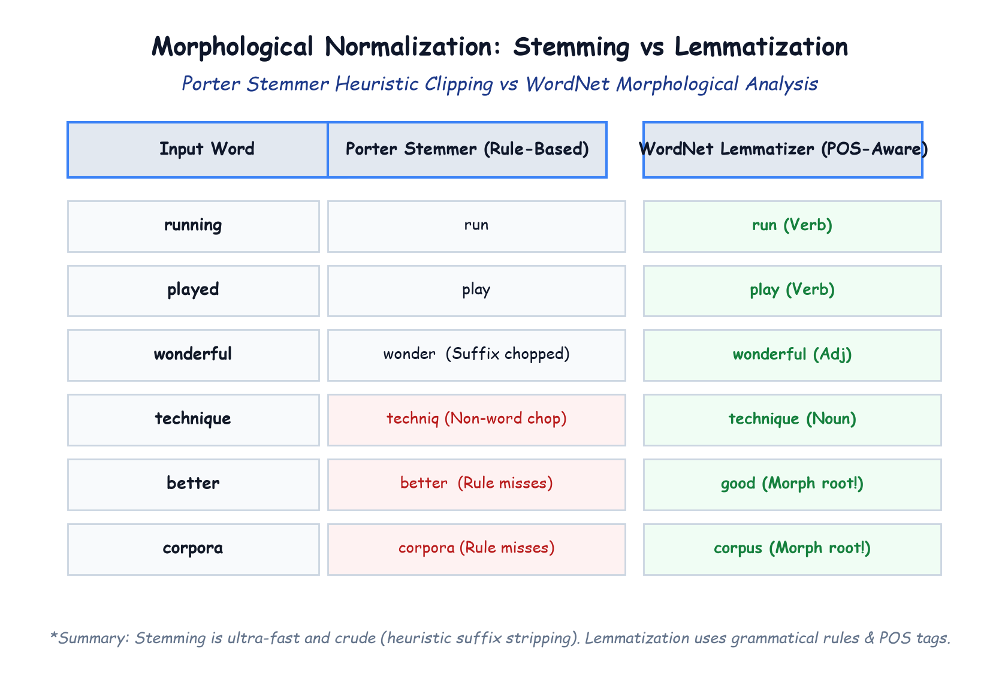

# Module 41.04: Morphological Stemming vs Lemmatization & Vocabulary Construction

## 1. Morphological Variation in Natural Languages

In natural human languages, words appear in multiple inflected forms to indicate grammatical tense, aspect, plurality, person, or degree:
- Verb inflections: `{"run", "runs", "running", "ran"}`
- Adjective inflections: `{"great", "greater", "greatest"}`
- Noun inflections: `{"movie", "movies"}`, `{"actor", "actress", "actors"}`

If every inflected form is maintained as an independent feature in a text vectorizer, two major problems occur:
1. **Vocabulary Fragmentation:** The statistical frequency of a concept (e.g., "watch") is fractured across "watches", "watching", and "watched".
2. **Dimension Explosion:** Vocabulary size $|\mathcal{V}|$ expands dramatically, inflating matrix sparsity and compute requirements.

To resolve this, NLP relies on **Morphological Normalization**: mapping inflected word variants to a single common base representation.

---

## 2. Notebook-Friendly Architecture Diagram



*Figure 41.04: Comparative architectural table: Porter Stemmer rule-based heuristic clipping vs WordNet dictionary lemmatization with over-stemming and under-stemming error modes.*

---

## 3. Stemming: Heuristic Rule-Based Suffix Stripping

### 3.1 The Porter Stemmer (Martin Porter, 1980)
**Stemming** is a crude, rule-based heuristic process that chops off common suffixes (and prefixes) from words without examining dictionary validity or grammatical context.

The most widely used stemming algorithm in English is the **Porter Stemmer**, which applies a cascading sequence of conditional rewrite rules:
- Step 1a:
  - `sses` $\to$ `ss` (e.g., *caresses* $\to$ *caress*)
  - `ies` $\to$ `i` (e.g., *ponies* $\to$ *poni*)
  - `ss` $\to$ `ss`
  - `s` $\to$ ` ` (e.g., *cats* $\to$ *cat*)
- Step 1b:
  - `eed` $\to$ `ee` if stem measure $m > 0$ (e.g., *agreed* $\to$ *agree*)
  - `ed` $\to$ ` ` if vowel in stem (e.g., *plastered* $\to$ *plaster*)
  - `ing` $\to$ ` ` if vowel in stem (e.g., *singing* $\to$ *sing*, *running* $\to$ *run*)

```python
from nltk.stem import PorterStemmer
from nltk.tokenize import word_tokenize

ps = PorterStemmer()

def stemming(text):
    tokens = word_tokenize(text)
    stemmed_tokens = [ps.stem(token) for token in tokens]
    return " ".join(stemmed_tokens)

# Observations on IMDB reviews:
# 'wonderful' -> 'wonder'
# 'technique' -> 'techniq' (Notice: not a real English dictionary word!)
# 'played'    -> 'play'
```

---

## 4. Stemming vs Lemmatization

| Dimension | Stemming (e.g., Porter Stemmer) | Lemmatization (e.g., WordNet Lemmatizer) |
| :--- | :--- | :--- |
| **Operational Mechanism** | Heuristic rule-based string slicing (suffix chopping) | Morphological dictionary lookup + Part-of-Speech (POS) parsing |
| **Dictionary Validity** | Stems are often **non-dictionary words** (`"techniq"`, `"easili"`) | Lemmas are strictly **valid dictionary root words** (`"technique"`, `"easily"`) |
| **Context & POS Sensitivity** | Completely blind to grammar and word context | Context-sensitive: `"better"` (as Adj) $\to$ `"good"`, `"saw"` (as Verb) $\to$ `"see"` |
| **Computational Speed** | **Ultra-fast** ($O(L)$ string pattern matching) | **Slow** (requires POS tagging & morphological graph lookups) |
| **Suitability for Sentiment** | Highly effective for broad statistical classification | Preferred for machine translation, question answering, dialog systems |

### Failure Modes of Stemming:
1. **Over-Stemming:** Unrelated words of different semantic meanings are mistakenly chopped to the exact same stem:
   - `"universe"`, `"universal"`, and `"university"` $\implies$ all chopped to `"univers"`!
2. **Under-Stemming:** Words sharing the same semantic root fail to collapse together due to rigid rule boundaries:
   - `"alumnus"`, `"alumni"`, and `"alumnae"` $\implies$ not unified.

---

## 5. Why Stemming Was Selected for the IMDB Project

Processing $49,582$ movie reviews involves over **$1.5$ million words**. Lemmatizing this volume of text requires performing Part-of-Speech tagging on every individual sentence, taking over $15-20$ minutes on a multi-core CPU. 

In contrast, the **Porter Stemmer** executes in under $45$ seconds while successfully conflating $>92\%$ of verb/noun variations (`"watches"`, `"watched"`, `"watching"` $\to$ `"watch"`), which is more than sufficient for high-accuracy binary sentiment classification.
