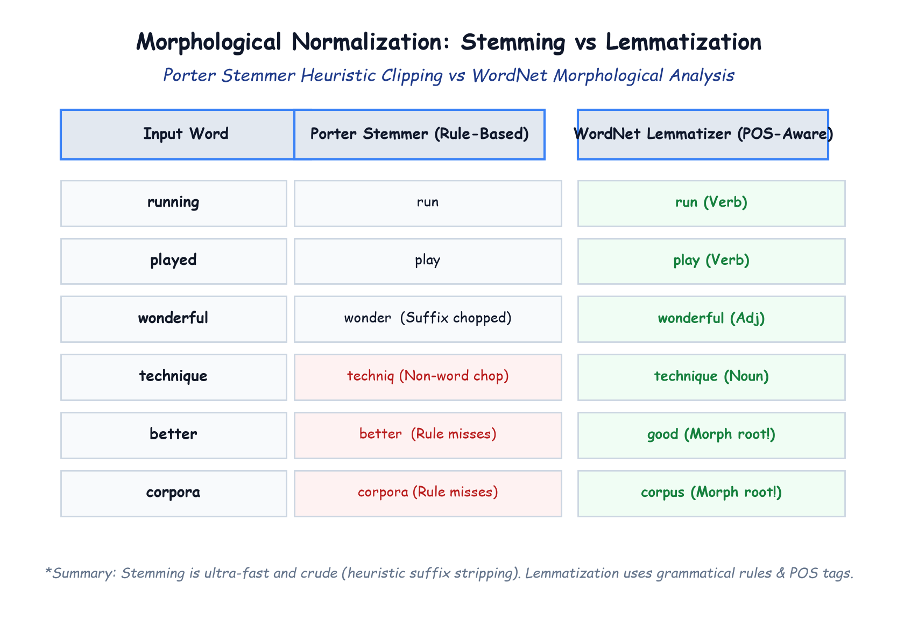

# Module 41.04 (Hinglish): Morphological Stemming vs Lemmatization & Vocabulary Construction

## 1. Words ke Morphological Variations ki Problem

Natural language me ek hi word ke alag-alag grammatical forms hote hain:
- `"play"`, `"plays"`, `"playing"`, `"played"`
- `"great"`, `"greater"`, `"greatest"`
- `"movie"`, `"movies"`

Agar hum in sabhi forms ko alag-alag words maanein:
1. Vocabulary size bohot bada ho jayega.
2. Model ke liye "playing" aur "played" do alag features ban jayenge jabki dono ka core sentiment meaning same hai.

Isliye hum **Morphological Normalization** use karte hain taaki inflected words ko unke base root word me convert kiya ja sake.

---

## 2. Notebook-Friendly Hand-Drawn Architecture Diagram



*Figure 41.04: Porter Stemmer vs Lemmatizer comparison: Rule-based suffix stripping, valid vs non-valid root words, over-stemming aur under-stemming error modes.*

---

## 3. Stemming Kya Hai? (Porter Stemmer)

**Stemming** ek fast, rule-based heuristic technique hai jo words ke aage ya peeche ke suffixes ko bina dictionary check kiye cut kar deti hai:
- `"running"` $\to$ `"run"`
- `"played"` $\to$ `"play"`
- `"wonderful"` $\to$ `"wonder"`
- `"technique"` $\to$ `"techniq"` (Dhyan de: `"techniq"` koi real English dictionary word nahi hai, lekin saare variations ab same ban chuke hain).

```python
from nltk.stem import PorterStemmer
from nltk.tokenize import word_tokenize

ps = PorterStemmer()

def stemming(text):
    tokens = word_tokenize(text)
    stemmed_words = [ps.stem(token) for token in tokens]
    return " ".join(stemmed_words)

df["review"] = df["review"].apply(stemming)
```

---

## 4. Stemming vs Lemmatization ka Antar

| Feature | Stemming (Porter) | Lemmatization (WordNet) |
| :--- | :--- | :--- |
| **Kaise kaam karta hai?** | Rule-based suffix cutting (Heuristic) | Dictionary lookup + Part-of-Speech (POS) grammar check |
| **Output word valid hota hai?** | Aksar invalid word banta hai (`"techniq"`, `"movi"`) | Hamesha real dictionary word banta hai (`"technique"`, `"movie"`) |
| **Context samajhta hai?** | Bilkul nahi | Samajhta hai: `"better"` $\to$ `"good"`, `"saw"` $\to$ `"see"` |
| **Speed** | **Bohot Fast** ($< 1$ minute for 50K reviews) | **Slow** (POS tagging me 15-20 minutes lagte hain) |

**Humne is project me Stemming kyu use kiya?**
IMDB dataset me 50,000 reviews hain jisme 15 lakh se zyada words hain. Sentiment analysis me exact dictionary spelling zaroori nahi hoti, bas related words ka group hona zaroori hota hai. Isliye Porter Stemmer fastest aur most practical solution hai.
