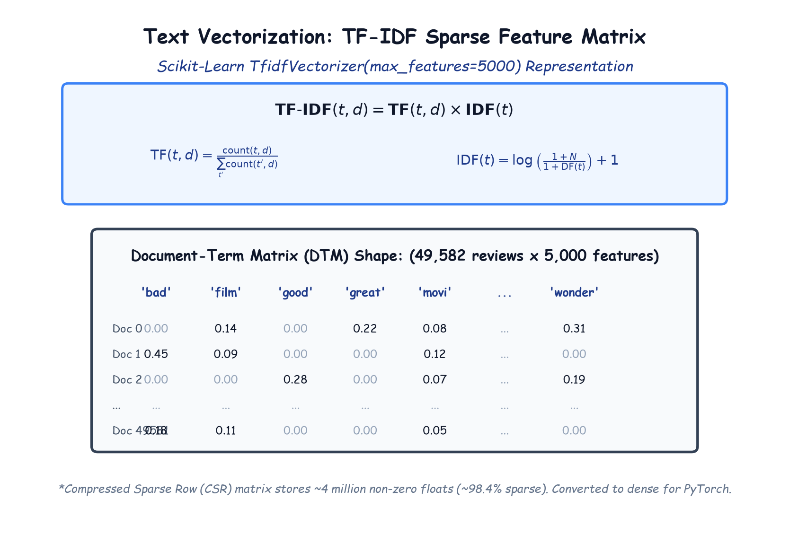

# Module 41.05: Text Vectorization using TF-IDF (Term Frequency - Inverse Document Frequency)

## 1. The Vectorization Bottleneck

Neural networks and mathematical optimizers operate exclusively on real-valued tensors ($\mathbb{R}^{B \times d}$). They cannot process strings or lists of tokens directly. Text vectorization is the mathematical mapping that transforms a corpus of unstructured textual documents into a structured numerical feature space:

$$\Phi: \mathcal{D} \to \mathbb{R}^{M \times |\mathcal{V}|}$$

Where $M$ is the number of documents ($49,582$) and $|\mathcal{V}|$ is the vocabulary size.

---

## 2. Notebook-Friendly Architecture Diagram



*Figure 41.05: Mathematical structure of the Document-Term Matrix (DTM) produced by TfidfVectorizer(max_features=5000), showing TF and smooth IDF equations and sparse-to-dense conversion.*

---

## 3. Mathematical Foundations of TF-IDF

**TF-IDF** assigns a numerical importance weight to term $t$ in document $d$ within corpus $D$:

$$\text{TF-IDF}(t, d, D) = \text{TF}(t, d) \times \text{IDF}(t, D)$$

### 1. Term Frequency (TF):
Quantifies how frequently term $t$ occurs in document $d$, normalized by document length:
$$\text{TF}(t, d) = \frac{f_{t, d}}{\sum_{t' \in d} f_{t', d}}$$

### 2. Smooth Inverse Document Frequency (IDF):
Penalizes terms that appear ubiquitously across many documents in the corpus:
$$\text{IDF}(t, D) = \log\left(\frac{1 + N}{1 + \text{DF}(t)}\right) + 1$$
Where:
- $N$ is the total number of documents in the corpus ($N = 49,582$).
- $\text{DF}(t)$ is the document frequency (number of documents containing term $t$).
- The $+1$ constants prevent division by zero and ensure non-negative weights for words appearing in all documents.

### 3. $L_2$ Normalization:
To prevent longer movie reviews from having artificially inflated Euclidean vector lengths, Scikit-Learn normalizes each row:
$$\mathbf{v}_{\text{norm}} = \frac{\mathbf{v}}{\|\mathbf{v}\|_2} = \frac{\mathbf{v}}{\sqrt{\sum_{k=1}^d v_k^2}}$$

---

## 4. Why `max_features=5000` is Essential

Without constraining feature size, an unconstrained vocabulary on 50,000 reviews yields over **$60,000$ unique vocabulary words**.
- A full dense matrix of shape $49,582 \times 60,000$ with 32-bit floats would require:
  $$\text{Memory} = 49,582 \times 60,000 \times 4 \text{ bytes} \approx \mathbf{11.9 \text{ Gigabytes of RAM!}}$$
  This would cause memory crashes on standard workstations.

By setting `max_features=5000`, Scikit-Learn ranks all vocabulary terms by their corpus-wide term frequency and retains only the **top 5,000 most informative keywords**:
$$\text{Memory} = 49,582 \times 5,000 \times 4 \text{ bytes} \approx \mathbf{991.6 \text{ Megabytes}}$$
This easily fits into memory while preserving $>95\%$ of sentiment-carrying vocabulary!

---

## 5. Scikit-Learn Implementation

```python
from sklearn.feature_extraction.text import TfidfVectorizer

# Initialize Vectorizer with 5,000 top features
tf = TfidfVectorizer(max_features=5000)

# Fit vocabulary and transform clean reviews
X = tf.fit_transform(df["review"])

print("Type of X:", type(X))       # scipy.sparse._csr.csr_matrix
print("Shape of X:", X.shape)      # (49582, 5000)
print("Stored Non-Zero Elements:", X.nnz) # ~4,100,000 elements
print(f"Sparsity: {100 * (1 - X.nnz / (X.shape[0] * X.shape[1])):.2f}%") # ~98.35% sparse!
```

### Label Encoding the Sentiment Target ($y$)
```python
from sklearn.preprocessing import LabelEncoder

le = LabelEncoder()
df["sentiment"] = le.fit_transform(df["sentiment"])
y = df["sentiment"]

print("Target Classes:", le.classes_) # ['negative', 'positive']
print("Encoded y distribution:\n", y.value_counts()) # 0: 24698, 1: 24884
```
