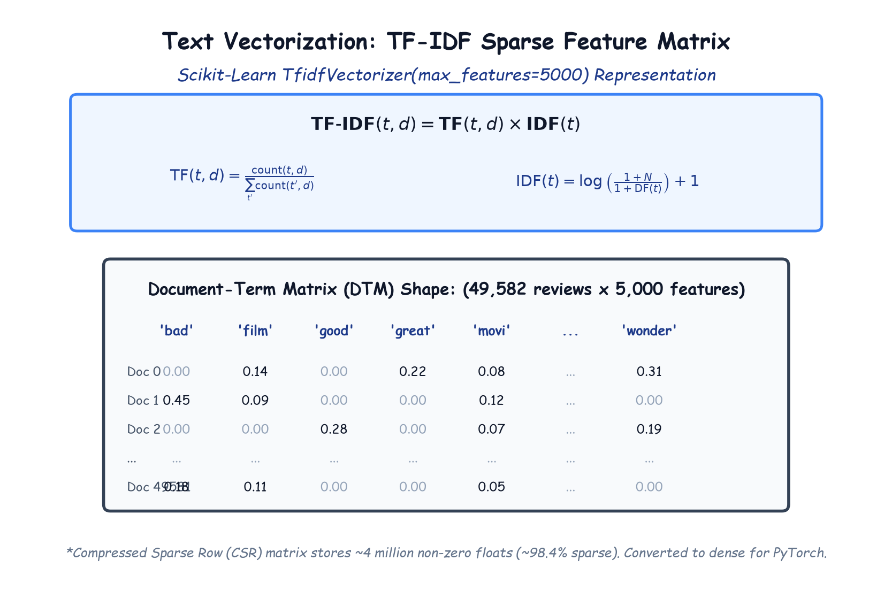

# Module 41.05 (Hinglish): Text Vectorization using TF-IDF (Term Frequency - Inverse Document Frequency)

## 1. Text Vectorization Kyu Zaroori Hai?

Machine learning models aur neural networks strings ("movie was awesome") par direct gradient descent ya backpropagation nahi chala sakte. Unhe mathematical vectors ($\mathbb{R}^d$) ki zarurat hoti hai.

Text ko numerical vectors me convert karne ke process ko **Vectorization** kaha jata hai.

---

## 2. Notebook-Friendly Hand-Drawn Architecture Diagram



*Figure 41.05: Document-Term Matrix (DTM) ka structure: 49,582 reviews $\times$ 5,000 features, TF aur smooth IDF formula, aur sparse-to-dense array conversion.*

---

## 3. TF-IDF Formula aur Mechanics

TF-IDF do cheezon ka product hota hai:

$$\text{TF-IDF}(t, d) = \text{TF}(t, d) \times \text{IDF}(t)$$

1. **Term Frequency (TF):** Term $t$ us review me kitni baar aaya hai.
2. **Inverse Document Frequency (IDF):** Agar koi word lagbhag har movie review me aata hai (jaise "film", "movie"), toh uska IDF bohot low ho jata hai. Agar koi word sirf kuch specific reviews me aata hai (jaise "terrific", "horrible"), toh uska IDF high hota hai.

Isse model generic common words ko ignore karke powerful sentiment keywords ko high weight deta hai.

---

## 4. `max_features=5000` Lagana Kyu Zaroori Hai?

Agar hum limit na lagayein, toh 50,000 reviews me **60,000 se zyada unique words** ban jaate hain.
- $49,582 \times 60,000$ matrix ko store karne ke liye **$\approx 12\text{ GB}$ RAM** lagegi, jisse system crash ho jayega.
- Isliye hum `max_features=5000` lagate hain jo sirf top 5,000 sabse important words ko retain karta hai.
- Isse matrix size sirf $\approx 990\text{ MB}$ reh jata hai jo easily CPU aur GPU dono par train ho jata hai.

---

## 5. Python Code Implementation

```python
from sklearn.feature_extraction.text import TfidfVectorizer
from sklearn.preprocessing import LabelEncoder

# 1. TF-IDF Vectorizer
tf = TfidfVectorizer(max_features=5000)
X = tf.fit_transform(df["review"])

print("Matrix Shape:", X.shape) # (49582, 5000)
print("Sparsity:", f"{100 * (1 - X.nnz / (X.shape[0] * X.shape[1])):.2f}%") # 98.35% elements 0 hain

# 2. Target Label Encoding
le = LabelEncoder()
df["sentiment"] = le.fit_transform(df["sentiment"])
y = df["sentiment"]
print("0 -> Negative, 1 -> Positive")
```
