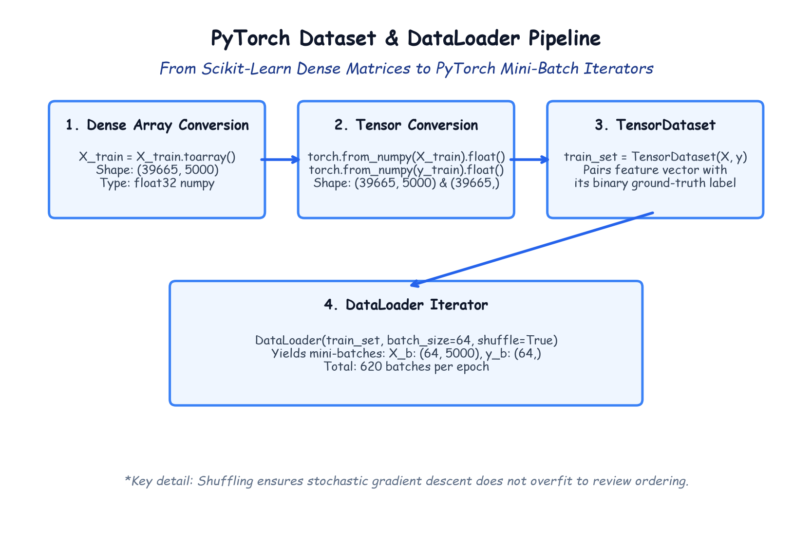

# Module 41.06: PyTorch Data Pipelines: TensorDataset, DataLoader, Batching & Splitting

## 1. Bridging Scikit-Learn Representations with PyTorch Tensors

In the preceding stages of our NLP pipeline, the raw text reviews were transformed using Scikit-Learn's `TfidfVectorizer(max_features=5000)`, yielding a high-dimensional feature matrix $\mathbf{X} \in \mathbb{R}^{49582 \times 5000}$ in SciPy Compressed Sparse Row (`csr_matrix`) format, alongside encoded binary target labels $\mathbf{y} \in \{0, 1\}^{49582}$.

To train a deep neural network in PyTorch using mini-batch Stochastic Gradient Descent (SGD), we must bridge these representations into PyTorch's native data handling primitives:
1. **Partitioning:** Splitting data into training ($80\%$) and testing ($20\%$) subsets to prevent data leakage and evaluate generalization.
2. **Dense Array Conversion:** Converting memory-efficient sparse matrices into contiguous, dense floating-point arrays (`X.toarray()`).
3. **Tensor Wrapping (`TensorDataset`):** Pairing feature matrices with their corresponding ground-truth sentiment labels as synchronized tensor pairs.
4. **Mini-Batch Pipelining (`DataLoader`):** Efficiently chunking data into mini-batches ($B = 64$), enabling parallel CPU prefetching and stochastic shuffling.

---

## 2. Notebook-Friendly Architecture Diagram



*Figure 41.06: Structural transformation pipeline: Dense NumPy arrays converted to PyTorch FloatTensors, bundled into TensorDataset, and iterated via DataLoader mini-batches.*

---

## 3. Train/Test Splitting & Dense Conversion

We partition our $49,582$ samples using an $80/20$ train-to-test ratio:

```python
from sklearn.model_selection import train_test_split

X_train, X_test, y_train, y_test = train_test_split(
    X, y, test_size=0.2, random_state=42
)

print("X_train shape (sparse):", X_train.shape) # (39665, 5000)
print("X_test shape (sparse): ", X_test.shape)  # (9917, 5000)
```

### The Sparse-to-Dense Trade-off
Standard PyTorch recurrent and linear layers require dense tensors. Therefore, we call `.toarray()` on both partitions:

```python
X_train = X_train.toarray()
X_test = X_test.toarray()
```
- **Memory footprint of `X_train`:**
  $$\text{Memory} = 39,665 \text{ samples} \times 5,000 \text{ floats} \times 4 \text{ bytes} \approx \mathbf{793.3 \text{ MB}}$$
- **Memory footprint of `X_test`:**
  $$\text{Memory} = 9,917 \text{ samples} \times 5,000 \text{ floats} \times 4 \text{ bytes} \approx \mathbf{198.3 \text{ MB}}$$
  Total RAM allocation is $\approx 1.0\text{ GB}$, comfortably fitting within standard system memory.

---

## 4. PyTorch `TensorDataset` and `DataLoader` Construction

```python
import torch
from torch.utils.data import TensorDataset, DataLoader

# 1. Convert NumPy arrays to 32-bit FloatTensors
train_features = torch.from_numpy(X_train).float()
train_labels = torch.from_numpy(y_train.values).float()

test_features = torch.from_numpy(X_test).float()
test_labels = torch.from_numpy(y_test.values).float()

# 2. Encapsulate in TensorDataset
train_set = TensorDataset(train_features, train_labels)
test_set = TensorDataset(test_features, test_labels)

# 3. Create DataLoader Mini-Batch Iterators
BATCH_SIZE = 64
train_loader = DataLoader(train_set, batch_size=BATCH_SIZE, shuffle=True)
test_loader = DataLoader(test_set, batch_size=BATCH_SIZE, shuffle=False)

print(f"Total Training Batches: {len(train_loader)}") # ceil(39665 / 64) = 620 batches
print(f"Total Testing Batches:  {len(test_loader)}")  # ceil(9917 / 64)  = 155 batches
```

---

## 5. Technical Mechanics of `DataLoader`

### 5.1 Why Shuffling is Strictly Required for Training (`shuffle=True`)
If training data is ordered or sorted by movie genre, release date, or rating, sequential mini-batches would exhibit strong statistical correlations. Gradient descent updates would fluctuate wildly, bouncing between local minima. Random permutation at the start of each epoch guarantees that every mini-batch approximates an **Independent and Identically Distributed (I.I.D.) sample** of the true data distribution:

$$\mathbb{E}[\nabla \mathcal{L}_{\text{batch}}] \approx \nabla \mathcal{L}_{\text{full}}$$

### 5.2 Deterministic Testing (`shuffle=False`)
For evaluation, shuffling is disabled to maintain deterministic ordering, simplify batch-by-batch error tracing, and reduce overhead.
