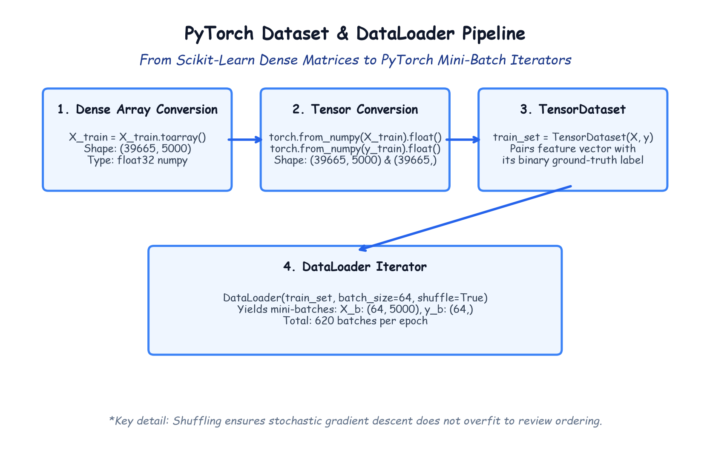

# Module 41.06 (Hinglish): PyTorch Data Pipelines: TensorDataset, DataLoader, Batching & Splitting

## 1. Scikit-Learn Data ko PyTorch me Convert Karne ki Need

Pichle steps me humne `TfidfVectorizer(max_features=5000)` use karke text reviews ko numerical matrix $\mathbf{X}$ ($49582 \times 5000$) me convert kar liya tha aur target sentiment $\mathbf{y}$ ($0$ aur $1$) me encoded tha.

PyTorch me deep learning model train karne ke liye hume data ko PyTorch ke native components me transform karna padta hai:
1. **Train/Test Split:** $80\%$ training aur $20\%$ testing data me divide karna.
2. **Dense Array Conversion:** Scipy ki sparse matrix ko dense NumPy array me convert karna (`toarray()`).
3. **TensorDataset:** Features aur labels ko ek synchronized pair me wrap karna.
4. **DataLoader:** Data ko chhote-chhote mini-batches ($64$ samples) me slice karna aur training ke liye shuffle karna.

---

## 2. Notebook-Friendly Hand-Drawn Architecture Diagram



*Figure 41.06: PyTorch Data Pipeline ka flow: Dense arrays, FloatTensors, TensorDataset pair creation, aur 64 batch size ke DataLoader iterators.*

---

## 3. Train/Test Split aur Dense Conversion

```python
from sklearn.model_selection import train_test_split

X_train, X_test, y_train, y_test = train_test_split(
    X, y, test_size=0.2, random_state=42
)

# Sparse CSR matrix ko dense array me convert karna
X_train = X_train.toarray()
X_test = X_test.toarray()

print("Train shape:", X_train.shape) # (39665, 5000) -> ~793 MB RAM
print("Test shape: ", X_test.shape)  # (9917, 5000)  -> ~198 MB RAM
```

---

## 4. PyTorch TensorDataset aur DataLoader Code

```python
import torch
from torch.utils.data import TensorDataset, DataLoader

# NumPy arrays ko PyTorch float tensors me convert karna
train_set = TensorDataset(
    torch.from_numpy(X_train).float(),
    torch.from_numpy(y_train.values).float()
)

test_set = TensorDataset(
    torch.from_numpy(X_test).float(),
    torch.from_numpy(y_test.values).float()
)

# DataLoader create karna
train_loader = DataLoader(train_set, batch_size=64, shuffle=True)
test_loader = DataLoader(test_set, batch_size=64, shuffle=False)

print("Total Train Batches per Epoch:", len(train_loader)) # 620 batches
print("Total Test Batches:", len(test_loader))             # 155 batches
```

**Training me `shuffle=True` kyu zaroori hai?**
Agar data shuffle nahi hoga toh model same order ke patterns ko memorize karne lagta hai. Shuffling se har mini-batch random banta hai jisse gradient descent smooth aur fast converge hota hai.
