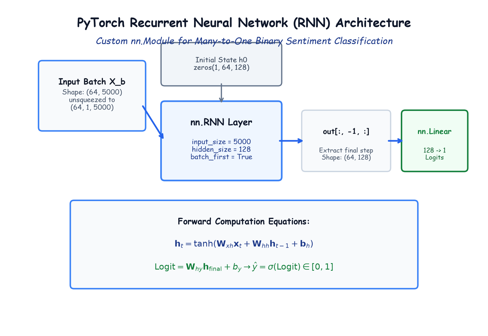

# Module 41.07: Designing the Recurrent Neural Network (RNN) Architecture in PyTorch

## 1. The Recurrent Neural Architecture for Sentiment Classification

To classify the sentiment of a review, we implement a custom Recurrent Neural Network (RNN) in PyTorch by subclassing `nn.Module`.

While standard Feedforward Networks treat inputs as static vectors, a recurrent cell processes sequential inputs by maintaining a temporal internal memory vector called the **hidden state** $\mathbf{h}_t \in \mathbb{R}^{d_h}$.

### Input Tensor Dimensions in PyTorch RNN
When configuring `nn.RNN(input_size, hidden_size, batch_first=True)`:
- The input tensor must have three dimensions:
  $$\mathbf{X} \in \mathbb{R}^{\text{Batch Size} \times \text{Sequence Length} \times \text{Input Size}}$$
- In our project, each review has been vectorized into a single $5,000$-dimensional TF-IDF feature representation. Therefore, we treat each document vector as a sequence of length $T = 1$:
  $$\mathbf{X}_{\text{batch}} \in \mathbb{R}^{64 \times 1 \times 5000}$$
  This is achieved dynamically using `Xb.unsqueeze(1)`.

---

## 2. Notebook-Friendly Architecture Diagram



*Figure 41.07: Structural schematic of the custom PyTorch RNN: Input batch unsqueezed to 3D tensor, initial zero hidden state $h_0$, recurrent hidden layer, final timestep extraction out[:, -1, :], and Linear readout head.*

---

## 3. PyTorch Model Definition

```python
import torch
import torch.nn as nn

class RNN(nn.Module):
    def __init__(self, input_size, hidden_size=128, num_layers=1):
        super(RNN, self).__init__()

        self.hidden_size = hidden_size
        self.num_layers = num_layers

        # Recurrent Layer: batch_first=True ensures shape (Batch, Seq_Len, Dim)
        self.rnn = nn.RNN(
            input_size=input_size, 
            hidden_size=hidden_size, 
            num_layers=num_layers, 
            batch_first=True
        )

        # Fully connected readout head mapping hidden vector to single scalar logit
        self.fc = nn.Linear(hidden_size, 1)

    def forward(self, x):
        # 1. Initialize hidden state h0 with zeros: shape (num_layers, batch_size, hidden_size)
        h0 = torch.zeros(self.num_layers, x.size(0), self.hidden_size, device=x.device)

        # 2. Recurrent forward pass
        # out shape: (batch_size, seq_len, hidden_size)
        # _ (h_n) shape: (num_layers, batch_size, hidden_size)
        out, _ = self.rnn(x, h0)

        # 3. Slicing the hidden state of the final timestep
        final_hidden = out[:, -1, :] # shape: (batch_size, hidden_size)

        # 4. Project to output logit
        logits = self.fc(final_hidden) # shape: (batch_size, 1)
        return logits
```

---

## 4. Mathematical Parameter Count Analysis

Let's calculate the exact learnable parameter count of our `RNN(input_size=5000, hidden_size=128, num_layers=1)`:

### 1. Recurrent Layer (`nn.RNN`):
The hidden state update equation is:
$$\mathbf{h}_t = \tanh(\mathbf{W}_{xh} \mathbf{x}_t + \mathbf{W}_{hh} \mathbf{h}_{t-1} + \mathbf{b}_h)$$
- Input-to-Hidden Weight Matrix $\mathbf{W}_{xh} \in \mathbb{R}^{128 \times 5000}$:
  $$128 \times 5,000 = \mathbf{640,000} \text{ weights}$$
- Hidden-to-Hidden Weight Matrix $\mathbf{W}_{hh} \in \mathbb{R}^{128 \times 128}$:
  $$128 \times 128 = \mathbf{16,384} \text{ weights}$$
- Bias Vector $\mathbf{b}_h \in \mathbb{R}^{128}$:
  $$\mathbf{128} \text{ biases}$$
- Subtotal RNN Layer: $640,000 + 16,384 + 128 = \mathbf{656,512} \text{ parameters}$.

### 2. Linear Readout Head (`nn.Linear`):
$$\hat{y}_{\text{logit}} = \mathbf{W}_{hy} \mathbf{h}_{\text{final}} + b_y$$
- Weight Matrix $\mathbf{W}_{hy} \in \mathbb{R}^{1 \times 128}$:
  $$1 \times 128 = \mathbf{128} \text{ weights}$$
- Bias $b_y \in \mathbb{R}^{1}$:
  $$\mathbf{1} \text{ bias}$$
- Subtotal Linear Layer: $128 + 1 = \mathbf{129} \text{ parameters}$.

### 3. Total Model Parameters:
$$\text{Total Parameters} = 656,512 + 129 = \mathbf{656,641} \text{ learnable parameters}$$

```python
model = RNN(input_size=5000)
total_params = sum(p.numel() for p in model.parameters() if p.requires_grad)
print("Total Learnable Parameters:", total_params) # 656641
```
